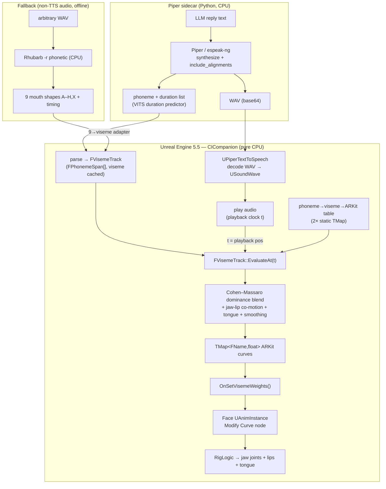
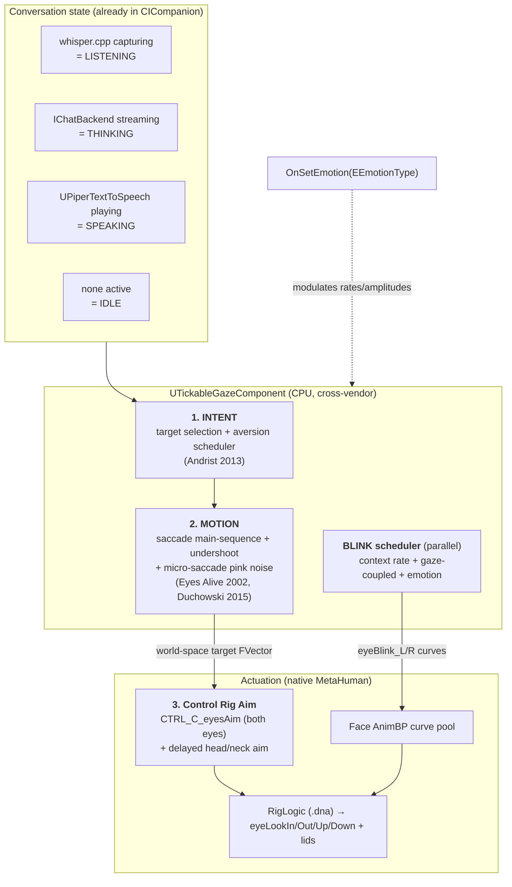
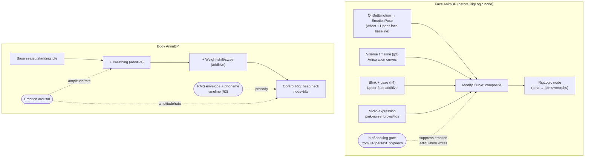
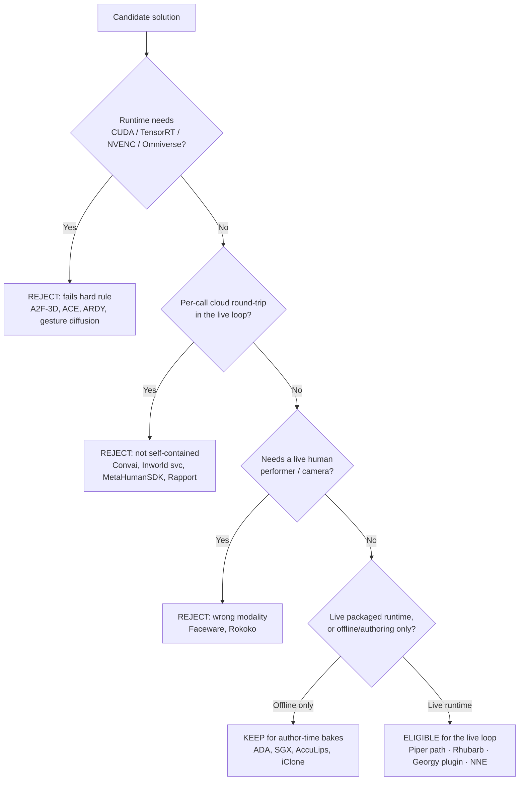
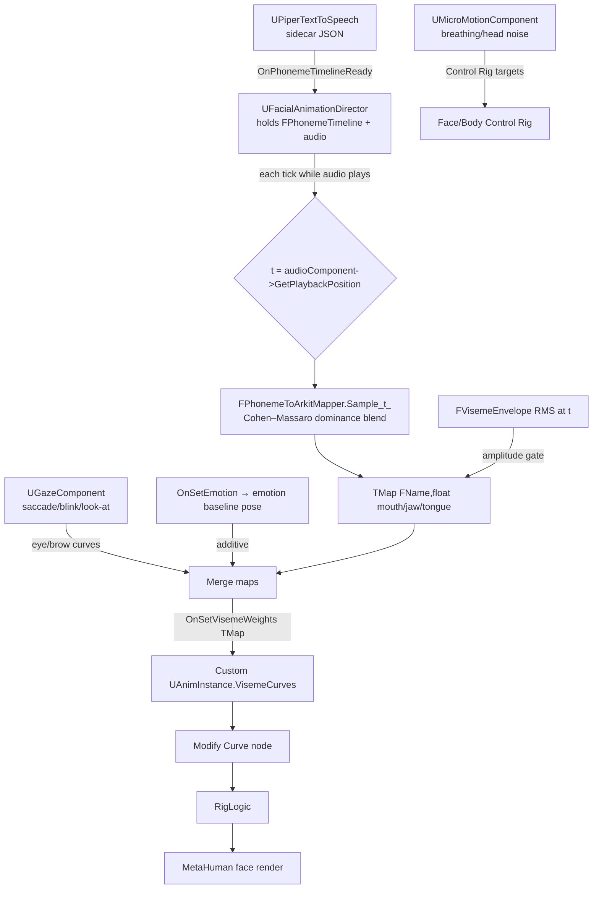

# Metahermit — Cross-Platform Lifelike Animation Plan

> **How the Companion gets a real face, real eyes, and real presence — on AMD, Mac, Intel, and NVIDIA alike, with no CUDA and no NVIDIA Audio2Face.**

| | |
|---|---|
| **Version** | 0.1 (Draft for review) |
| **Date** | 2026-07-15 |
| **Companion doc** | [`GDD.md`](GDD.md) — this plan resolves the GDD's #1 flagged gap (the placeholder RMS→jaw "muppet mouth" lip-sync). |
| **Hard rule** | The animation runtime must be **vendor-neutral**: no CUDA, no Omniverse/ACE, no NVENC dependency, no Windows-only API. That is precisely why **NVIDIA Audio2Face is rejected**. |

## The thesis

Audio2Face runs a neural network on an NVIDIA GPU to *infer* mouth shapes from a raw waveform. **We don't infer — we already know.** Piper (our TTS, via espeak-ng) synthesizes speech *from* a phoneme sequence, so we can read the phonemes and their timing directly and map **phoneme → viseme → weighted MetaHuman ARKit curves** with pure in-engine arithmetic. Layer procedural **eyes** (gaze, saccades, blinks) and a **micro-motion** system (breathing, head motion, emotion) on top — all CPU math in Control Rig / AnimBP. The result is dramatically more lifelike than the current 1-DOF jaw flap, and it runs identically on every GPU vendor because **there is no GPU ML in the loop**.

An adversarial cross-platform review (see [§6](#6-cross-platform-reality-check--corrections)) confirmed the core thesis holds and found the real vendor exposure lives in the **delivery layer** (video encode) and one **linchpin** (Piper alignment needs a patched model) — both addressed there. Read §6 alongside the design sections; its corrections are authoritative where they conflict with an earlier optimistic phrasing.

> ### Measured 2026-07-28 — the resident is CC-named, not ARKit-named
>
> This plan maps phoneme → viseme → **ARKit** curves throughout, which assumed a MetaHuman face.
> The resident is now Reallusion CC **Nia** ([[nia-resident]]), and her rig was probed directly:
>
> - **ARKit-named morph targets: 0 of 10** sampled (`jawOpen`, `mouthFunnel`, `mouthPucker`,
>   `eyeBlinkLeft`, … none present). The ARKit tables below therefore do **not** apply to her as
>   written.
> - **CC viseme morph targets: 15 of 15 present** — `V_Open`, `V_Wide`, `V_Tight`, `V_Tight_O`,
>   `V_Explosive`, `V_Dental_Lip`, `V_Affricate`, `V_Lip_Open`, and the seven `V_Tongue_*`.
> - 286 morph targets total, including a deep articulator set (`Jaw_Open/L/R/Forward/Up/Down`,
>   `Mouth_Close`, `Mouth_Funnel_*`, `Mouth_Pucker_*`, `Mouth_Press_*`), plus an `ExpPoseAsset`
>   carrying the CC phoneme poses (`Ah`, `EE`, `Ih`, `Oh`, `W_OO`, `S_Z`, `T_L_D_N`, `K_G_H_NG`,
>   `Th`, `R`, `AE`) and FACS expressions (`Eye_Blink_L/R`, `Mouth_Smile_L/R`, `Brow_Raise_*`).
>
> **The design survives; only the output table is retargeted.** Make the phoneme→viseme stage
> vendor-neutral (it already is) and put the rig-specific names behind a swappable **face profile**
> — a CC profile for Nia, an ARKit profile for MetaHuman — so both are drivable from one mapper.
>
> One simplification this unlocks: because the 15 visemes are **real morph targets** rather than
> only PoseAsset entries, they can be driven by `SetMorphTarget()` straight from C++. No AnimBP
> node, no Control Rig, and critically **no Blueprint** — which matters because
> `AMetaHumanCompanionCharacter` emits `BlueprintImplementableEvent`s that are inert without a
> hand-authored `BP_CompanionCharacter`, and the diorama map is authored by Python in a
> content-only project that cannot reference plugin C++ at all.

## Table of contents

1. [Cross-Platform Viseme & Lip Pipeline (the Audio2Face alternative)](#1-cross-platform-viseme--lip-pipeline-the-audio2face-alternative)
2. [Procedural Eyes: Gaze, Saccades, Blinks, Vergence](#2-procedural-eyes-gaze-saccades-blinks-vergence)
3. [Micro-Motion, Breathing, Head Motion & Emotion](#3-micro-motion-breathing-head-motion--emotion)
4. [Solution Landscape: Open, Paid & NVIDIA-Locked (Buy-vs-Build)](#4-solution-landscape-open-paid--nvidia-locked-buy-vs-build)
5. [Integration into CICompanion + Cross-Vendor Validation & Roadmap](#5-integration-into-cicompanion--cross-vendor-validation--roadmap)
6. [Cross-Platform Reality Check & Corrections](#6-cross-platform-reality-check--corrections) — *adversarial review; authoritative caveats*
- [Appendix — Full Solution Matrix](#appendix--full-solution-matrix)

---

## 1. Cross-Platform Viseme & Lip Pipeline (the Audio2Face alternative)

Today's mouth is a single degree of freedom. `FVisemeEnvelope::Compute()` slices the decoded Piper WAV into RMS windows and emits `FVisemeKey{ TimeSeconds, JawOpen }` — the jaw flaps in rough proportion to loudness, and every other articulator (lips, tongue, rounding, closure) is dead. This section replaces that with a **phoneme-timed articulator track** driven by data Piper already computes internally, mapped through a hand-authored phoneme→viseme→ARKit table with coarticulation, and fed frame-accurately into `OnSetVisemeWeights`. It is pure CPU arithmetic — no ML inference, no GPU compute, no Audio2Face — so it runs bit-for-bit identically on AMD/RADV, Apple Metal, Intel Arc/iGPU, and NVIDIA.

### 1.1 Two paths, one mapper

| Path | When it runs | Timing source | Latency | Notes |
|---|---|---|---|---|
| **Primary — Piper phoneme timing** | Every line the companion *speaks* (we own the TTS) | VITS duration predictor inside Piper (`include_alignments=True`) | Real-time, zero recognition error | The `whisper.cpp` → `IChatBackend` → `UPiperTextToSpeech` loop already produces the audio; we surface the phoneme alignment it currently discards. |
| **Fallback — Rhubarb Lip Sync** | Arbitrary / non-TTS audio (recorded VO, imported clips) | Rhubarb `-r phonetic` recognizer (offline CPU) | Slower-than-real-time → pre-baked | MIT, cross-platform CLI subprocess; language-independent, no CUDA, no cloud. |

Both paths converge on the **same** phoneme/shape→ARKit mapping table (§1.3) and the **same** coarticulation blender (§1.4), so lip shapes are consistent regardless of source. The only difference is timing provenance and whether the track is streamed live or baked to an asset.

### 1.2 Data structures — replacing `FVisemeEnvelope`

`FVisemeEnvelope` (1-DOF, `JawOpen` scalar keys) is superseded by a **phoneme-timed viseme track**. Keep the class name-space under `Voice/` alongside the existing `VisemeEnvelope.h`.

```cpp
// One phoneme with acoustically-matched timing, straight from Piper alignments.
USTRUCT()
struct FPhonemeSpan
{
    GENERATED_BODY()
    FString  Phoneme;     // espeak-ng IPA/Kirshenbaum token, e.g. "u", "p", "ð"
    float    StartSeconds = 0.f;
    float    DurationSeconds = 0.f;
    uint8    Viseme = 0;  // resolved EViseme (OVR-15 class), cached at parse time
};

// The full utterance timeline. Replaces FVisemeEnvelope as the OnVisemeReady payload.
USTRUCT()
struct FVisemeTrack
{
    GENERATED_BODY()
    TArray<FPhonemeSpan> Spans;   // sorted by StartSeconds
    float SampleRate = 22050.f;   // from Piper, for sample→seconds conversion
    float TotalDuration = 0.f;

    // Evaluate the whole ARKit curve set at a playback time (the hot path, §1.5).
    void EvaluateAt(float TimeSeconds, TMap<FName, float>& OutCurves) const;
};
```

`UPiperTextToSpeech` changes: the current `PiperTextToSpeech.cpp` POSTs `{"text":...}` with `Accept: audio/wav` and gets **audio only**, then computes the RMS envelope from that audio (the phoneme timing never leaves the model). Swap the transport for a thin Piper sidecar (≈30 lines of FastAPI wrapping `piper` with `include_alignments=True`) returning JSON:

```json
{ "wav_base64": "...", "sample_rate": 22050,
  "phonemes": [ {"ph":"h","start":0.00,"dur":0.05}, {"ph":"ɛ","start":0.05,"dur":0.11}, ... ] }
```

Parse `phonemes` into `FVisemeTrack.Spans`, decode the WAV as today, and broadcast `OnVisemeTrackReady(const FVisemeTrack&)` in place of `OnVisemeEnvelopeReady`. `FVisemeEnvelope` stays in the tree as the **degraded fallback** for the (now rare) case where no phoneme data is available and Rhubarb hasn't run — one `jawOpen` curve is strictly better than a frozen face.

> **Why Piper, not espeak-ng, for timing:** espeak-ng gives the phoneme *sequence* (`espeak-ng -q --ipa`) but its `-x` durations are synthesis-internal estimates, not acoustically matched to the audio you'll actually play. Piper is VITS; its stochastic **duration predictor** emits a per-phoneme frame count that the monotonic alignment expands to exact sample offsets (`frames × hop_length`). That is the timing that matches the waveform. `piper1-gpl ≥ 1.3.1` (repo moved `rhasspy` → `OHF-Voice/piper1-gpl`) exposes it via `include_alignments`; use espeak-ng only to phonemize text you are *not* synthesizing with Piper.

### 1.3 Phoneme → viseme → ARKit-weight table

Two-stage lookup: a `TMap<FString, EViseme>` collapses espeak phonemes into the 15 language-independent OVR viseme classes, and a `TMap<EViseme, TMap<FName,float>>` expands each class into a **weighted target vector** of ARKit-52 curves. A viseme is a *pose*, not one curve — this is where jaw, lip closure, funnel/pucker rounding, spread/wide, and tongue all live. Peak weights below (0–1); §1.4 blends between them.

| Viseme | espeak phonemes | jaw | lip closure / press | rounding (funnel/pucker) | spread / wide | tongue | vertical lip |
|---|---|---|---|---|---|---|---|
| `sil` | silence, pause | `jawOpen` 0.0 | — | — | — | — | rest |
| `PP` | p b m | `jawOpen` 0.05 | `mouthClose` 1.0, `mouthPress_L/R` 0.5 | — | — | — | — |
| `FF` | f v | `jawOpen` 0.10 | `mouthRollLower` 0.5 | — | — | — | `mouthLowerDown_L/R` 0.25, `mouthUpperUp_L/R` 0.15 |
| `TH` | θ ð | `jawOpen` 0.15 | — | — | — | **`tongueOut` 0.40** | `mouthLowerDown_L/R` 0.20 |
| `DD` | t d n l | `jawOpen` 0.20 | — | — | — | **`tongueOut` 0.12** | `mouthShrugUpper` 0.20 |
| `kk` | k g ŋ | `jawOpen` 0.25 | — | — | `mouthStretch_L/R` 0.10 | — | — |
| `CH` | tʃ dʒ ʃ ʒ | `jawOpen` 0.15 | — | `mouthFunnel` 0.55, `mouthPucker` 0.35 | — | — | — |
| `SS` | s z | `jawOpen` 0.08 | `mouthClose` 0.25 | — | `mouthStretch_L/R` 0.25 | — | — |
| `nn` | n ɲ | `jawOpen` 0.15 | — | — | — | **`tongueOut` 0.15** | — |
| `RR` | r ɹ ɝ | `jawOpen` 0.12 | — | `mouthFunnel` 0.35, `mouthPucker` 0.40 | — | — | — |
| `aa` | ɑ æ ʌ a | `jawOpen` 0.70 | — | — | — | — | `mouthLowerDown_L/R` 0.30 |
| `E` | ɛ e | `jawOpen` 0.30 | — | — | `mouthStretch_L/R` 0.30, `mouthSmile_L/R` 0.15 | — | — |
| `ih` | ɪ i j | `jawOpen` 0.15 | — | — | `mouthSmile_L/R` 0.30, `mouthStretch_L/R` 0.30 | — | — |
| `oh` | oʊ ɔ o | `jawOpen` 0.40 | — | `mouthFunnel` 0.40, `mouthPucker` 0.30 | — | — | — |
| `ou` | ʊ u w | `jawOpen` 0.10 | — | `mouthPucker` 0.70, `mouthFunnel` 0.40 | — | — | — |

Notes that matter for fidelity:

- **Tongue for TH / L / D** — ARKit exposes exactly one tongue coefficient, `tongueOut`. It cannot show alveolar tongue-tip placement precisely, but a subtle `tongueOut` on `TH` (0.40, clearly visible), `DD` (0.12), and `nn` (0.15) reads as "the tongue is doing something" and is a large step over the frozen tongue of the RMS path. RigLogic expands `tongueOut` into the rig's richer internal tongue joints.
- **F/V has no dedicated ARKit shape** — the lower-lip-to-upper-teeth bite is synthesized from `mouthRollLower` + asymmetric `mouthLowerDown/UpperUp`; RigLogic's lip-roll behavior does the rest.
- **Curve-name exactness** — the `TMap<FName,float>` keys must match the mesh's curve metadata. UE 5.5 MetaHumans use Apple camelCase (`mouthSmileLeft`), but some A2F/mapping assets use `mouthSmile_L`. Confirm against `Face_Archetype_Skeleton`'s Curves panel before shipping the table; the `_L/_R` above are placeholders for whatever the mesh declares.

The whole table is **data** — two static maps, unit-testable exactly like the existing `WavVisemeSpec.cpp`, and identical on every platform because it is lookup + multiply.

### 1.4 Coarticulation, smoothing, jaw-lip co-motion

Do **not** step the ARKit vector phoneme-by-phoneme — that snaps and pops. Use the **Cohen–Massaro dominance model**: each phoneme span contributes a time-varying *dominance* to each articulator, and the rendered curve is the dominance-weighted average of neighbouring spans' targets.

For articulator (curve) *k* and span *p* centered at its phoneme time τ_p:

- Dominance: `D_{p,k}(t) = α_{p,k} · exp(−θ_{p,k} · |t − τ_p|)`
- Rendered value: `F_k(t) = Σ_p D_{p,k}(t)·T_{p,k} / Σ_p D_{p,k}(t)`

where `T_{p,k}` is the §1.3 target and `α`, `θ` are per-articulator constants:

- **α** = how strongly a phoneme claims an articulator. `PP` claims `mouthClose` with α≈1.0; vowels claim it α≈0. This is what lets a bilabial closure *win* even mid-vowel.
- **θ** = falloff / reach. Small θ = long anticipatory + carryover reach = more coarticulation. Rounded visemes (`ou`, `oh`, `CH`, `RR`) get **small θ on the rounding curves** so `mouthPucker` in "you" starts forming *during the preceding consonant* — lip protrusion anticipation, the single most convincing coarticulation cue. Use asymmetric θ (separate anticipatory vs carryover) for realism.
- **Bilabial override** — the model's known failure is bilabial closures getting washed out by a loud adjacent vowel. Patch it: during `PP` spans, clamp `mouthClose ≥ target`. A missed lip closure on /p/,/b/,/m/ is the most visible lip-sync error there is.

**Jaw–lip co-motion** falls out of the model naturally because `jawOpen` is just another articulator in the same blend — but reinforce it two ways: (1) every viseme target already carries a matched small `jawOpen` (e.g. `PP` = 0.05, `ou` = 0.10) so lips and jaw move as a unit rather than independently; (2) apply a light per-curve critically-damped smoother (`FMath::FInterpTo`-style, ~12 units/s) on top of the dominance blend so consonant onsets ramp over ~60–90 ms instead of stepping. Cheap v1 approximation if the full dominance sum is too much for a first pass: give each viseme an onset/offset ramp window and sum-normalize overlapping windows — a one-neighbour special case of the same math.

All of this runs in `FVisemeTrack::EvaluateAt()` — floating-point exp, multiply, divide. No platform-specific code path exists.

### 1.5 Feeding `OnSetVisemeWeights` each frame, synced to audio playback

The critical discipline: sample the track at **audio playback position**, not wall-clock time. Under Pixel Streaming the render and the audio can drift; driving from `USoundWave` playback time keeps lips locked to the sound the user actually hears.

Per-frame flow, once `OnVisemeTrackReady` has handed the character an `FVisemeTrack` and playback has started:

1. On `Tick` (or an `FTickableGameObject` on the character), read the current playback time `t` of the active viseme audio component.
2. `Track.EvaluateAt(t, CurveMap)` → a `TMap<FName,float>` of ~14–18 ARKit curves (§1.4 blend).
3. Broadcast through the **existing seam**: `MetaHumanCompanionCharacter::OnSetVisemeWeights(CurveMap)`. The C++ never touches the skeletal mesh — that design is correct, keep it.
4. In `BP_CompanionCharacter`, `OnSetVisemeWeights` copies the map into a `TMap<FName,float>` property on a small custom `UAnimInstance` on the Face component. A **Modify Curve** node in the Face AnimBP applies those values into the curve stream **before** the RigLogic node. RigLogic expands each named curve into the coordinated jaw-joint rotation + lip stretch + tongue + secondary shapes.

> **Do not `SetMorphTarget`.** Setting morph targets directly bypasses RigLogic — you get lip blendshapes with no jaw-joint motion and no coordinated deformation, which looks broken. Always drive **named curves** and let RigLogic resolve them. (This is the same path Live Link Face and the Georgy runtime plugin use.)

When the audio stops, blend all curves to `sil` (rest) over ~120 ms and clear the track. The procedural eyes/blink/breath layer (a separate section) writes its ARKit curves *additively* over this same mechanism, so nothing here conflicts with gaze or emotion.

### 1.6 Proof: pure CPU, no hidden vendor dependency

Every stage is deterministic CPU work. Nothing in the runtime touches CUDA, TensorRT, NVENC, DirectML, Omniverse, or a GPU compute queue.

| Stage | Compute | AMD/RADV | Mac/Metal | Intel | NVIDIA |
|---|---|---|---|---|---|
| Piper synth + alignment | VITS on CPU (or any GPU) in the sidecar; **timing is math inside the model**, identical output regardless of device | ✅ | ✅ | ✅ | ✅ |
| phoneme→viseme→ARKit lookup | two `TMap` lookups + scalar multiply | ✅ | ✅ | ✅ | ✅ |
| Cohen–Massaro blend + smoothing | `exp`, add, divide, `FInterpTo` | ✅ | ✅ | ✅ | ✅ |
| curve injection → RigLogic | AnimBP curve pool + RigLogic sparse eval (already runs cross-vendor for every MetaHuman) | ✅ | ✅ | ✅ | ✅ |
| Rhubarb fallback | offline CPU CLI subprocess (PocketSphinx/phonetic) | ✅ | ✅ | ✅ | ✅ |

The one thing that would reintroduce a vendor lock — a neural audio→blendshape model — is deliberately **absent**. If it is ever wanted, route it through ONNX Runtime with DirectML (AMD/Intel/NVIDIA) / CoreML (Mac) / CPU providers, never Audio2Face's CUDA+TensorRT path. But the §1.3–1.4 math mapper already yields proper jaw+lip+tongue+rounding shapes on every GPU, so no ML is required for the primary goal.

### 1.7 Data flow



### 1.8 Honest effort & gaps

- **Effort:** Transport change to the Piper sidecar is small (~1 day) and is the highest-leverage single edit — it unlocks everything. The mapping table + dominance blender is the real work: ~1–2 weeks of authoring and per-viseme tuning against real MetaHuman playback, because the peak weights in §1.3 are a *seed* from the OVR/Azure references, not final values. Expect several tuning passes watching close-ups.
- **Ceiling:** This will not match neural Audio2Face for organic *upper-face* micro-motion or truly natural tongue placement — ARKit's single `tongueOut` is a real limitation, and there is no emotion coupling in the lip layer itself (that comes from `OnSetEmotion` on a separate additive layer). It *will* decisively beat the current 1-DOF jaw flap: correct closures, visible rounding, spread vowels, coarticulated transitions, and a moving tongue.
- **Coarticulation cost:** The full Cohen–Massaro sum over all spans is O(phonemes) per frame; for long utterances, window it to ±2 neighbouring spans (their dominance dominates anyway) to keep `EvaluateAt` cheap at 60–120 Hz.
- **Rhubarb coarseness:** 9 shapes, no true coarticulation — fine for baked/canned audio, never for the live conversational loop, which must always take the Piper phoneme path.
- **Curve-name drift** between MetaHuman versions is the most likely integration bug; pin the table to the shipped mesh's actual curve metadata and cover it with a unit test that asserts every key resolves.

---

## 2. Procedural Eyes: Gaze, Saccades, Blinks, Vergence

Metahermit has **no camera of its interlocutor** — there is no eye-tracking input to react to. Every gaze target, saccade, blink, and vergence angle is therefore *synthesized* from conversation state the pipeline already owns: whether `UWhisperSpeechToText` is capturing, whether the LLM (`IChatBackend`) is streaming, and whether `UPiperTextToSpeech` audio is playing. This is exactly the regime the procedural-gaze literature targets (Canales & Jörg 2023 synthesize conversational gaze with no observed speaker), so it is a strength, not a gap.

Everything below is **deterministic CPU math** evaluated on the animation thread — noise generators, timers, and transform aiming written into MetaHuman's existing ARKit curve/control path. **Zero GPU compute, zero ML inference, no CUDA/NVENC/Omniverse/DirectML.** It runs identically on the Radeon 8060S/RADV deployment, Apple Metal, Intel Arc/iGPU, and NVIDIA, and survives Pixel Streaming because eyes are driven from *state*, not from a per-frame GPU readback. This subsystem has no vendor-specific dependency of any kind.

### 2.1 Architecture: a 3-layer stack + a parallel blink scheduler

The whole subsystem is one lightweight `UActorComponent` — call it `UTickableGazeComponent` — added to `AMetaHumanCompanionCharacter`. It ticks (`bTickInEditor=false`, `TG_PrePhysics`) at engine rate, decides *where* the eyes should point and *when* to blink, and writes results either into ARKit-named curves (reusing the exact `OnSetVisemeWeights` → Face AnimBP → RigLogic path already built for lip-sync) or into a world-space aim target consumed by Control Rig.



Layers 1–2 emit **a single world-space target point** each tick; layer 3 aims both eyeballs at it. Driving a single 3D point (not per-eye angles) is deliberate — it makes **vergence fall out of the geometry for free** (§2.6).

### 2.2 Actuation layer — the MetaHuman controls you actually write

| Control / curve | What it is | How to drive it |
|---|---|---|
| `CTRL_C_eyesAim` | MetaHuman's single 2-axis control that aims **both** eyeballs at a target; RigLogic resolves per-eye `eyeLookIn/Out/Up/Down_L/R` **and** correlated lid-follow + skin deformation | Control Rig **Aim Constraint** (or the "Runtime MetaHuman Eyes Aim" helper node) on this control, target = the FVector from §2.4. Full weight, fast. |
| `eyeLookIn/Out/Up/Down_L/R` (8 ARKit curves) | The raw ARKit look curves RigLogic drives from the aim control | Do **not** normally write these directly — let `CTRL_C_eyesAim` produce them. Only write directly if you skip Control Rig and go pure-AnimBP. |
| `CTRL_Expressions_Eye_Blink_L/R` = ARKit `eyeBlinkLeft/Right` | Lid closure | Blink scheduler ramps 0→1→0 (§2.5) via the **same `TMap<FName,float>` Modify-Curve path** as visemes. |
| `eyeWideLeft/Right`, `eyeSquintLeft/Right` | Lid aperture for arousal/emotion | Additive offset from `OnSetEmotion` (surprise → `eyeWide`; anger/joy → `eyeSquint`). |
| Head/neck bones (`head`, `neck_01/02`) | Eyes-lead / head-follow coordination | Second, **weaker + delayed** Aim Constraint (weight ~0.3–0.5, ~120–200 ms lag) with a horizontal **dead-zone** so the head only turns past ~15–20° eccentricity (Collewijn head-saccade model). |

**Cross-platform note:** all of this is stock Control Rig transform math + RigLogic curve evaluation on the animation thread — the same evaluator already running for the lip-sync. Nothing here touches a GPU compute path. Confirmed portable to RADV/Metal/Arc/NVIDIA.

The naming caveat from the lip-sync work applies: confirm the mesh's actual curve names in the SkeletalMesh Curves panel (UE 5.5 MetaHumans expose the camelCase Apple names `eyeBlinkLeft` etc.; some mapping assets use `eyeBlink_L`). Your `TMap<FName,float>` must match exactly.

### 2.3 State → gaze behavior mapping

State is derived from signals CICompanion already has — no new plumbing. `LISTENING` = `UWhisperSpeechToText` is capturing; `THINKING` = `IChatBackend` request in flight (`IsWaitingForResponse()`); `SPEAKING` = `UPiperTextToSpeech` audio is playing (you already know playback position for lip-sync); `IDLE` = none of the above.

| State | Primary target | Aversion behavior | Mutual-gaze dwell | Saccade rate | Blink rate | Source / rationale |
|---|---|---|---|---|---|---|
| **LISTENING** | User camera (long, steady mutual gaze — signals attention) | Rare, brief | ~7.9 s mutual / ~0.43 s away (`237.5±47.1` / `13.0±7.1` frames @30fps) | Low | ~26/min (conversation) | Eyes Alive listening stats; attentive listener blinks at speech pauses |
| **THINKING** | **Cognitive aversion**: up-and-to-the-side, off-user | Strong, sustained while LLM streams | — (broken) | Low, small-amplitude drift | Slightly elevated; **fire a blink at the moment gaze breaks away** | Andrist cognitive aversion — "looking up/away = I'm formulating"; drive directly off the streaming flag |
| **SPEAKING** | User camera, but with frequent floor-holding aversions | Frequent short aversions during mid-utterance pauses (signals "still my turn"); **return gaze to user at end-of-utterance** (turn-yield) | Shorter than listening | Higher (speaker gaze is more mobile) | ~26/min, **coupled to clause/phrase boundaries** from the Piper phoneme timeline | Andrist floor-management + Eyes Alive speaking mode; you already have phrase boundaries from §Part-B phonemes |
| **IDLE** | User camera with periodic saccades to **diorama props** (1970s datacenter scene points of interest), then return-to-user bias | Wandering, curiosity-driven | Medium | Medium, larger amplitude | ~17/min (rest) | Salience/attention scheduler; return-to-user keeps it socially anchored |

Transitions are smoothed by the motion layer (no snapping): a state change re-weights the target list; the saccade generator executes the move on a biological velocity profile.

### 2.4 Gaze target model & attention scheduler (INTENT layer)

A small weighted target list with dwell timers and a return-to-user bias:

- **User camera (primary).** For Pixel Streaming, place the target at a **plausible conversational depth of 0.6–1.2 m** in front of the face along the camera ray — *not* at the camera's actual far position. This is what makes vergence read as "looking **at** you" instead of a thousand-yard stare through you (§2.6). Default **0.9 m**.
- **Diorama props (secondary).** A hand-authored `TArray<FVector>` of interest points in the scene (console panels, tape reels, blinking lights). During IDLE/SPEAKING the scheduler occasionally saccades to one, dwells `0.3–1.0 s`, then returns. No salience ML needed — a scripted interest list is sufficient and fully cross-platform.
- **Cognitive-aversion point (THINKING).** Synthesized up-and-to-one-side offset (default **+15° azimuth, +10–20° elevation**, side chosen with slight randomization and hysteresis so it doesn't twitch left/right).

Aversion timing per Andrist: **cognitive** aversion triggers on the THINKING flag; **floor-holding** aversions trigger on mid-utterance silences the TTS envelope already exposes; **turn-yield** returns gaze on TTS end-of-utterance.

### 2.5 Saccades, micro-saccades, and eye darts (MOTION layer + noise model)

**Macro-saccades (target changes)** follow the empirical *main sequence* so they feel biological rather than lerped:

- Duration `≈ a + b·Amplitude`, with `a ≈ 20–30 ms`, `b ≈ 2 ms/deg` (so a 20° shift ≈ 60–70 ms). Peak velocity rises ~linearly with amplitude and **saturates above ~15–20°**.
- Trajectory = **minimum-jerk** angular velocity profile (not linear interp).
- **Saccadic undershoot:** the primary saccade lands **~10% short** of the target, followed ~50–100 ms later by a smaller same-direction **corrective saccade**. This "undershoot-then-correct" is subtle but a strong realism cue (saccadic-undershoot model, Frontiers VR 2026).

**Micro-saccades & fixational drift (the noise model).** During any fixation the eyes are never perfectly still — a steady eye reads as dead/fake, especially in Pixel-Streaming close-ups. Add **1/f pink noise** (Duchowski et al. 2015) as a tiny offset on the aim target:

- Amplitude on the order of **0.3–1.5°**, band-limited to a few Hz.
- Implement as summed octaves of value noise, or a pink-noise filter over `FMath::PerlinNoise1D`. Independent horizontal/vertical channels, uncorrelated between the two behaviors so it doesn't look periodic.
- Occasional larger **eye darts**: a Poisson-timed (mean ~1–2 s) small saccade of **1–3°** in a random direction, then return — the involuntary "gaze jitter" that Eyes Alive uses to read as engaged.

All of this is a handful of float operations per tick. No platform tuning needed because the parameters are physiological constants, not hardware-dependent.

### 2.6 Vergence / convergence

Because layer 3 aims **both** eyes at a single world-space point via `CTRL_C_eyesAim`, convergence is **automatic and free**: near targets cross the eyes slightly inward, far targets keep them parallel. The only requirement is that the "look at user" target sits at a **realistic depth (0.6–1.2 m, default 0.9 m)** — put it too far and you get the wall-eyed stare; too near and it goes cross-eyed. Add a small slow **convergence noise** (sub-degree) for realism.

**Gap / caveat:** vergence is free *only* while you drive a single target point. If you ever bypass Control Rig and write `eyeLookIn/Out` per-eye directly (the pure-AnimBP fallback), you must compute convergence yourself from target distance and the interpupillary distance. Recommendation: **always drive the world-space target** and never per-eye angles.

### 2.7 Blink system (parallel scheduler)

A separate scheduler writing `eyeBlinkLeft/Right`, because blinks must *couple* to events, not run on a metronome. Three coupled sources:

1. **Spontaneous, context-dependent base rate** — draw inter-blink intervals from a distribution (not fixed) around the active context mean: **rest ~17/min, conversation ~26/min (range ~10–33), high-concentration/"reading" ~4.5/min**. A single blink ramps `0→1→0` over **~100–400 ms** (default close ~6 frames / open ~8 frames at 60 fps).
2. **Gaze-shift coupled** — a large saccade or aversion raises immediate blink probability to **~20%** (Peters & Qureshi). **Fire a blink on the THINKING look-away** and on big IDLE darts. This is the single most important coupling for believability.
3. **Emotion coupled** — scale rate and amplitude from `OnSetEmotion`: anxiety/fear → faster, stronger, more rhythmic; calm/neutral → baseline; fatigue/boredom → slower with occasional long closures. Also fire blinks on **TTS clause/phrase boundaries** (available from the phoneme timeline) while SPEAKING.

**Refractory clamp:** enforce a minimum ~250–300 ms between blink onsets so couplings can't stack into a flutter.

### 2.8 Pupil behavior — honest status: **optional v2, not v1**

Pupil dilation tracks arousal and cognitive load and is a genuine (if subtle) affect cue — dilate under high arousal/THINKING load, with slow pink-noise "hippus" unrest. **But ARKit has no pupil coefficient and the stock MetaHuman face rig exposes no pupil-size control**, so it does **not** flow through the `OnSetVisemeWeights` path. Driving it requires custom work: a **material parameter on the eye shader** (scale iris/pupil UV or a pupil-radius param) driven by a slow (sub-Hz) curve from emotion arousal + the THINKING flag, or a dedicated morph.

This is cross-platform (a scalar material param, no GPU compute), but it is **additional rig/material engineering with low on-screen payoff** relative to gaze and blink. **Recommendation: ship v1 without it; add it only for emotional close-ups once gaze/blink/breath are solid.** Do not expect it from ARKit/RigLogic out of the box.

### 2.9 Parameter defaults (starting table — all runtime-tunable, no per-platform variation)

| Parameter | Default | Notes |
|---|---|---|
| User-target depth | 0.90 m | For correct vergence; 0.6–1.2 m range |
| Mutual-gaze dwell (LISTENING) | 7.9 s (σ 1.6 s) | Eyes Alive `237.5±47.1` frames |
| Gaze-away duration (LISTENING) | 0.43 s (σ 0.24 s) | `13.0±7.1` frames |
| Cognitive-aversion offset (THINKING) | +15° az, +15° el | Side hysteresis to avoid twitching |
| Saccade duration | `25 ms + 2 ms/deg` | Min-jerk profile, saturate >18° |
| Saccade undershoot | 10% + corrective @ ~70 ms | Frontiers VR 2026 |
| Micro-saccade noise | 0.3–1.5°, 1/f, few Hz | Duchowski pink noise |
| Eye-dart cadence | Poisson mean 1.5 s, 1–3° | IDLE/engaged jitter |
| Blink base rate | 17 / 26 / 4.5 per min (idle/convo/concentrating) | Sampled, not periodic |
| Blink duration | ~250 ms (100–400 ms) | close 6f / open 8f @60fps |
| Gaze-shift blink probability | 0.20 on large saccade | Peters & Qureshi |
| Blink refractory | 280 ms | Anti-flutter clamp |
| Head-follow weight / lag | 0.4 / 150 ms, 18° dead-zone | Eyes-lead/head-follow |

### 2.10 Effort & honest gaps

- **Effort:** the `UTickableGazeComponent` (state machine + noise + saccade generator + blink scheduler) is ~1–2 focused engineering days of C++; the Control Rig aim setup (eyes + delayed head) is ~half a day; **tuning to taste is the real cost** — expect several iterations of playtesting, because the parameters interact (blink coupling vs. saccade cadence especially).
- **Testable like the lip-sync:** the scheduler is pure math with no engine dependencies in its core, so the saccade profile, undershoot, noise, and blink-timing logic can be unit-tested exactly like `WavVisemeSpec.cpp` — deterministic given a seeded RNG.
- **Real gaps:** (1) **pupil** needs custom material work and is deferred (§2.8). (2) Without a real interlocutor camera, "looking at the user" is only as convincing as the assumed 0.9 m depth and camera ray — fine for a fixed Pixel-Streaming framing, needs revisiting if the viewer camera moves freely. (3) Micro-expression brow/cheek idle and breathing are **out of scope for this section** but must be layered additively alongside (they share the same additive-curve discipline) or the eyes will look alive on a dead face.
- **What this explicitly is not:** it does **not** use NVIDIA Audio2Face-3D's eye/gaze curves. A2F-3D does now emit gaze/saccade output for MetaHuman, but its runtime is CUDA/TensorRT/Omniverse-bound and is correctly rejected — this procedural stack replaces it entirely, cross-vendor, and gaze is a solved procedural problem that needs no ML and no camera.

---

## 3. Micro-Motion, Breathing, Head Motion & Emotion

This is the "aliveness" layer: everything that makes the companion read as a living presence *between and underneath* the words. It is entirely procedural — Control Rig + Animation Blueprint math and a small emotion-pose library — with **zero GPU inference, no CUDA/NVENC/Omniverse, no cloud**. It runs identically on the AMD Radeon 8060S/RADV deployment today and on Metal, Intel Arc/iGPU, and NVIDIA, and survives Pixel Streaming because every layer is deterministic CPU animation evaluated on the anim thread. It composes with, rather than replaces, the phoneme→viseme lip-sync from §2: lips are driven by Piper phoneme timing; this layer owns the *rest of the face and body* and the emotional coloring underneath.

### 3.1 The layered composition — who owns what

The single hardest design problem here is **layer priority**: the emotion system and the viseme system both want to write mouth curves, and if they fight, you get either a frozen grin that can't articulate or lips that wipe out all affect. The resolution is **channel ownership**, not a global blend weight.

Split the MetaHuman ARKit-52 curve set into three ownership classes, composited (in the Face `UAnimInstance`, before the RigLogic node) in this order:

| Class | ARKit curves | Owner | Conflict rule |
|---|---|---|---|
| **Articulation** | `jawOpen`, `mouthClose`, `mouthFunnel`, `mouthPucker`, `mouthPressL/R`, `mouthRollLower`, `mouthStretchL/R`, `mouthUpperUpL/R`, `mouthLowerDownL/R`, `tongueOut` | **Viseme (§2)** | Viseme is authoritative. Emotion never writes these while TTS audio is playing. |
| **Affect (mouth corners)** | `mouthSmileL/R`, `mouthFrownL/R`, `mouthDimpleL/R`, `cheekSquintL/R`, `noseSneerL/R` | **Emotion** | Emotion owns; viseme leaves them alone. They *color* the mouth without blocking closures because they act on corners/cheeks, not the jaw/lip-seal channels. |
| **Upper face** | `browInnerUp`, `browDownL/R`, `browOuterUpL/R`, `eyeWideL/R`, `eyeSquintL/R`, `eyeBlinkL/R`, `eyeLook*` | **Emotion + gaze/blink (§4) + micro-noise** | Additive summation; emotion sets the baseline pose, gaze/blink and micro-noise add on top. |

Because Articulation and Affect touch **mostly disjoint curves**, "viseme lips win, emotion drives everything else" falls out of the curve partition almost for free. The two genuine overlaps are handled explicitly:

- **`mouthStretchL/R`** appears in both spread visemes (`ih`, `E`, `SS`) and the joy affect pose. Rule: viseme value wins via **max-combine during speech**, so a wide "ee" still reads while a smile persists.
- **`jawOpen` for surprise.** The surprise emotion pose wants `jawOpen≈0.2`, which directly fights viseme jaw. Rule: **gate the emotion's `jawOpen` contribution to 0 whenever Piper audio is playing** (you know this exactly — `UPiperTextToSpeech` controls playback start/stop). Surprise then expresses through brows and eyes while speaking, and can drop the jaw only during silence.

The "TTS is playing" signal is the master gate. `UPiperTextToSpeech` already knows precisely when audio starts and ends (it decodes the WAV and drives the envelope). Expose a `bIsSpeaking` bool the Face AnimInstance reads; use it to (a) suppress emotion writes to Articulation channels, and (b) switch head motion from idle to speech-coupled (§3.3).



### 3.2 Breathing & weight-shift idle (additive body)

Backbone of "alive" for a seated/standing talker. Two additive layers on the MetaHuman **body** AnimBP, blended over the base idle in **Additive (Mesh Space)** mode via `Apply Additive` nodes:

- **Breathing** — an additive pose (chest/shoulder rise) driven by a low-frequency sine, ~**0.25 Hz at rest**, applied to `spine_04`/`spine_05` and `clavicle_l/r`, with a subtle correlated `cheekPuff`/nostril flare on the exhale. Author it as a one-frame additive pose scaled by the sine, or as a 2-pose (inhale/exhale) `Blend` driven by the sine phase. Amplitude and rate are **modulated by emotion arousal** (calm/slow when neutral; faster, shallower under "concern"/"excited").
- **Weight-shift / sway** — a very slow **Perlin/`FMath::PerlinNoise1D`** offset (period ~8–15 s) on `pelvis` + counter-rotation on `spine_03`, giving the imperceptible постural drift that separates "person" from "mannequin." Amplitude a few degrees, spring-damped so it never snaps.

Both are additive, so they never fight the base idle or any co-speech gesture montage layered above. Source the base idle from a free Mixamo seated/standing loop retargeted via the native IK Retargeter. **Cross-platform: 100% — standard skeletal + additive blend, CPU.**

### 3.3 Speech-coupled head motion (prosody & punctuation)

Research consensus is that conversational head motion is driven mostly by **prosody (rhythm/emphasis), not semantics** — which is fortunate, because you already compute the prosodic signal. Reuse the **RMS envelope** that `FVisemeEnvelope` produces (it survives even in §2's richer pipeline) plus the **phoneme timeline** from Piper, and feed a Control Rig layer on `neck_01`/`neck_02`/`head`:

| Cue | Signal source (already available) | Head response |
|---|---|---|
| Emphasis / stressed syllable | RMS envelope local peak (optionally gated by long-duration vowels in the phoneme timeline) | Small additive **pitch nod** (down-up, ~2–5°), spring-damped |
| Continuous speech | `bIsSpeaking` true | Gentle continuous **yaw/roll sway**, larger than the idle sway |
| Phrase / clause boundary | **Punctuation** in the TTS text (`,` `.` `?`) → mapped to timeline positions, or silence gaps in the envelope | Head **reset toward neutral** + a small settling nod; questions (`?`) get a slight upward tilt hold |
| Emotion | `OnSetEmotion` arousal | Scales nod **amplitude and frequency** (bigger, quicker under high arousal; smaller, slower under "concern"/"sad") |

Implement with **Control Rig spring nodes** (`Spring Interpolate`) for organic overshoot/settle so nods never look like a metronome, and always **superimpose on** (not replace) the breathing/sway layers. On silence, decay back to the idle sway. This is the cross-vendor, deterministic stand-in for audio-driven head-motion networks (ARTalk etc.), at a fraction of the cost and with no GPU.

**Honest gap:** true pitch-based emphasis is better than RMS alone. Piper/VITS does not hand you F0 directly; you'd either estimate pitch from the synthesized WAV (cheap autocorrelation, CPU) or infer emphasis from vowel duration + energy. RMS+duration is a good v1; pitch extraction is a v2 polish item. The result is convincingly "talking" but less varied than data-driven motion — acceptable and honest for a companion.

### 3.4 Brow & eyelid micro-expressions

Micro-expressions are what push a still-between-utterances face from "paused" to "thinking." Drive the **upper-face** class with low-amplitude **1/f pink noise** (a few lines of CPU code) plus occasional discrete events:

- Continuous sub-threshold jitter on `browInnerUp`, `browOuterUpL/R`, `eyeSquintL/R` (amplitude ~0.03–0.06) so the brow is never perfectly still.
- Occasional discrete **brow flashes** (a fast `browInnerUp` or `browOuterUp` raise) on emphasis or at the start of a reply — reads as "punctuating a point."
- **Lid tightening** (`eyeSquintL/R`) coupled to "concern"/"anger" emotion baselines.

These sum **additively on top of** the emotion baseline pose and the blink/gaze curves from §4, so they color without overriding. Micro-noise amplitude is scaled by emotion (more restless under anxiety, calmer when neutral). **Cross-platform: pure math into ARKit curves through RigLogic, no GPU.**

### 3.5 The EMOTION system (OnSetEmotion → blended ARKit sets)

`OnSetEmotion(EEmotionType)` is the existing hook; build it out into a **small library of additive ARKit expression poses** with an intensity scalar. The LLM infers an emotion + intensity (from sentiment of its own reply, or an explicit tag in the response), calls `OnSetEmotion`, and the Face AnimInstance **interpolates toward the target pose over ~150–400 ms** (via per-curve `FInterpTo`), so affect shifts read as felt, not switched.

Each pose is a weighted ARKit vector, deliberately concentrated in the **Affect** and **Upper-face** classes so it never collides with visemes (values are peak weights at intensity 1.0; scale by intensity):

| `EEmotionType` | Affect (mouth/cheek) | Upper face (brow/eye) | Body/head coupling | Notes on viseme coexistence |
|---|---|---|---|---|
| `Neutral` | all ≈ 0 | all ≈ 0 | baseline breathing/sway | — |
| `Joy` | `mouthSmileL/R`=0.45, `cheekSquintL/R`=0.30, `mouthDimpleL/R`=0.2 | `eyeSquintL/R`=0.15 | faster breathing, larger nods | Smile lives on corners/cheeks; lips still articulate closures fully |
| `Curiosity` | `mouthSmileL/R`=0.12 | `browInnerUp`=0.30, `browOuterUpL/R`=0.20, `eyeWideL/R`=0.15 | slight head **tilt** (Control Rig roll ~5°) | Upper-face only — zero mouth conflict |
| `Concern` | `mouthFrownL/R`=0.15, `mouthPressL/R`=0.10 | `browInnerUp`=0.50, `browDownL/R`=0.20 | slower/shallower breathing, smaller nods | Press/frown on corners; jaw untouched |
| `Sadness` | `mouthFrownL/R`=0.30 | `browInnerUp`=0.40, lid droop via `eyeBlinkL/R`=0.15 | slow breathing, low head carriage | Partial-blink droop is additive on lids |
| `Surprise` | `mouthSmileL/R`=0.10 | `browInnerUp`=0.40, `browOuterUpL/R`=0.40, `eyeWideL/R`=0.40, `jawOpen`=0.20 **(gated)** | quick inhale (breathing spike) | **`jawOpen` gated to 0 while `bIsSpeaking`**; expresses through eyes/brows when talking |
| `Anger` | `noseSneerL/R`=0.30, `mouthPressL/R`=0.20 | `browDownL/R`=0.50, `eyeSquintL/R`=0.20 | faster breathing, sharper nods | Press/sneer coexist with articulation |

Beyond the face, the **same emotion state modulates the whole body** for coherence (this is what makes it read as a mood, not a mask): breathing rate/depth (§3.2), head-nod amplitude/frequency (§3.3), micro-expression restlessness (§3.4), and — via §4 — blink rate and gaze-aversion. One `EEmotionType` + intensity fans out to all of them.

**Bounding LLM output (borrowed idea, not dependency):** clamp every emotion weight and every joint offset to a fixed range so a hallucinated intensity can't produce a broken pose. This is the one worthwhile concept from **posecode** — a clamped, LLM-friendly directive DSL — reimplemented as a few `FMath::Clamp` guards on the emotion targets. We take the idea; we take **no dependency** on posecode itself (see §3.6).

### 3.6 ARDY & posecode — evaluated and skipped (cross-platform lens)

Both were flagged as candidates; both are **rejected for the runtime**, for the same reason Audio2Face is:

| Tool | What it is | Cross-platform verdict | Disposition |
|---|---|---|---|
| **NVIDIA ARDY** (autoregressive diffusion, SIGGRAPH 2026) | Text→**SMPL full-body** motion via a diffusion transformer | **HARD NVIDIA/CUDA lock** — PyTorch ≥2.4 + CUDA, tested RTX 4090/Ubuntu, TensorRT path. Not a UE runtime; outputs SMPL body, **not** MetaHuman ARKit/face; needs an external Python GPU service + retarget. | **Skip in runtime** — violates the no-CUDA rule and doesn't even target the face. At most an *offline* dev-box tool to bake idle/gesture clips you retarget and ship as ordinary animation. Never a live dependency. |
| **posecode** (posecode.org, MIT) | LLM-friendly text→pose **DSL** with joints clamped to clinical ranges; **browser/Three.js** renderer | Cross-platform *in the browser only* — client-side FK, no GPU, but **no UE/MetaHuman output**. It renders its own Three.js skeleton; driving RigLogic would require writing an exporter/bridge, and it's rigid keyframe posing (physio/yoga oriented), not lifelike micro-motion. | **Skip as a component.** Borrow **only its one good idea** — the clamped joint-angle directive — and reimplement it as bounded targets for our Control Rig / emotion poses (§3.5). No dependency. |

The cross-platform lens is decisive: everything §3 needs — additive breathing, weight-shift, prosody-coupled head motion, brow/lid micro-expressions, and emotion-blended ARKit poses — is achievable **purely in Control Rig / AnimBP on the CPU**, deterministic, and identical on AMD/RADV, Metal, Intel, and NVIDIA. The ML/diffusion options add quality only by reintroducing exactly the GPU/vendor lock the project forbids, so they belong strictly to optional offline clip-baking or are dropped entirely.

### 3.7 Effort & gaps (honest)

- **Highest value-per-effort:** additive breathing + weight-shift, and the emotion pose library. Both are small, deterministic, and disproportionately "alive." Do these first.
- **Moderate effort:** speech-coupled head motion. RMS+vowel-duration emphasis is a solid v1; **F0/pitch-based emphasis is a v2** (Piper doesn't expose F0; cheap CPU autocorrelation on the WAV closes the gap).
- **Art-heavy tuning:** emotion pose weights, micro-expression amplitudes, and interpolation times need iteration on a real MetaHuman to avoid a "mask" or "twitchy" feel — budget authoring time, not just code.
- **Known limitation:** procedural head motion is less varied than data-driven models; for a seated companion it reads well, but don't oversell it as performance-grade.
- **Dependency:** all of this rides on the `bIsSpeaking` gate and the reused RMS envelope from `UPiperTextToSpeech`/`FVisemeEnvelope`; if the §2 transport work lands, this layer has everything it needs with no new external systems.

---

## 4. Solution Landscape: Open, Paid & NVIDIA-Locked (with Buy-vs-Build)

This section inventories every lip-sync, face, eye, and body-motion solution surfaced in the research and scores each against Metahermit's hard constraints: **UE 5.5, delivered over Pixel Streaming, must run on AMD (Radeon 8060S / RADV), Mac (Metal), Intel (Arc/iGPU) and NVIDIA, with NO CUDA / Omniverse / NVENC anywhere in the animation runtime**, and a strong preference for self-contained (no per-call cloud) operation. Everything is judged as a component you could drop into the existing `CICompanion` plugin behind `OnSetVisemeWeights` / `OnSetEmotion` — not as a standalone demo.

Legend for the **Platform / lock** column: ✅ = runs on that vendor with no special dependency, ❌ = does not / cannot, ☁️ = cloud round-trip, 🎭 = needs a live human performer, 📼 = offline/author-time only (not a live runtime).

### 4.1 The master comparison

| Solution | Type | Cost / License | Platform / Vendor lock (AMD · Mac · Intel · NVIDIA) | UE / MetaHuman fit | Quality | Verdict for Metahermit |
|---|---|---|---|---|---|---|
| **Piper/espeak-ng phoneme→viseme→ARKit** (in-engine, pure math) | Live lip-sync | Free. Piper MIT, espeak-ng GPL-3.0 (used only as phonemizer at TTS time). Your own code. | ✅ · ✅ · ✅ · ✅ — CPU curve math only, zero ML at runtime, survives Pixel Streaming | Ideal — feeds existing `OnSetVisemeWeights` (ARKit curves → Face AnimBP → RigLogic). Replaces 1-DOF `FVisemeEnvelope` | Best real-time result shippable cross-vendor: real jaw+lip+tongue, closures, rounding, authored coarticulation. Ceiling below neural on organic upper-face | **BUILD — PRIMARY.** The only option that is simultaneously free, live, packaged-runtime, and provably vendor-agnostic. This is the spine of the whole system. |
| **Phoneme→viseme→ARKit-52 mapping tables** (Oculus 15-viseme, Azure IDs, CMUdict, AccuLips/JALI refs) | Rig data (glue) | Free — data, not software | ✅ · ✅ · ✅ · ✅ — pure lookup | The glue every non-native option needs to reach RigLogic. Reused by both the Piper live path and Rhubarb fallback | Determines the whole system's fidelity; hand-tuned table with tongue + funnel/pucker is what beats "jaw flap" | **BUILD — core IP.** Highest leverage-per-hour work item. Author once, share across paths. |
| **Rhubarb Lip Sync** (DanielSWolf) | Offline lip-sync | Free, MIT | ✅ · ✅ · ✅ · ✅ — CPU-only CLI, Win/Mac/Linux, zero GPU | Emits 6–9 Preston-Blair shapes + timings → map to same ARKit table via a 9→ARKit adapter | Good for a free offline tool, esp. with transcript; coarse (no tongue/emotion), reliable timing | **ADOPT — fallback only.** Correct answer for arbitrary/non-TTS audio (recorded VO, streamed clips). Too slow for live conversational latency. |
| **Epic MetaHuman Animator — Audio-Driven Animation (ADA)** | Neural face (author-time) | Free with UE / MetaHuman (free under $1M rev) | ✅ · ✅ · ✅ · ✅ inference-wise — runs on **NNE/NNERuntimeORT (CPU + DirectML)**, min GPU lists AMD RX5500XT; **NOT CUDA-locked**. BUT 📼 shipped workflow is editor/bake, not live packaged runtime | Best-in-class by definition — drives full MetaHuman rig natively (jaw+lips+tongue+upper-face+head+emotion), no viseme mapping | Highest *free* quality for MetaHuman: full-face, coarticulated, emotion-aware | **ADOPT for offline set-pieces only.** Genuinely CUDA-free, so your anti-A2F rule does *not* exclude it — pre-bake canned lines/emotes with it. Cannot be the live driver today; prototype runtime ADA but do not depend on it. |
| **NNE / NNERuntimeORT** (ONNX Runtime for UE) | Inference substrate | Free, ships with UE | ✅ · ✅ · ✅ · ✅ — CPU + DirectML (Win/Linux/Intel/AMD/NVIDIA) + CoreML (Mac). No CUDA required | Generic — runs any ONNX audio→ARKit model at runtime and drives curves | N/A (infrastructure) — enables neural quality without vendor lock | **KEEP as escape hatch.** If the procedural path ever plateaus, a compact audio→ARKit ONNX model on NNE is the only *free* route to neural lip-sync that honors the no-CUDA rule. |
| **Runtime MetaHuman Lip Sync** (Georgy Dev, Fab) | Live lip-sync | **Paid, ~$200 one-time**, per-seat perpetual, no royalty, no metering | ✅ · ✅ · ✅ · ✅ — on-device, offline, CPU/ONNX, explicitly Win/Mac/iOS/Linux/Android/Quest. No CUDA/cloud | Purpose-built for MetaHuman. 3 local models: Standard (14 visemes), Realistic (81 controls), Mood-Enabled (12 moods). Consumes mic/TTS/file audio | High for a runtime option; Realistic/Mood approach ADA-like richness while staying live + cross-vendor | **BUY & BENCHMARK — the one paid tool worth money.** Lowest-risk commercial path that still honors every hard rule. Buy first; verify it runs **headless on the AMD/Linux Pixel-Streaming node** before trusting it in production. |
| **NVIDIA Audio2Face / ACE / Audio2Face-3D SDK** | Neural face | Free/MIT code + Open Model weights — but ops cost = NVIDIA GPU | ❌ · ❌ · ❌ · ✅ — **HARD CUDA lock**: needs Ampere/Ada GPU, CUDA 12.8+, TensorRT 10.13+, Win/Linux only, no CPU, no Metal, non-portable TensorRT engines | Excellent on paper — official ACE UE plugin + MetaHuman ARKit mapping sample | State of the art | **REJECT.** This is precisely the dependency the project bans. Free license does *not* fix the CUDA/TensorRT lock. Reference-only for curve names (`mh_arkit_mapping_pose_A2F`) and emotion coupling. |
| **OVR / Oculus LipSync** (Meta, incl. UE5 community recompiles) | Live lip-sync | Free (Oculus SDK license). Official plugin **EOL** | ⚠️ · ✅ · ✅ · ✅ — CPU DSP, no CUDA, but **no official Linux target** (prebuilt lib) — a real gap for RADV-first | 15 non-ARKit visemes → needs your mapping. Good bilabial/fricative closures, no tongue, no coarticulation | Decent but dated; mushy on fast speech | **REFERENCE-ONLY.** You already own cleaner phoneme timing from Piper, so OVR's acoustic *guess* is redundant. EOL + Linux gap kill it as a primary. Mine its 15-viseme table. |
| **uLipSync** (hecomi) | Live lip-sync | Free, MIT | ✅ · ✅ · ✅ · ✅ conceptually — CPU MFCC, but it's a **Unity package, no UE port** | None directly (Unity blendshapes) | Good real-time Unity solution | **REFERENCE-ONLY.** Architecture blueprint (MFCC→profile→blendshape) only. Do not reimplement unless Rhubarb proves insufficient. |
| **Speech Graphics SGX / Rapport** | Paid face | Quote-only. SGX = annual sub; Rapport = usage-based cloud | SGX 📼 offline bake (GPU-agnostic at runtime); Rapport ☁️ cloud real-time. Not NVIDIA-locked, but neither is a self-hosted cross-platform runtime lib | Strong UE5 plugin, AAA-proven (TLOU, Hogwarts, BG3), muscle-sim coarticulation | Gold-standard AAA | **REFERENCE / offline-cinematic only.** SGX bake could work cross-platform but isn't live; Rapport is a cloud dependency against the self-contained goal. Opaque enterprise pricing. Quality benchmark, not a runtime. |
| **JALI Research** | Paid lip-sync | Quote-only (Production / Per-Seat / Indie tiers) | ✅ · ✅ · ✅ · ✅ — **cross-platform C++ library** (Win/Mac/Linux), no CUDA claim. Primarily 📼 authoring, now marketing real-time | Good — UE 5.0-5.7 plugin/CLI/C++ lib, AAA-proven (Cyberpunk multilingual) | High, strong multilingual coarticulation | **QUOTE ONLY IF fidelity demands it.** The most architecturally compatible *heavyweight* commercial option — a cross-platform C++ lib could embed without breaking the no-NVIDIA rule. Risk: authoring-oriented, opaque price. Otherwise mine the JALI viseme model for your mapping table. |
| **Convai (NeuroSync)** | Cloud platform | SaaS $0–$1,199/mo, per-interaction metered | ☁️ cloud (on-prem only at Enterprise). Client not GPU-locked, but network + per-use cost | Very easy UE integration, 250+ blendshapes live | Good conversational quality | **REJECT as runtime.** Duplicates your whisper.cpp/Ollama/Piper stack, adds cloud cost + latency; the NeuroSync model is server-side and inseparable. |
| **Inworld AI** | Cloud TTS + lip-sync | Usage-based (~$0.005/min TTS) | ☁️ TTS is cloud, but the **lip-sync method is GPU-agnostic**: phoneme timing → client-side viseme weights via AnimBP node | UE SDK, MetaHuman-compatible | Good; quality is in the table, not GPU ML | **REFERENCE — but VALIDATES THE HYPOTHESIS.** Inworld ships exactly the "TTS phoneme timing → client viseme blend, no GPU" pattern Metahermit plans with Piper. Copy the pattern, not the cloud dependency. |
| **Faceware Studio + Analyzer** | Perf-capture | Studio indie $239; Live Link plugin free | 🎭 needs a live actor + camera. Win-centric authoring | Good mocap → MetaHuman ARKit via free Live Link | High (performer-dependent) | **REJECT — wrong modality.** No live actor in an autonomous TTS companion. Only relevant for a future operator-puppeteered mode. |
| **Reallusion iClone + CC (AccuLips)** | Offline authoring | iClone $599 / CC $299 perpetual (or subs) | 📼 Windows desktop app. Not NVIDIA-locked but not a runtime lib | Good pipeline fit via Live Link/bake; AccuLips has tongue detail | High authored quality | **REFERENCE / offline content.** Can't serve dynamic LLM speech at runtime. Its text→viseme(+tongue) model is a good design ref for your mapper. |
| **Replikant / Replikant Chat** | End product | Freemium + subs; runs on GeForce NOW | ☁️/❌ — closed UE5 *app*, not an embeddable SDK; no way to license the engine standalone | It *is* a UE5 app, not a component | Good stylized real-time | **NOT APPLICABLE.** A competing product, not a library you can license into `CICompanion`. |
| **MetaHuman SDK** (metahumansdk.io) | Cloud lip-sync | Cloud API, metered/opaque | ☁️ cloud round-trip (audio/text → animation). Not GPU-locked, but per-request + network | Purpose-built for MetaHuman, easy | Good multilingual | **REJECT as runtime.** Cloud dependency + per-use cost contradicts the self-contained goal and is redundant with Piper. |
| **Rokoko Face Capture** | Perf-capture | Free Starter; Face in Studio Pro sub | 🎭 needs iPhone (ARKit) + live performer + Apple hardware | Clean 52-ARKit stream via Live Link | Good ARKit-grade | **REJECT — wrong modality** (same as Faceware). Only for recording reference idle/emotion clips. |
| **DeepMotion SayMotion / Animate 3D** | Cloud body-gen | Credit-metered, $15–$300/mo | ☁️ web/API, not in-engine | FBX body export; **no face/lip-sync at all** | Decent body motion | **OUT OF SCOPE.** Body-only, hands/face unsupported. Nothing for lip-sync/eyes/expression. |
| **NVIDIA ARDY** (SIGGRAPH 2026 diffusion) | Body-gen | Apache-2.0 code, NVIDIA Open Model weights | ❌ · ❌ · ❌ · ✅ — **CUDA/PyTorch, RTX 4090, Ubuntu.** SMPL output, no MetaHuman/ARKit | None as a runtime | SOTA generative body | **REJECT in-runtime** (same class as A2F). At most an *offline* dev-box tool to bake idle/gesture clips you retarget and ship as plain animation. |
| **Co-speech gesture diffusion nets** (DiffuseStyleGesture / EMAGE / DiffGesture) | Body-gen | Research licenses, free to obtain | ❌ GPU/PyTorch, many-step, non-realtime by authors' own admission | None at runtime (BVH/SMPL-X → retarget) | Best-in-class gesture variety | **REJECT in-runtime.** Offline gesture-clip baking on a dev GPU only; ship results as ordinary retargeted animation. |
| **posecode** (posecode.org) | Pose DSL | MIT | ✅ but **browser/Three.js only**, no MetaHuman/UE output | None direct | Rigid clamped keyframe posing | **REFERENCE — one idea.** Borrow its clamped joint-angle DSL concept as bounded LLM→Control-Rig pose directives; don't depend on posecode. |
| **Procedural eyes / gaze / saccades / blinks / breathing / micro-expression** (Control Rig + AnimBP) | Eyes + body | Free (engine built-ins + published algorithms) | ✅ · ✅ · ✅ · ✅ — deterministic CPU math in the anim eval | Native — drives ARKit eye/blink/brow curves + eye/head bones via your existing hooks | Where "lifelike" is actually won; disproportionately high impact | **BUILD — prioritize alongside lip-sync.** No surveyed paid tool beats procedural here cross-platform. Eyes/blink/breath read as more alive than perfect lips alone. |
| **Additive body layers + Mixamo/Control Rig** (breathing, idle sway, co-speech gesture montages, prosody-driven head) | Body | Free (engine + Mixamo); optional paid retarget convenience | ✅ · ✅ · ✅ · ✅ — CPU skeletal + additive blends | Native MetaHuman body AnimBP | Backbone of "feels alive" for a seated/standing talker | **BUILD.** Reuse the RMS envelope you already compute to drive additive head motion; curate Mixamo gestures. No commercial dependency warranted. |

### 4.2 Why every NVIDIA and cloud option is rejected

The rejections cluster into four honest buckets, and none of them is fixable with money:



- **NVIDIA Audio2Face-3D / ACE / ARDY / gesture-diffusion nets (CUDA bucket).** Audio2Face-3D is now MIT-licensed with open weights — the *cost* story changed, the *platform* story did not. Real-time inference still hard-requires an Ampere/Ada NVIDIA GPU, CUDA 12.8+, TensorRT 10.13+, Windows or Linux only, no CPU path, no Metal, and non-portable TensorRT engines. It "does not support cross-vendor hardware like DirectML does." It cannot run on the Radeon 8060S/RADV deployment or on Mac Metal, full stop. ARDY and the gesture-diffusion nets are the same class of PyTorch+CUDA dependency and additionally output SMPL/BVH bodies, not MetaHuman ARKit curves. All are admissible only as *offline dev-box tools* on a spare NVIDIA box to bake clips you then retarget and ship as ordinary animation — never as a live dependency.
- **Convai, Inworld (service), MetaHuman SDK, Speech Graphics Rapport (cloud bucket).** These add a network round-trip and per-interaction cost to a loop you already run locally with whisper.cpp + Ollama + Piper. They duplicate your stack and reintroduce exactly the cloud dependency a private-appliance product exists to avoid. Inworld is the useful one — but only as *architectural proof* that "TTS phoneme timing → client-side viseme weights, no GPU" ships in production; copy the pattern, not the dependency.
- **Faceware, Rokoko (mocap bucket).** Performance-capture tools need a live actor and (for Rokoko) an iPhone. Metahermit is an autonomous TTS-driven companion with no human puppeteer, so these are the wrong modality entirely.
- **SGX, iClone/AccuLips, JALI, MetaHuman Animator ADA (offline/authoring bucket).** These produce excellent animation but *bake* it; they are not live packaged runtimes. They stay in the toolbox for pre-rendered set-pieces (see §4.4), not the conversational loop.

The single most important nuance the research settles: **Epic's ADA is NOT in the CUDA bucket.** It runs on NNE/NNERuntimeORT with CPU + DirectML execution providers and even lists an AMD RX5500XT as a minimum GPU. Your anti-Audio2Face rule is a rule against *CUDA*, not against *neural face models* — so ADA (and any future ONNX audio→ARKit model on NNE) is admissible. ADA's only disqualifier for the *live* loop is that its shipped workflow is editor/bake, not packaged-runtime inference.

### 4.3 Buy vs. build: the money decision

**Build in-house (free, cross-vendor, and the highest-leverage work):**

1. **The Piper/espeak-ng phoneme→viseme→ARKit live mapper + Cohen–Massaro coarticulation.** Because you own the TTS, per-phoneme timing is already computed inside Piper's VITS duration predictor and is directly extractable (`include_alignments` in piper1-gpl ≥ 1.3.1). This is pure CPU math — deterministic, unit-testable, and identical on RADV/Metal/Arc/NVIDIA. Nothing you can buy is simultaneously this portable and this cheap.
2. **The phoneme→viseme→ARKit-52 mapping table** (with tongue and rounded-vowel funnel/pucker). Core IP, shared by the live path and the Rhubarb fallback.
3. **The procedural eyes/gaze/blink/breathing/head-motion/emotion stack** in Control Rig / AnimBP. No surveyed commercial tool solves these cross-platform better than procedural code, and this is where perceived "aliveness" is actually won.

**Buy exactly one thing — and only after benchmarking:**

- **Runtime MetaHuman Lip Sync (Georgy Dev), ~$200 one-time.** It is the *only* commercial product that satisfies every hard constraint at once: on-device, no cloud, no CUDA, real-time, MetaHuman-native ARKit output, cross-platform (Win/Mac/iOS/Linux/Android/Quest), with 81-control "Realistic" and 12-mood emotion models. At $200 perpetual with no royalty it is cheaper than a day of engineering. **Buy it early as a de-risking benchmark** — it gives you an immediate richer-than-jawOpen runtime *and* a quality bar to measure your in-house mapper against. The one thing to verify before shipping: that it runs **headless on the AMD/Linux Pixel-Streaming node**, since its models are closed. Keep the free Piper path as the baseline you always control.

**Do not buy (this project):** JALI, Speech Graphics, iClone/AccuLips are all quote-only or authoring-oriented and buy you nothing the free stack + the $200 plugin don't already cover for a live cross-platform runtime. Request a JALI quote *only* if AAA fidelity becomes a hard requirement and its C++ library is confirmed to embed cross-platform without CUDA — otherwise mine its viseme model for free.

### 4.4 Final build recommendation (decisive)

Ship a **procedural-first, cross-vendor stack** with a cheap commercial hedge and a free author-time enricher:

| Layer | Decision | Rationale |
|---|---|---|
| **Live lip-sync (primary)** | **BUILD** Piper phoneme timing → viseme → ARKit + Cohen–Massaro coarticulation, into `OnSetVisemeWeights` | Only free, live, packaged-runtime, provably vendor-agnostic option. Validated by Inworld's shipping architecture. |
| **Live lip-sync (commercial hedge)** | **BUY & BENCHMARK** Georgy Runtime MetaHuman Lip Sync (~$200) | Lowest-risk paid upgrade honoring every hard rule; instant richness + a quality yardstick. Verify headless AMD/Linux. |
| **Non-TTS audio fallback** | **ADOPT** Rhubarb (offline CPU, MIT) | Correct free answer for recorded/arbitrary audio; feed it the transcript. |
| **Author-time set-pieces** | **ADOPT** MetaHuman Animator ADA (free, NNE/DirectML — *not* CUDA) | Highest free full-face quality for pre-baked canned lines/emotes; runs cross-vendor. Not the live driver. |
| **Eyes / gaze / blink / breathing / head / emotion** | **BUILD** procedural Control Rig / AnimBP | Cross-vendor by construction; disproportionately high liveliness payoff; nothing commercial beats it here. |
| **Co-speech gesture / body** | **BUILD** additive layers + curated Mixamo, prosody-driven head via existing RMS envelope | Free, deterministic, cross-vendor stand-in for gesture-ML. |
| **Neural escape hatch** | **KEEP IN RESERVE** compact audio→ARKit ONNX model on NNERuntimeORT (CPU/DirectML/CoreML) | The only *free* route to neural lip-sync that still honors no-CUDA, if the procedural path ever plateaus. |
| **Everything NVIDIA/cloud/mocap** | **REJECT** for the runtime | A2F/ACE/ARDY (CUDA), Convai/Inworld/MetaHumanSDK/Rapport (cloud), Faceware/Rokoko (needs actor), SayMotion (body-only). |

**Bottom line:** the correct product is overwhelmingly a **build**, not a buy. The KEY HYPOTHESIS holds — owning the TTS means owning frame-accurate phoneme timing, so the best cross-vendor live lip-sync needs no GPU ML at all. Spend $200 on the Georgy plugin as a benchmark and safety net, spend nothing else, and invest your real engineering in the phoneme→ARKit mapper, the coarticulation model, and the procedural eyes/body layers — the three places where cross-platform "lifelike" is genuinely won.

---

## 5. Integration into CICompanion + Cross-Vendor Validation & Roadmap

Everything in Sections 1–4 has to land inside one existing plugin — `CICompanion` (UE 5.5, at `C:\Users\hegem\OneDrive\Documents\Unreal Projects\MetaHumanLocalLLM\Plugins\CICompanion\`) — without breaking the seam that already works: the C++ never touches the skeletal mesh; it only broadcasts data and fires `OnSetVisemeWeights` / `OnSetEmotion` into `BP_CompanionCharacter`. This section is the wiring diagram, the per-frame contract, the test plan, the cross-vendor proof, and the phased build order.

### 5.1 What changes, class by class

The upgrade is fundamentally a **data-type change** (`float JawOpen` → `TMap<FName,float>` ARKit curve set) plus a **timeline source change** (RMS-from-audio → phoneme-from-Piper), then procedural layers stacked on top. The public seam (`OnSetVisemeWeights`, `OnSetEmotion`) does not change signature, so no Blueprint rewiring is forced.

| Class / asset | Today | Change | Risk |
|---|---|---|---|
| `FVisemeKey` (`VisemeEnvelope.h`) | `{float TimeSeconds, float JawOpen}` | **Keep** as the fallback low-fidelity type. Add a sibling `FPhonemeMark{ FString Phoneme, float Start, float Dur }` and `FPhonemeTimeline` (a `TArray<FPhonemeMark>` + sample_rate). | Low — additive |
| `FVisemeEnvelope::Compute()` | RMS window → normalized `JawOpen` keys | **Keep intact** as the amplitude gate + fallback. It still computes the RMS envelope, now consumed as a *loudness multiplier* on the phoneme-driven curves (Sec 4/A5), not as the sole DOF. | Low — reused, not replaced |
| `UPiperTextToSpeech` (`PiperTextToSpeech.cpp`) | POSTs `{"text"}`, `Accept: audio/wav`, gets WAV, computes envelope from audio (line 81), broadcasts `OnVisemeEnvelopeReady` | **Transport swap:** request JSON (`wav_base64` + `phonemes[]`) from the Piper sidecar (`include_alignments=True`, piper1-gpl ≥1.3.1). Parse into `FPhonemeTimeline`. Broadcast a new `OnPhonemeTimelineReady(FPhonemeTimeline, /*audio*/)`. If the response lacks phonemes, fall back to the existing envelope path unchanged. | **Medium** — network contract + graceful degradation |
| **NEW** `FPhonemeToArkitMapper` (pure C++, no UObject) | — | The A4 data tables (`phoneme→OVR-15`, `OVR-15→TMap<FName,float>`) + the A5 Cohen–Massaro dominance blender. Given a timeline and a sample time `t`, returns `TMap<FName,float>`. **Zero engine dependencies beyond `FName`/`TMap`** → unit-testable headless. | Low — pure math |
| **NEW** `UFacialAnimationDirector` (`UActorComponent`) | — | The per-frame conductor (Sec 5.2). Owns the active `FPhonemeTimeline`, samples it at `audioPlaybackPosition`, runs the mapper, merges in emotion baseline + procedural layers, and calls the character's `OnSetVisemeWeights`. Ticks only while audio plays. | Medium — the new heart |
| **NEW** `UGazeComponent` / `UMicroMotionComponent` (`UActorComponent`) | — | Procedural gaze/saccade/blink scheduler (Part 3 stack) and breathing/head/idle noise. Emit ARKit eye/brow curves (merged into the same `TMap`) and drive Control Rig targets. Read conversation state from `IsWaitingForResponse()` / TTS-active. | Medium — mostly deterministic math |
| `AMetaHumanCompanionCharacter` | Declares `OnSetVisemeWeights(TMap<FName,float>)`, `OnSetEmotion(EEmotionType)` | **No signature change.** `OnSetVisemeWeights` already takes the exact map type we now fill richly. `OnSetEmotion` now also feeds `UFacialAnimationDirector`'s emotion-baseline blend, not just a BP pose swap. | Low — the seam was designed for this |
| `BP_CompanionCharacter` + `Face_AnimBP` | BP event sets curves | Add a custom `UAnimInstance` with a `TMap<FName,float> VisemeCurves` UPROPERTY + a **Modify Curve** node *before* the RigLogic node (Mechanism 1, A3). `OnSetVisemeWeights` copies the map in. **Never `SetMorphTarget`; never bypass RigLogic.** | Medium — AnimBP authoring |

Rhubarb (Sec B2) plugs in as an alternate `FPhonemeTimeline` producer for non-TTS audio: a `URhubarbBaker` invokes the CLI as a subprocess, its 9 shapes go through a small 9→OVR adapter into the *same* mapper. No downstream code knows the difference.

### 5.2 The per-frame update model (synced to audio, not wall-clock)

The single most important correctness rule: **drive from audio playback position, not `DeltaTime` accumulation or wall-clock.** Under Pixel Streaming the render clock and the audio clock drift; sampling the phoneme timeline at the *actual* playback cursor keeps lips locked to sound regardless of vendor, frame rate, or streaming latency.



Update contract per tick (only runs while `UAudioComponent::IsPlaying()`):

1. `t = AudioComponent->GetPlaybackPosition()` (seconds into the current utterance).
2. `MouthMap = Mapper.Sample(Timeline, t)` — dominance-blended ARKit vector (A5), 60–120 Hz.
3. Multiply mouth-open channels by `Envelope.SampleRMS(t)` so silence/quiet syllables don't over-articulate.
4. `GazeComponent` and emotion baseline write their curves into the same `TMap` (eyes/brows/cheeks are disjoint from mouth channels, so merge is a union; where they overlap — e.g. `cheekSquint` from both a smile emotion and an `ih` viseme — take max or additive-clamp).
5. One `OnSetViseme​Weights(MergedMap)` call. Body/head procedural motion writes Control Rig targets separately (they're bones, not curves).

When no audio is playing, the Director idles: mouth → rest, gaze/blink/breathing keep running (this is where "alive between sentences" is won).

### 5.3 Staying hermetically testable — extend the 62-test suite

The current suite (e.g. `WavVisemeSpec.cpp`) already proves the design philosophy: the audio→curve math is **pure and headless**, testable with no editor, no GPU, no MetaHuman asset. We preserve that property by keeping all new logic in non-UObject, engine-light classes (`FPhonemeToArkitMapper`, the dominance blender, the timeline parser) and testing them the same way.

| New test spec | Asserts | Why it's hermetic |
|---|---|---|
| `PhonemeTimelineParseSpec` | Piper JSON (fixture strings) → correct `FPhonemeMark` starts/durations; `0` separator handling; missing-phoneme fallback flag set | Pure string→struct; no network (fixtures checked in) |
| `PhonemeToVisemeSpec` | Every espeak phoneme in the A4 table maps to exactly one OVR viseme; no phoneme unmapped; unknown phoneme → `sil` | Table lookup; deterministic |
| `VisemeToArkitSpec` | Each OVR viseme yields the documented `TMap<FName,float>`; all `FName`s exist in a curated ARKit-52 allow-list (guards the `mouthSmileLeft` vs `mouthSmile_L` naming trap, A1) | Data-only |
| `CoarticulationSpec` | Golden-master: a fixed phoneme sequence ("hello", "you", "puppy") sampled at N times produces a curve matrix within ε of a committed reference; **PP bilabial closure is never washed out** by adjacent loud vowels (the known Cohen–Massaro failure, A5) | Deterministic float math, fixed seed |
| `EnvelopeGateSpec` | Silence → mouth curves ≈ 0 even mid-phoneme; loud vowel → full open | Reuses existing RMS path |
| `GazeSchedulerSpec` | Blink inter-arrival within Poisson bounds (fixed RNG seed); saccade main-sequence duration = a+b·amplitude; gaze-evoked blink fires on large saccade | RNG seeded → reproducible |
| `RhubarbAdapterSpec` | Rhubarb A–H shapes → same ARKit vectors as equivalent OVR visemes | Data-only |

Golden-master tests are the key technique: because the blender is deterministic given a timeline, we freeze reference curve matrices and diff against them — this catches any accidental behavior change on any platform and is the cross-vendor regression guard. Target: **62 → ~85+ tests**, all runnable via the existing headless test path (no `NNE`, no GPU, no Piper server — the sidecar is mocked with JSON fixtures).

### 5.4 Cross-vendor validation matrix

Every runtime component is either in-engine CPU math, standard AnimBP/Control Rig evaluation, or a CPU service. **No component requires CUDA, TensorRT, NVENC, Omniverse, or DirectML-only paths.** The one optional ML escape hatch (B3) is explicitly *not* in the shipping runtime and, if ever added, routes through vendor-agnostic ONNX Runtime EPs.

| Component | Mechanism | AMD (RADV/8060S) | Mac (Metal) | Intel (Arc/iGPU) | NVIDIA | CUDA-free? |
|---|---|---|---|---|---|---|
| Phoneme timeline extraction | Piper VITS duration predictor, **CPU** Python sidecar | ✅ | ✅ | ✅ | ✅ | ✅ (runs on CPU; GPU optional & vendor-neutral) |
| Phoneme→viseme→ARKit mapper | Pure C++ table lookup + arithmetic | ✅ | ✅ | ✅ | ✅ | ✅ (no GPU at all) |
| Cohen–Massaro coarticulation | Pure C++ float math in AnimBP/component | ✅ | ✅ | ✅ | ✅ | ✅ |
| RMS envelope gate | Existing CPU DSP | ✅ | ✅ | ✅ | ✅ | ✅ |
| Curve → RigLogic | `Modify Curve` node → RigLogic evaluator (CPU anim thread) | ✅ | ✅ | ✅ | ✅ | ✅ (RigLogic is CPU) |
| Gaze / saccade / blink | Deterministic CPU math → ARKit eye curves + Control Rig aim | ✅ | ✅ | ✅ | ✅ | ✅ |
| Breathing / head / idle | Additive AnimBP layers + Control Rig noise/springs | ✅ | ✅ | ✅ | ✅ | ✅ |
| Emotion baseline (`OnSetEmotion`) | Additive ARKit curve presets | ✅ | ✅ | ✅ | ✅ | ✅ |
| Rhubarb fallback | MIT CPU CLI subprocess (offline) | ✅ | ✅ | ✅ | ✅ | ✅ |
| Pixel Streaming transport | Correctness held by audio-playback-position sampling (5.2) | ✅ | ✅ | ✅ | ✅ | ✅ (uses the platform's own streaming encoder, **not** NVENC-locked) |
| *(Optional, not shipped)* learned audio→blendshape | ONNX Runtime **DirectML** (Win: AMD/Intel/NVIDIA) / **CoreML** (Mac) / **CPU** | ✅ | ✅ | ✅ | ✅ | ✅ (explicitly not TensorRT/CUDA) |
| ~~NVIDIA Audio2Face-3D~~ | ~~CUDA 12.8+ / TensorRT 10.13+~~ | ❌ | ❌ | ❌ | only | ❌ **REJECTED** |

**Honest gaps / caveats:**
- The Piper sidecar is a **separate process** (Python/FastAPI). It's CPU and cross-platform, but it is a deployment dependency — the engine stays ML-free, but ops must ship and health-check the sidecar next to the Pixel Streaming node. Acceptable because the existing pipeline already runs Piper as an HTTP server; this only changes its response shape.
- espeak-ng phoneme *durations* alone are synthesis estimates; accurate timing **requires** the Piper VITS alignment (piper1-gpl ≥1.3.1). If someone pins an older Piper, the phoneme path silently degrades — the parser must detect missing alignments and fall back to the RMS envelope, and a test must assert that fallback.
- Pupil dilation and true alveolar tongue positions are **not expressible** through ARKit-52 (A1) — pupil needs a custom eye-material param (out of scope for v1), tongue is approximated via `tongueOut`. Not a vendor issue; a rig-capability ceiling shared by every solution here.

### 5.5 Phased roadmap

Effort estimates are engineer-weeks for one experienced UE/C++ dev, honestly padded for AnimBP iteration and tuning (the tuning tail is always underestimated).

| Phase | Scope | Effort | Depends on | Definition of done |
|---|---|---|---|---|
| **P0 — Phoneme visemes (the leverage)** | Piper sidecar emits `include_alignments` JSON; `FPhonemeTimeline` parser; A4 mapper tables; A5 dominance blender (or its attack/decay approximation for v1); custom `UAnimInstance` + Modify Curve; `UFacialAnimationDirector` sampling at playback position | **3–4 wk** | piper1-gpl ≥1.3.1; MetaHuman Face_AnimBP access | Live LLM speech drives jaw+lips+tongue with visible bilabial closures and vowel rounding, synced under Pixel Streaming; `PhonemeToVisemeSpec` + `CoarticulationSpec` green; **RMS fallback still works** when alignments absent |
| **P1 — Gaze + blink** | `UGazeComponent`: Eyes-Alive saccade scheduler, microsaccade pink-noise jitter, context blink rate, gaze-evoked blinks, world-space look-at target (vergence for free); Control Rig eye/head lead-lag | **2–3 wk** | P0 curve-merge path; conversation state from `IsWaitingForResponse()` | Eyes hold mutual gaze while listening, avert on "thinking", blink at conversational cadence + on saccades; `GazeSchedulerSpec` green; reads noticeably "alive" between sentences |
| **P2 — Emotion + head motion** | Build out `OnSetEmotion` as additive ARKit emotion-pose library (joy/sad/anger/surprise/fear/disgust + intensity); speech-prosody-driven additive head nods/tilts (reuse RMS + pitch); emotion modulates blink/gaze/breathing amplitude | **2–3 wk** | P0 (curve layer), P1 (component pattern) | LLM sentiment visibly changes face + head cadence; emotion coexists with visemes on a separate additive layer without fighting; whole-body affect coherent |
| **P3 — Breathing / gesture polish** | Additive breathing/idle-sway/weight-shift layers; Control Rig springs for secondary settle/overshoot; curated Mixamo co-speech gesture montages on emphasis; per-emotion breathing rate | **2–3 wk** | P2 | Idle no longer static; breathing + micro-sway + occasional beat gestures; no canned-loop feel; retargeted clips cross-vendor |
| **P4 — Rhubarb fallback + tuning** | `URhubarbBaker` subprocess + 9→OVR adapter for non-TTS audio (cached); end-to-end perceptual tuning pass on dominance α/θ, blink rates, gaze timings; golden-master lock | **1–2 wk** | P0 mapper (shared downstream) | Arbitrary/recorded audio gets lip-sync via the same ARKit path; full suite (~85+ tests) green on a CI runner with **no GPU**; a tuning doc records final parameters |

**Total: ~10–15 engineer-weeks** to full lifelike parity, but **P0 alone (3–4 wk) is the step-change** — it replaces the 1-DOF jaw flap with genuine coarticulated speech and is the piece that makes the character read as talking rather than chewing. P1 is the second-biggest perceptual win per week (eyes sell "alive" more than perfect lips). P2–P4 are polish that compounds. Nothing on this roadmap introduces a vendor GPU dependency; the paid Georgy Runtime Lip Sync plugin and ONNX/NNE remain **held in reserve** as quality upgrades only if the free phoneme path plateaus — and both honor the no-CUDA rule.

---

Relevant files for the implementing engineer:
- `Plugins\CICompanion\Source\CICompanion\Public\Voice\VisemeEnvelope.h` / `Private\Voice\VisemeEnvelope.cpp` — extend with `FPhonemeMark`/`FPhonemeTimeline`, keep `Compute()` as the amplitude gate.
- `Plugins\CICompanion\Source\CICompanion\Private\Voice\PiperTextToSpeech.cpp` (line ~81) — transport swap to alignment JSON.
- `Plugins\CICompanion\Source\CICompanion\Public\Avatar\MetaHumanCompanionCharacter.h` — unchanged seam (`OnSetVisemeWeights`, `OnSetEmotion`); new components attach to `BP_CompanionCharacter`.

---

## 6. Cross-Platform Reality Check & Corrections

An adversarial reviewer was tasked with breaking the vendor-neutrality claim. Verdict: the **animation runtime is genuinely cross-vendor**, but three things must be corrected or scoped or the "provably vendor-agnostic end-to-end" claim is overstated. These override any rosier phrasing above.

### 6.1 Vendor-lock risks (ranked)

| Severity | Component | The risk | Resolution |
|---|---|---|---|
| HIGH | Pixel Streaming video encoder | The plan repeats 'survives Pixel Streaming' as if the delivery layer is vendor-neutral, but UE Pixel Streaming's hardware H.264/H.265 encode has only two paths: NVIDIA NVENC and AMD AMF. Per Epic's own docs the official Linux runtime container supports NVENC only ('AMD GPUs planned for a future release'), and there ... | **We already ship software VP8** on the AMD target for exactly this reason. Document it as a deliberate choice: HW encode (NVENC/AMF) is unavailable on RADV/Linux, so the transport is CPU VPX (higher CPU, acceptable latency at 720p). Revisit AMF/pro-driver or an NVIDIA edge node only if CPU encode becomes the bottleneck. This is a *transport* cost, not an *animation* dependency. |
| MEDIUM | ONNX 'neural escape hatch' via DirectML | DirectML is a Windows-only API (Direct3D 12). The stated deployment is AMD/RADV on Linux, where DirectML does not exist. So on the actual target there is NO vendor-neutral GPU ONNX path: CUDA=NVIDIA-only, ROCm=AMD-only and weakly supported in ORT, Vulkan EP=experimental. The 'reserve neural path that honors no-CUDA'... | Correct the capability claim: **DirectML is Windows-only.** On AMD/Linux the neural path is **CPU-only** (ROCm/Vulkan EPs are not vendor-neutral). Our primary path is CPU math anyway, so this only affects the optional ML fallback — keep it CPU-EP on the Linux node. |
| MEDIUM | MetaHuman Animator Audio-Driven Animation | The plan's ADOPT-for-offline recommendation rests on 'ADA is NOT CUDA-locked, runs on NNE/DirectML, min GPU AMD RX5500XT.' Epic's public docs do not confirm the execution-provider/hardware details; if ADA's GPU acceleration goes through DirectML it is Windows-only, and Mac/Linux may be CPU-only or unsupported. Unver... | Downgrade from *adopt* to **verify**: confirm ADA's execution provider on Mac/Linux before relying on it as a cross-vendor bake tool; treat as Windows-editor author-time only until proven. |
| LOW | Georgy Runtime MetaHuman Lip Sync | Models are closed-source; the plan cannot verify which ONNX execution provider they use headless on AMD/Linux. A DirectML(Windows)/CoreML(Mac) assumption inside the bundled runtime would silently break the RADV/Linux Pixel-Streaming node. Plan does flag this correctly ('verify headless AMD/Linux') so it is a known, ... | Already flagged in-plan. If ever used, **verify headless on AMD/Linux** (its bundled EP may assume DirectML/CoreML). |

### 6.2 Technical corrections (fold into implementation)

- 'Runs bit-for-bit identically on AMD/RADV, Metal, Intel, NVIDIA' is false. Floating-point exp/FMA/compiler differences and especially VITS neural inference are not bit-identical across devices; the Sec 5.3 golden-master tests use an epsilon tolerance, which contradicts the bit-exact claim. Correct to 'deterministic per platform, functionally equivalent within tolerance.'
- 'Piper... timing is math inside the model, identical output regardless of device' is wrong: neural inference differs CPU-vs-GPU-vs-vendor, and VITS uses a STOCHASTIC duration predictor (RNG) so the same text yields different phoneme timings run-to-run even on one machine. Alignment is self-consistent with its own generated audio, but not device- or run-identical.
- Sec 4.1 NNE row 'CPU + DirectML (Win/Linux/Intel/AMD/NVIDIA)' - DirectML does not run on Linux. Remove Linux from the DirectML capability; Linux GPU ONNX would need ROCm/CUDA/Vulkan, none of which is vendor-neutral.
- The Sec 1.2 JSON example implies ready-to-use per-phoneme start+dur from any Piper >=1.3.1. Per libpiper docs the field is per-phoneme audio SAMPLE COUNT (duration, cumulative-summed to get starts) AND 'requires a patched model' behind an experimental extra - not available on stock voices as shown.
- CTRL_C_eyesAim is a real MetaHuman Face Control Rig control (this part of the plan is correct) - the correction is only that its convergence behavior for near targets must be confirmed before claiming 'vergence for free.'
- *(gap)* LINCHPIN OVERSTATED: Piper phoneme alignments 'Require a patched model' (per libpiper C-API docs) and live behind an experimental `pip install piper-tts[alignment]` extra. Stock Piper voices emit NO alignment data regardless of an include_alignments flag; each voice must be re-exported/patched. The '~1 day, ~30-line FastAPI sidecar' estimate for P0 (called 'the step-change that unlocks everything') omits per-voice model re-export and the experimental dependency. The whole primary path hinges on this.
- *(gap)* AUDIO-SYNC DEFECT vs actual code: TTS plays through USoundWaveProcedural via QueueAudio (PiperTextToSpeech.cpp l.102-110). UAudioComponent::GetPlaybackPosition() is unreliable/returns 0 for procedural sound waves, yet the plan calls 'sample at audio playback position' the single most important correctness rule. As written it will not have a working playback clock; needs a manual queued-sample counter or a non-procedural USoundWave.
- *(gap)* VERGENCE 'FOR FREE' unproven: CTRL_C_eyesAim exists, but the plan assumes it resolves a single 3D world point into differing per-eye angles. If it is a combined 2-axis look-direction control (typical of MetaHuman face-board controls), both eyes rotate identically = parallel gaze = NO convergence, and the entire 0.6-1.2 m depth reasoning is moot. True vergence requires aiming the two eye joints at the point, not a shared 2-axis control. Must be verified before relying on it.
- *(gap)* RMS gate can fight the bilabial clamp: Sec 5.2 step 3 multiplies 'mouth-open channels' by the RMS envelope, but a quiet /m/,/p/,/b/ still needs full mouthClose. If the gate touches closure channels it suppresses exactly the closures Sec 1.4 works hardest to preserve. The gate must be restricted to opening channels only.
- *(gap)* SEAM NOT YET WIRED IN C++: OnVisemeEnvelopeReady (on UPiperTextToSpeech) is not connected to OnSetVisemeWeights (on AMetaHumanCompanionCharacter) in C++; the character's OnSetVisemeWeights is an unimplemented BlueprintImplementableEvent (header: 'UNullTextToSpeech never calls this... wire it once a real backend is chosen'). The plan's 'broadcast through the existing seam / the seam already works' is true only for the signature, not for a live connection.
- *(gap)* tongueOut -> MetaHuman tongue is unverified: no confirmation the stock MetaHuman DNA maps the ARKit tongueOut curve to visible tongue-joint motion through RigLogic; plan already concedes the single-DOF ceiling (no alveolar placement).
- *(gap)* Non-streaming latency: Piper synthesizes the full utterance before returning audio+alignments, so the 'real-time, zero latency' label for the primary path ignores whole-utterance synthesis delay before speech onset.
- *(gap)* License: piper1-gpl and espeak-ng are GPL-3.0 (the repo is literally 'piper1-gpl' because of the espeak-ng relicense). Distributing them in a commercial appliance is only clean if the sidecar stays a separate process (mere aggregation). The plan keeps it as a sidecar, which is correct, but should state GPL-3.0 compliance explicitly.

### 6.3 P0 scope adjustments (consequences of the above)

1. **Scope Piper alignment into P0 as real work, not a flag.** Per-phoneme duration needs a **patched/re-exported Piper voice** behind the experimental alignment extra; the field is per-phoneme audio **sample count** (cumulative-sum to get start times). Budget model-patching + a golden-file alignment test, not "flip a flag."
2. **Fix the playback clock.** Do **not** trust `GetPlaybackPosition()` on the `USoundWaveProcedural` we stream; drive viseme time from a **sample-accurate submix/audio clock** so lips stay locked to voice.
3. **Restate the determinism claim honestly:** the pipeline is *deterministic per platform and functionally equivalent within tolerance* — **not** bit-identical across devices (FP/FMA differences; VITS uses a stochastic duration predictor, so timing self-consistently matches the audio it generated but varies run-to-run). Sync correctness comes from aligning to *that utterance's own* audio, which is exactly what we do.
4. **Confirm `CTRL_C_eyesAim` vergence** on the real MetaHuman Face Control Rig for near targets before claiming "vergence for free."

### 6.4 Bottom line

> The animation/coarticulation CORE thesis holds and is genuinely cross-vendor: phoneme->viseme->ARKit lookup, the Cohen-Massaro dominance blend, the procedural eyes/blink/breath/emotion layers, RigLogic curve injection, and the Rhubarb fallback are all pure CPU math with no CUDA/Omniverse/Metal/DirectX dependency, and correctly reject A2F/ACE/ARDY/cloud/mocap. Curve-name-drift, tongue/pupil ceilings, and the bilabial-washout risk are honestly disclosed. BUT the plan hides its real vendor exposure in the DELIVERY layer it keeps hand-waving as free: Unreal Pixel Streaming's hardware video encoder is NVENC/AMF-only, is officially NVENC-only on Linux, and has no working RADV/Mesa AMF path on the target AMD Radeon 8060S - so NVENC, an explicitly banned dependency, is the canonical transport, and the AMD/Linux target likely falls back to software encode. It also overstates its linchpin (Piper alignments need patched/re-exported models plus an experimental extra, not a 1-day flag flip) and carries a concrete audio-sync defect against its own code (GetPlaybackPosition is unreliable on the USoundWaveProcedural it actually uses). BUILDABLE and mostly vendor-agnostic in the animation runtime, but NOT 'provably vendor-agnostic end-to-end' as claimed until (1) the Pixel Streaming encoder path on AMD/Linux is proven or replaced, (2) Piper alignment model-patching is scoped into P0, and (3) the playback clock and eye-vergence mechanisms are verified against the real rig and audio component."

---

## Appendix — Full Solution Matrix

Every solution surveyed (open, paid, NVIDIA-locked), across lip-sync, eyes, and body/micro. **Verdict** is specifically for this cross-platform, no-CUDA, RADV-first project.

| Solution | Category | Cost / License | Platform / vendor lock | UE / MetaHuman fit | Verdict |
|---|---|---|---|---|---|
| Meta / Oculus OVR LipSync (UE plugin, incl. community UE5 recompiles: Shiyatzu/OVRLipSy... | lipsync | Free. Oculus SDK License (permits personal + commercial use). Official plugin is END-OF... | Cross-platform-ish: UE 4.20+; official targets Win, macOS, Android. CPU DSP-based, no CUDA/NVIDIA, no GPU ML. Runs fully at runtime in packaged builds. AMD/Intel/Mac fine. Linux is not an official target (would need porting the prebuilt lib) — a real gap si... | Outputs 15 language-agnostic visemes (sil, PP, FF, TH, DD, kk, CH, SS, nn, RR, aa, E, ih, oh, ou). NOT ARKit curves — you must author a 15-viseme -> ARKit-52 mapping to feed OnSetVisemeWeights. 15 visemes cover jaw+lip closures (PP/FF/TH) far better than th... | Reference-only / conditional adopt. Because you control TTS you get cleaner shapes driving visemes from Piper phonemes directly (below) than from OVR's acoustic guess. Keep OVR as a proven 15-viseme reference table and a possible fallback for non-TTS audio ... |
| Rhubarb Lip Sync (DanielSWolf/rhubarb-lip-sync) | lipsync | Free, MIT. Fully open source. Commercial use allowed. | Fully cross-platform, CPU-only, offline. Standalone command-line binary (Win/macOS/Linux). Zero GPU, zero CUDA, zero vendor lock — the most portable option here. Not a runtime library; it is an author-time/offline batch tool (invoke as a subprocess). | Emits a small viseme set (Preston Blair-style A-H = ~6-9 mouth shapes) with timestamps, optionally guided by a dialog text transcript for accuracy. You map its A-H visemes -> ARKit-52 curves. Because you have TTS text, you can pass the transcript to sharply... | Adopt as the fallback path exactly as your hypothesis states. It is the correct free, cross-vendor answer for ARBITRARY / non-TTS audio (user-supplied clips, recorded VO) where you have no phoneme stream. Run it offline to bake ARKit curves. Not for live co... |
| uLipSync (hecomi/uLipSync) | lipsync | Free, MIT. Open source. | Cross-platform and CPU-only (Unity Burst/Jobs, MFCC, no native plugin, no CUDA) — BUT it is a UNITY package, not Unreal. There is no UE port; the algorithm would have to be reimplemented in C++. | None directly (Unity SkinnedMeshRenderer blendshapes). Conceptually maps MFCC-derived phoneme profiles to blendshape weights at runtime or pre-baked — the same pattern you'd use in UE. | Reference-only for this UE project. Value is as an architecture blueprint (MFCC->profile->blendshape, calibratable, CPU, cross-vendor) if you ever need audio-driven visemes for non-TTS input inside UE without Rhubarb's offline step. Do not port unless Rhuba... |
| Epic MetaHuman Animator - Audio-Driven Animation (ADA), official (UE 5.5 experimental /... | inference | Free. Included with Unreal Engine / MetaHuman license (free under $1M revenue). Ships i... | NOT CUDA/Omniverse-locked (this is the key finding that distinguishes it from NVIDIA Audio2Face). Inference runs on NNE via NNERuntimeORT (ONNX Runtime) with CPU + DirectML execution providers, so it is vendor-agnostic. Stated min GPU is 'NVIDIA RTX2070 OR ... | Best-in-class fit by definition: drives the full MetaHuman facial control rig (all RigLogic controls, jaw+lips+tongue+upper-face gestures, inferred head motion, and manual emotion overrides Anger/Happy/Sad/Surprise/Fear/Disgust in 5.6). Native — no viseme m... | Adopt for author-time content; keep watching for runtime. Use it now to pre-bake high-quality canned lines / emotes cross-vendor (it is genuinely CUDA-free — your anti-Audio2Face rule does not exclude it). For the LIVE conversational loop over Pixel Streami... |
| Piper + espeak-ng phoneme+duration timing -> viseme -> ARKit (your KEY HYPOTHESIS, in-e... | lipsync | Free. espeak-ng GPL-3.0; Piper MIT (espeak-ng now embedded in the Piper wheel). You alr... | Fully cross-vendor, CPU-only, runtime. Pure arithmetic in-engine after TTS — runs identically on AMD/RADV, Metal, Intel, NVIDIA, no CUDA, no ML inference. This is the ONLY option in this list that is simultaneously free, live/real-time, packaged-runtime, an... | Direct and ideal. espeak-ng already produces the IPA/Kirshenbaum phoneme sequence WITH per-phoneme duration (e.g. `espeak-ng --ipa=3` / `-x --phonout=`; and Piper's internal phonemization exposes the phoneme IDs). Map phoneme -> viseme -> ARKit-52 weights a... | Adopt as the PRIMARY live lip-sync engine. It is the correct architecture for Metahermit: free, deterministic, low-latency, and provably platform-agnostic because it involves no GPU inference at all. Invest here (good phoneme->ARKit table + coarticulation) ... |
| Phoneme -> viseme -> ARKit-52 blendshape mapping tables (Oculus 15-viseme set, CMU-dict... | rig | Free. Mapping tables are data, not licensed software. Oculus 15-viseme definitions, CMU... | None — pure lookup data, works anywhere. | This is the glue every option above (except native ADA) needs to reach MetaHuman. MetaHuman Face = ARKit-52 curves on RigLogic, so any 15-viseme (OVR) / A-H (Rhubarb) / IPA-phoneme (Piper) stream must be mapped to ARKit weights (jawOpen, mouthClose, mouthPu... | Adopt / build this table as core IP. Seed it from the Oculus 15-viseme set and Azure's viseme->shape reference, extend to full ARKit-52 with tongue, and reuse it for BOTH the Piper live path and the Rhubarb fallback so shapes are consistent. This is the hig... |
| Runtime MetaHuman Lip Sync (Georgy/solutions.georgy.dev, Fab marketplace plugin) | lipsync | PAID (Fab, per-seat), not open source. Listed here because it is the closest turnkey ma... | Explicitly cross-platform and CPU/ONNX-based (no stated CUDA): Windows, Mac, iOS, Linux, Android, Quest (Realistic/Mood models list all; Standard = Win/Android/Quest). Real-time at runtime in packaged games via Live Link-style solver — the thing official AD... | Direct MetaHuman facial-control output. Three models: Standard (14 visemes), Realistic (81 facial controls), Mood-Enabled (12 moods w/ intensity). Analyzes raw audio phonemes directly; accepts mic, TTS, or files (so it can consume your Piper audio). | Reference-only given the FREE/open-source constraint, but the single best fallback-to-buy. If the in-house Piper->ARKit path underdelivers on organic motion, this is the lowest-risk paid path that still honors the no-CUDA / cross-vendor (incl. Linux/Metal) ... |
| NVIDIA Audio2Face / ACE (baseline being rejected) | inference | Free/open-sourced models (2025) BUT operationally tied to NVIDIA ACE/Omniverse tooling ... | CUDA/NVIDIA/Omniverse-oriented. Real-time runtime path effectively requires NVIDIA GPU; violates the project's HARD RULE (AMD/Mac/Intel, no-CUDA/NVENC). | Excellent MetaHuman fidelity via ACE UE plugin, but that fit is irrelevant if it cannot run on the target hardware. | Avoid (as already decided). Included only to confirm the boundary: the CUDA/NVENC dependency is exactly what disqualifies it, and it is why Epic's NNE/DirectML-based ADA and the pure-math Piper path are the correct cross-vendor substitutes. |
| NNE / NNERuntimeORT (ONNX Runtime for Unreal) as the cross-vendor inference substrate | inference | Free, ships with UE. Not a lip-sync solution itself — the engine layer that lets ANY ON... | Vendor-agnostic by design: CPU + DirectML execution providers (Win/Linux/Mac/iOS/Android); no CUDA required. This is the technical reason Epic ADA and Georgy's plugin can be cross-platform. | Generic. If you later train/obtain a compact audio->ARKit ONNX model, NNE runs it at runtime on AMD/Intel/Apple without CUDA and drives MetaHuman curves. | Adopt as the escape hatch. If the procedural Piper path plateaus and you want neural realism without buying Georgy's plugin, the CUDA-free route is: small audio->ARKit ONNX model + NNERuntimeORT. Keep this in the back pocket; it is the only free way to get ... |
| Procedural eyes / gaze / saccades / blinks / breathing / micro-expression (Control Rig ... | eyes | Free. Built entirely from UE Control Rig / Animation Blueprint / curves you already con... | Fully cross-vendor (runs in the normal anim eval on any platform). | Native — MetaHuman exposes eye bones/look-at controls and ARKit eye/blink/brow curves (eyeBlink_L/R, eyeLook*, browInnerUp, cheekSquint, etc.). Layer these additively over whatever lip-sync drives the mouth via your OnSetVisemeWeights/OnSetEmotion hooks. | Adopt and prioritize alongside the Piper lip path. Independent of the lip-sync choice, cross-vendor by construction, and complements every option above. Drive emotion pose blends from the LLM sentiment via OnSetEmotion. |
| NVIDIA Audio2Face-3D (open-source model + ACE Unreal Plugin v2.5 / NIM) | lipsync | Free. Code/SDK/UE plugin under MIT; model weights under NVIDIA Open Model License (comm... | HARD NVIDIA LOCK. Inference requires an NVIDIA CUDA GPU (Ampere RTX 30xx / Ada RTX 40xx), CUDA 12.8+, TensorRT 10.13+. Windows 10/11 or Linux (Ubuntu 20.04+) only; NO macOS, NO CPU inference, NO AMD/Intel. TensorRT engines are non-portable across GPU archs.... | Best-in-class UE fit on paper: official ACE Unreal Plugin (v2.5, UE 5.5/5.6) with Blueprint nodes and a ready MetaHuman ARKit-curve mapping sample project. Streams audio->face blendshapes in real time. | AVOID for Metahermit runtime - this is precisely the CUDA/NIM dependency the project bans. It cannot run on AMD (RADV/8060S), Metal/Mac, or Intel Arc, and has no CPU path. Reference-only: study its ARKit curve mapping and emotion coupling, but do not ship i... |
| Speech Graphics SGX / Rapport | lipsync | Commercial, quote-only. SGX = annual subscription, packages vary by seats/features/serv... | Vendor-controlled, not NVIDIA-locked per se. SGX is a production/offline audio-to-face tool (plugins for Maya and UE5) - it bakes animation you import, not a live runtime. Rapport is a CLOUD real-time service (network dependency, per-usage). Neither is a se... | Strong: official UE5 plugin, drives MetaHuman faces; used in AAA (The Last of Us, Hogwarts Legacy, Baldur's Gate 3). Emotionally expressive, multilingual, tongue/jaw/lip detail. | REFERENCE-ONLY / partial fit. SGX offline baking could work cross-platform (animation is pre-rendered, GPU-agnostic at runtime) but it is not a live conversational path and pricing is opaque/enterprise. Rapport is a cloud dependency (against the self-contai... |
| JALI Research | lipsync | Commercial, negotiated. Tiers: Production (per-project or annual), Production Studio An... | NOT NVIDIA-locked. Ships as UE plugin, CLI (jsync.exe), and C++ library for Windows, Mac, AND Linux - explicitly cross-platform. Primarily an offline/authoring pipeline (Maya -> UE via CLI), though it now markets real-time (NAB 2026 live workflow). | Good: supports UE 5.0-5.7 via plugin/CLI/C++ lib; proven at scale (Cyberpunk 2077 multilingual lip-sync with CD Projekt Red). | WORTH A DIRECT QUOTE - the most architecturally compatible commercial option. Cross-platform C++ library (Win/Mac/Linux, no CUDA claim) could theoretically embed in the UE runtime without violating the no-NVIDIA rule. Risk: it's authoring-oriented and prici... |
| Convai (NeuroSync animation) | lipsync | SaaS: Free ($0, 3000 interactions/mo), Indie Dev $29/mo, Professional $99/mo, Scale $49... | CLOUD SERVICE by default. NeuroSync neural lip-sync processes live audio on Convai's servers (per-interaction billing). Not vendor-GPU-locked on the client, but it's a network/cloud dependency and ties STT+LLM+TTS to Convai's stack. On-Prem only at Enterpri... | Very easy UE integration: reparent MetaHuman to ConvaiBaseCharacter + add Convai Face Sync component, Blueprint-only, drives 250+/MetaHuman blendshapes in real time. | AVOID as runtime dependency. It's a cloud conversational platform that duplicates Metahermit's existing whisper.cpp/Ollama/Piper stack and adds per-interaction cost + network reliance. The only interesting piece (NeuroSync) is server-side and not separable.... |
| Inworld AI | lipsync | Usage-based, no subscription tiers. TTS: Inworld-TTS-1 $5 / 1M chars (~$0.005/min), TTS... | Cloud service, but the LIP-SYNC APPROACH is notable and GPU-agnostic: Inworld's TTS emits per-phoneme timing; their SDK maps phonemes->viseme categories and exposes per-frame blend weights applied via an AnimBP node. The neural work is TTS-side (cloud); the... | UE SDK with built-in lipsync templates, MetaHuman-compatible; phoneme timing drives ARKit-style morph weights through an AnimBP node. | REFERENCE-ONLY but VALIDATES THE HYPOTHESIS. Don't adopt the cloud service, but Inworld's architecture (TTS phoneme timing -> client-side viseme blend weights, no GPU) is a direct proof-point that Metahermit's Piper/espeak-ng phoneme->ARKit plan is sound an... |
| Faceware Studio + Analyzer | rig | Studio indie $239 (early-adopter $179/yr) for <$100k/yr earners; pro/Analyzer/Studio Pl... | NOT NVIDIA-locked, but it's PERFORMANCE-CAPTURE, not audio-driven. Needs a live actor + camera/webcam (or footage for Analyzer). Real-time streams via free Live Link to UE. Windows-centric authoring tool. | Good for mocap: free Live Link plugin streams tracked facial performance to MetaHuman ARKit curves in real time. | AVOID for this use case (wrong modality). Metahermit is audio/TTS-driven with no live actor, so a face-mocap tool doesn't fit the autonomous companion loop. Only relevant if they ever want an operator-puppeteered mode. Reference-only. |
| Reallusion iClone + Character Creator (AccuLips) | lipsync | Perpetual or subscription. iClone perpetual $599 (or 365 sub $59/mo, $199/yr); Characte... | NOT NVIDIA-locked, but it's an OFFLINE AUTHORING TOOL (Windows desktop app). AccuLips generates lip-sync/visemes inside iClone; you retarget to MetaHuman via Live Link or bake animation. Not an in-engine runtime library. | Good pipeline fit: LiveLink plugin + retargeted MetaHuman 'dummy' bodies; AccuLips visemes (with tongue articulation) drive MetaHuman faces. But it's author-time, not runtime. | REFERENCE-ONLY / offline-content fit. Cannot serve dynamic LLM-generated speech at runtime (it's a desktop authoring app). Its AccuLips viseme model (text->viseme incl. tongue) is a good design reference for the in-engine phoneme->ARKit mapper. Not a live r... |
| Replikant / Replikant Chat | lipsync | Freemium consumer app; paid subs ~$12 to ~$100 on Steam / NVIDIA GeForce NOW. Replikant... | Closed vertically-integrated product built IN Unreal Engine 5 - it is an app/platform, not an embeddable SDK. Runs on GeForce NOW (NVIDIA cloud) among others. No documented way to license the lip-sync engine standalone into a third-party UE project. | It IS a UE5 app with its own characters/lip-sync/gestures; not designed to drop into someone else's MetaHuman pipeline. | AVOID / not applicable. It's a competing end-product, not a component you can license into Metahermit's CICompanion plugin. Reference-only for feature scope (gesture + gaze + lip-sync combos). |
| MetaHuman SDK (metahumansdk.io) | lipsync | Cloud API, credit/subscription-based (2-day full free trial; detailed tiers only on the... | CLOUD API dependency. The UE5 plugin sends audio/text to MetaHumanSDK servers which return lip-sync animation; also bundles Google/Azure TTS and Dialogflow connectors. Not local, not self-hosted; per-request metering. Audio clips capped (~5 min). | Purpose-built for MetaHuman: audio-to-lip-sync and text-to-lip-sync, multilingual, editor + runtime nodes. Popular, easy. | AVOID as runtime. It's a metered cloud service - network dependency and per-use cost, contrary to the self-contained on-device goal, and redundant with the existing Piper TTS. Not GPU-locked, but the cloud round-trip is the dealbreaker. Reference-only. |
| Rokoko Face Capture | rig | Rokoko Studio: free Starter tier; Face Capture now bundled in Studio Pro subscription (... | NOT NVIDIA-locked, but it's ARKit-based PERFORMANCE CAPTURE requiring an iPhone (ARKit) + the iOS app streaming into Rokoko Studio, then Live Link to UE. Needs a live performer and Apple hardware; not audio-driven, not autonomous. | Standard 52 ARKit blendshapes @60fps stream to UE via Rokoko's Live Link plugin - clean MetaHuman fit. | AVOID for this use case (wrong modality, needs actor + iPhone). Same story as Faceware: no live-actor loop in an autonomous TTS companion. Useful only if they record reference performances to author idle/emotion clips. Reference-only. |
| DeepMotion SayMotion / Animate 3D | body | SayMotion: free 25 credits/mo (non-commercial); commercial $15/mo (50 cr) to $300/mo (1... | Cloud, credit-metered text-to-3D-animation / video-mocap service. Web/API, not an in-engine runtime. | Exports FBX animation you import to UE; not a MetaHuman face driver. | AVOID / out of scope for face+lip-sync. SayMotion is explicitly FULL-BODY ONLY - hands and FACE are not yet supported, so it offers nothing for lip-sync/eyes/micro-expression. Might be a future reference for generating body/gesture idle clips offline, but n... |
| Fab paid plugin: 'Runtime MetaHuman Lip Sync' (Georgy Dev) | lipsync | One-time ~$199.99 on Fab (Unreal-standard EULA, per-seat/perpetual, no runtime royalty,... | NO vendor lock - the standout finding. Runs FULLY LOCAL / OFFLINE on-device, 'language-independent audio phoneme processing, on-device', no cloud for core function. Explicitly cross-platform: Windows, Mac, iOS, Linux, Android, AND Meta Quest. No NVIDIA/CUDA... | Purpose-built for MetaHuman (+ CC4, Genesis, ARKit, custom). Three local models: Standard (14 visemes), Realistic (81 facial controls, MetaHuman-exclusive), Mood-Enabled (Realistic + 12 mood/emotion types). Real-time, zero-latency runtime component. | ADOPT / evaluate FIRST. This is the closest match to every hard constraint: cheap one-time $200, no CUDA, no cloud, runs on AMD/Metal/Intel/NVIDIA/Quest, real-time MetaHuman ARKit driver with emotion. It directly upgrades the current 1-DOF FVisemeEnvelope. ... |
| MetaHuman "Runtime MetaHuman Eyes Aim" node (Face AnimBP) — the recommended gaze primitive | rig | Free. Ships as the "Eyes Aim helper" inside Epic's Runtime MetaHuman Lip Sync plugin; a... | Cross-platform. Pure runtime CPU transform math evaluated in the Face Animation Blueprint / RigLogic post-process; no GPU compute, no CUDA/NVENC. Runs identically on AMD/RADV, Metal, Intel, NVIDIA and under Pixel Streaming. | Native. Drives the MetaHuman face rig's CTRL_C_eyesAim control (the single control that aims BOTH eyeballs at a world/local target). You add the node to Face_AnimBP and feed a target world-location from the Event Graph (e.g. the Pixel Streaming viewer's vir... | ADOPT as the base gaze actuator. It is the single integration point your synthesized-gaze layer should target. No camera of the user is required — you supply the target yourself. |
| Control Rig Aim Constraint / "Find Look At Rotation" (hand-rolled eye + head aim) | rig | Free (engine built-in). | Fully cross-platform, CPU-only. Aim Constraint and Kismet 'Find Look At Rotation' are core engine nodes. | Good alternative/supplement to the Eyes Aim node when you want explicit control or want to also aim the head/neck. Control Rig runs as a post-process step after the AnimBP; you add an Aim Constraint on each eye bone (or on CTRL_C_eyesAim) with aim axis + ta... | ADOPT as the head+neck coordination layer around the Eyes Aim node. FocalRig (paid marketplace plugin) packages this if you want it turnkey, but it's easy to build. |
| Eyes Alive — statistical saccade model (Lee, Badler & Badler 2002) | eyes | Free (published algorithm/paper; you implement it). ACM TOG 2002. | Cross-platform — it's pure math/statistics you run on CPU in the AnimBP or a UActorComponent. No vendor anything. | Excellent. Generates a stream of small involuntary saccades (gaze jitter around the current fixation) plus mode-dependent gaze on/off statistics, output as small offsets added to the Eyes Aim target or to CTRL_C_eyesAim. This is what makes a MetaHuman look ... | ADOPT as the core saccade/gaze-timing scheduler. Combine speaking/listening mode from your existing LLM/TTS state (you already know when the companion is talking). |
| Microsaccade + pupil-unrest jitter via 1/f pink noise (Duchowski et al. 2015) | eyes | Free (published method). | Cross-platform CPU. A pink-noise generator is a few lines. | Adds sub-degree jitter to the eye aim during fixations and a subtle pupil-size unrest, layered on top of Eyes Alive saccades. Feeds tiny offsets into CTRL_C_eyesAim; pupil unrest would need a pupil scale curve (see pupil entry — MetaHuman pupil control is l... | ADOPT as a thin jitter layer on the fixation. Low effort, high realism payoff. |
| Real-Time Conversational Gaze Synthesis (Canales & Jörg 2023) — speaking/listening cadence | eyes | Free (MIG 2023 paper; algorithm). ACM 10.1145/3623264.3624446. | Cross-platform, real-time CPU procedural model designed for avatars. | Directly on-point for Metahermit: it synthesizes conversational gaze (no camera of a real speaker required) from conversational state — exactly your constraint. Outputs gaze targets + saccades + gaze-evoked blinks you route to the Eyes Aim node and blink cu... | ADOPT as the architecture for the whole synthesized-gaze subsystem; use Eyes Alive numbers and the undershooting model to fill parameter details. |
| Conversational Gaze Aversion model (Andrist et al. 2013/2014) | eyes | Free (IVA 2013 paper). | Cross-platform behavioral scheduler (pure logic/timing). | Sits above the saccade layer: decides WHEN and HOW LONG to look away and in which direction, for three social functions. Emits an aversion target (offset direction + duration) that the Eyes Alive/Eyes Aim layer executes. | ADOPT as the high-level gaze-intent scheduler. Trigger cognitive aversion from your LLM 'thinking/streaming' state, floor-holding from TTS mid-utterance pauses, turn-yield from TTS end-of-utterance. |
| Saccade main sequence + saccadic undershooting/hypometria + corrective saccades (Collew... | eyes | Free (published equations). | Cross-platform CPU math. | Defines the exact velocity/duration profile of each eye move you push into the Eyes Aim target, plus the human 'undershoot then correct' pattern. Applies to every saccade the scheduler fires. | ADOPT as the per-saccade motion profile (min-jerk + ~10% undershoot + corrective). Cheap and high fidelity. |
| Blink system — spontaneous cadence + gaze-coupled + emotion/anxiety-coupled | eyes | Free (physiological data + MetaHuman blink curves). | Cross-platform; drives ARKit blink curves through RigLogic. No GPU. | Directly drives MetaHuman blink curves: CTRL_Expressions_Eye_Blink_L/R (rig control names) = ARKit EyeBlinkLeft/EyeBlinkRight into RigLogic. A single blink = ramp EyeBlink 0->1->0 over ~100-400ms (full blink duration range). You already have the OnSetViseme... | ADOPT. Implement as a blink scheduler component writing EyeBlink_L/R curves, modulated by context (rest/convo/thinking), gaze-shift events, TTS phrase boundaries, and emotion. |
| Pupil dilation (arousal / cognitive-load coupled) | eyes | Free. | Cross-platform. Note: not GPU-bound but constrained by the rig — MetaHuman's default face rig does NOT expose an ARKit pupil-size control (ARKit has no pupil blendshape). | Partial/limited. To animate pupil diameter you must add it yourself: either a material parameter on the eye shader (scale the iris/pupil UV or a pupil-radius param in the MetaHuman eye material) driven by a curve, or a small morph. It is NOT a stock ARKit c... | REFERENCE-ONLY / optional polish. Implement via eye-material param if you want emotional depth in close-ups; skip for v1. Do not expect it from ARKit/RigLogic out of the box. |
| Vergence / convergence (eyes converge on near vs far targets) | eyes | Free. | Cross-platform CPU geometry. | Native and automatic when using a world-space target: because CTRL_C_eyesAim aims both eyes at a single 3D point, the two eyes naturally converge for near targets and stay parallel for far ones. If you instead drive per-eye rotations directly, you must add ... | ADOPT implicitly by always driving gaze via a single world-space target point (not per-eye angles). Set the 'look at user' target at a realistic depth. |
| Attention / salience-based target selection (where to look) | eyes | Free (you author the attention model). | Cross-platform logic. | Sits at the very top: chooses the fixation target that the aversion+saccade+aim stack then executes. For Metahermit the candidate set is small and known: the user's camera (primary), objects of interest in the 1970s datacenter scene, and synthesized aversio... | ADOPT as a small weighted-target scheduler. This is where 'look at user / camera / objects of interest' is decided. |
| NVIDIA Audio2Face-3D / ACE eye+gaze (gaze, idle, saccade motions) | inference | Model open-sourced (2025), but the practical runtime path is the ACE/Omniverse stack. | REJECTED for this project. The real-time inference path is CUDA/NVIDIA-GPU and Omniverse/NIM-oriented; it violates the hard 'no CUDA/Omniverse/NVENC in the animation runtime, must run on AMD/RADV, Metal, Intel' rule. Even though A2F-3D now outputs eye gaze/... | Technically compatible (A2F-3D emits ARKit-style eye curves incl. EyeLookIn/Out/Up/Down + blink for MetaHuman via the ACE Unreal plugin and mh_arkit_mapping_pose_A2F), but the dependency is the disqualifier. | AVOID for the animation runtime (same reason A2F is already rejected). Useful only as a REFERENCE for which curves to drive and as an offline authoring aid on an NVIDIA workstation. Your procedural stack replaces it entirely, cross-vendor. |
| Ruhland et al. "Look me in the eyes" survey (Eurographics STAR 2014) + supporting surveys | eyes | Free (survey papers). | N/A (literature). | N/A — the canonical taxonomy/parameter reference underpinning every model above. | REFERENCE-ONLY. Read to validate the parameter set; not something you 'ship'. |
| Piper/espeak-ng phoneme→viseme→ARKit mapping (in-engine, pure math) | lipsync | Free — your own code. Piper (MIT) + espeak-ng (GPL-3.0) already in pipeline; espeak-ng ... | Fully cross-platform. No GPU, no ML at runtime — runs identically on AMD/RADV, Metal, Intel Arc/iGPU, NVIDIA. It is just curve math on the CPU/AnimBP. | Ideal. Feeds the existing OnSetVisemeWeights hook (ARKit-named curves → Face AnimBP → RigLogic). Replaces the 1-DOF jawOpen envelope with real mouth shapes. | ADOPT as primary lip-sync. This is exactly the KEY HYPOTHESIS and it is sound — because you control the TTS you get phoneme timing for free, so no audio-ML inference is needed. Cross-vendor by construction. |
| Rhubarb Lip Sync (offline CPU fallback) | lipsync | Open source, MIT/BSD-style (permissive). Free. Bundled CLI/library. | Cross-platform CPU (Windows/Mac/Linux). No GPU. Uses PocketSphinx phonetic recognition; slower-than-realtime, so offline/pre-bake only. | Outputs a small viseme set (Preston Blair 6–9 mouth shapes) with timings that map cleanly to the same ARKit curve set as the Piper path. | ADOPT as the narrow fallback exactly as hypothesized — arbitrary/non-TTS audio only. Live conversational speech should always go through the Piper phoneme path. |
| Oculus/Meta OVR LipSync (15-viseme runtime) | lipsync | Free (Meta license, permissive for use). Ships a native audio-analysis lib. | Runs on CPU and is portable, but it is Meta-maintained, tuned for its 15-viseme set, and the UE integration is aging/Meta-XR-oriented. No GPU needed. | Would require a 15-viseme→ARKit remap layer. Redundant with your Piper phoneme path, which already has better timing. | REFERENCE-ONLY. Its one advantage (works on arbitrary audio in realtime) is better served by keeping Rhubarb for offline and your phoneme path for live. Don't add it. |
| Runtime MetaHuman Lip Sync plugin (georgy.dev, third-party UE plugin) | lipsync | Commercial UE plugin (paid, per-seat/per-product on Fab). Ships a local neural model; c... | Advertises local, offline, CPU/GPU-agnostic inference (no cloud, no Audio2Face). Cross-platform in principle, but it is a closed neural model — verify it runs on Linux server + RADV headless before trusting it. | Purpose-built for MetaHuman Face rig / ARKit curves; drop-in relative to your hooks. Handles arbitrary audio in realtime. | EVALUATE as an optional quality upgrade / commercial fallback. Only adopt if (a) it verifiably runs headless on your AMD/Linux Pixel Streaming node and Mac/Intel targets, and (b) licensing permits server deployment. Your free phoneme path should remain the ... |
| Additive AnimBP layers: breathing, idle sway, weight-shift | body | Free (engine feature). Source clips from Mixamo (free) or Fab/marketplace idle packs (v... | 100% cross-platform, CPU. Standard skeletal animation + additive blend nodes; zero GPU/vendor dependency. | Native to the MetaHuman body AnimBP. Author breathing as an additive pose relative to the reference pose; stack above the base idle with additive mode, weight ~0.5–1.0. | ADOPT as the core body layer. Highest value-per-effort on the body side. |
| Control Rig procedural motion (additive head/spine, spring nodes, look-at) | rig | Free (engine feature). | Cross-platform, CPU. Control Rig solves on the animation thread — no GPU/vendor lock. | Runs as a node in the MetaHuman AnimBP graph, post-pose. Perfect for layering procedural neck/chest/head motion and eye look-at on top of clip-based idle. | ADOPT as the procedural-motion engine. It is the cross-platform substitute for everything ARDY/gesture-ML would otherwise do, at a fraction of the cost and with full determinism. |
| Procedural gaze / saccades / blinks (Lee 'Eyes Alive' math in Control Rig) | eyes | Free if implemented from the literature (Lee, Badler & Badler 2002; Ruhland et al. surv... | Fully cross-platform, CPU. Just eye-bone rotations + eyelid ARKit curves driven by a statistical model. | Drives MetaHuman eye bones + eyeBlink/eyeLook ARKit curves via Control Rig. Integrates with the look-at target. | ADOPT. Second-highest lifelike payoff after lip-sync. Pure math, cross-vendor. |
| Emotion→ARKit blendshape sets mapped from OnSetEmotion | rig | Free (your own curve presets over the MetaHuman rig). | Cross-platform, CPU. Additive facial curves only. | Directly consumes the existing OnSetEmotion hook; layers additive ARKit expression curves under/over the viseme layer via AnimBP layered blend or Control Rig additive tracks. | ADOPT. This is the concrete build-out of the OnSetEmotion hook and the cross-platform answer to 'emotion blendshapes from inferred emotion.' |
| Speech-coupled procedural head motion (prosody/amplitude → additive head) | rig | Free (own code). | Cross-platform, CPU. Drives head bones from audio envelope/pitch you already compute. | Layer on the same neck/chest Control Rig used for idle; superimpose on breathing/idle without conflict. | ADOPT. Reuses existing audio analysis; the cross-vendor stand-in for audio-driven head-motion networks (ARTalk etc.). |
| Motion Matching / Pose Search (UE native) | body | Free (engine plugin, PoseSearch). Sample library (Game Animation Sample) free. | Cross-platform, CPU-based search on the animation thread. No GPU requirement. | Works on MetaHuman body skeleton. Great for locomotion, but for a mostly seated/standing talker it's largely overkill. | REFERENCE-ONLY / optional. Adopt only if you later need rich standing locomotion or a large gesture library with automatic selection. Not required for the core seated companion. |
| Mixamo + retargeting (idle & co-speech gesture clip libraries) | body | Mixamo clips free (Adobe). Retarget natively via UE IK Rig/IK Retargeter (free) or 'Mix... | Cross-platform, CPU. Just skeletal clips retargeted to the MetaHuman skeleton. | Retarget to MetaHuman body skeleton; use as base idles and as additive/overlay talking-gesture montages triggered around speech. | ADOPT as the practical co-speech gesture source. This is the cross-platform, no-GPU alternative to gesture-generation networks — bake/curate clips instead of inferring them. |
| NVIDIA ARDY (Autoregressive Diffusion, SIGGRAPH 2026) | inference | Code Apache-2.0; model checkpoints under separate 'NVIDIA Open Model' license. Free to ... | HARD NVIDIA/GPU lock. PyTorch >=2.4 + CUDA; tested on RTX 4090 / driver 575, Ubuntu 22.04; TensorRT path for speed. Not embeddable in a UE animation runtime and violates your no-CUDA rule. | None as a runtime. It generates SMPL-style full-body text-to-motion, not MetaHuman face/ARKit output; would need an external Python GPU service + retarget pipeline. | AVOID in-runtime (fails the no-CUDA/no-vendor-GPU hard rule). REFERENCE-ONLY: at most an OFFLINE authoring tool on a dev NVIDIA box to BAKE idle/gesture clips that you then retarget and ship as plain animation. Never a live dependency. |
| posecode (posecode.org / github posecode-dev) | body | MIT, free and open source. | Cross-platform but browser/Three.js only — client-side forward kinematics, 60fps on a phone, NO GPU/ML. It is a web renderer + text authoring language, not an engine runtime. | No direct UE output. It renders its own Three.js skeleton; it does not drive a MetaHuman rig or emit UE-consumable animation without you writing an exporter/bridge. | REFERENCE-ONLY. Not a runtime fit and no MetaHuman output. The ONE idea worth borrowing: its clamped joint-angle DSL is a nice model for how your LLM could emit safe, bounded pose/emotion directives — reimplement that concept as bounded targets for your Con... |
| Audio-driven co-speech gesture nets (DiffuseStyleGesture / EMAGE / DiffGesture) | inference | Academic code, mostly permissive/research licenses (MIT/CC-varies), free to obtain. | GPU + PyTorch. Diffusion models are many-sampling-step and slow — authors explicitly note they're not yet suited to realtime. Effectively NVIDIA-GPU/Python service territory. | None at runtime. Output is skeleton motion (BVH/SMPL-X) needing retarget; no MetaHuman/ARKit output. | AVOID in-runtime (GPU/latency, violates hard rule). REFERENCE-ONLY: optional OFFLINE gesture-clip BAKING on a dev GPU to enrich your Mixamo library; ship the results as ordinary retargeted animation. |
| NVIDIA Audio2Face / ACE (baseline being rejected) | inference | NVIDIA license; some components open-sourced, but runtime targets NVIDIA stack. | CUDA/NVENC/Omniverse-oriented GPU lock. Fails the hard rule. | Produces ARKit/MetaHuman-compatible face curves, but only via an NVIDIA GPU path. | AVOID (already correctly rejected). Documented here only to anchor the contrast: your Piper phoneme path + procedural face/eyes is the cross-vendor replacement. |

*(Full untrimmed research — including the MetaHuman ARKit curve mechanics and coarticulation math — is preserved in the workflow transcript.)*
