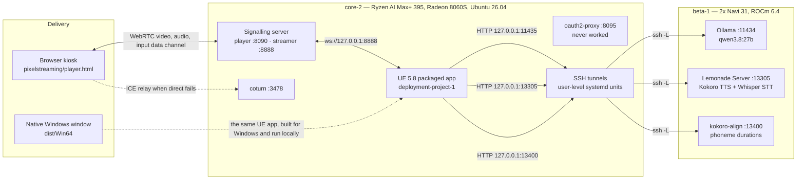
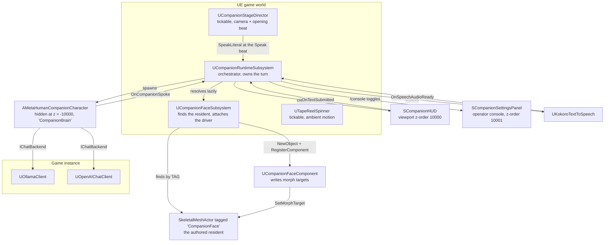
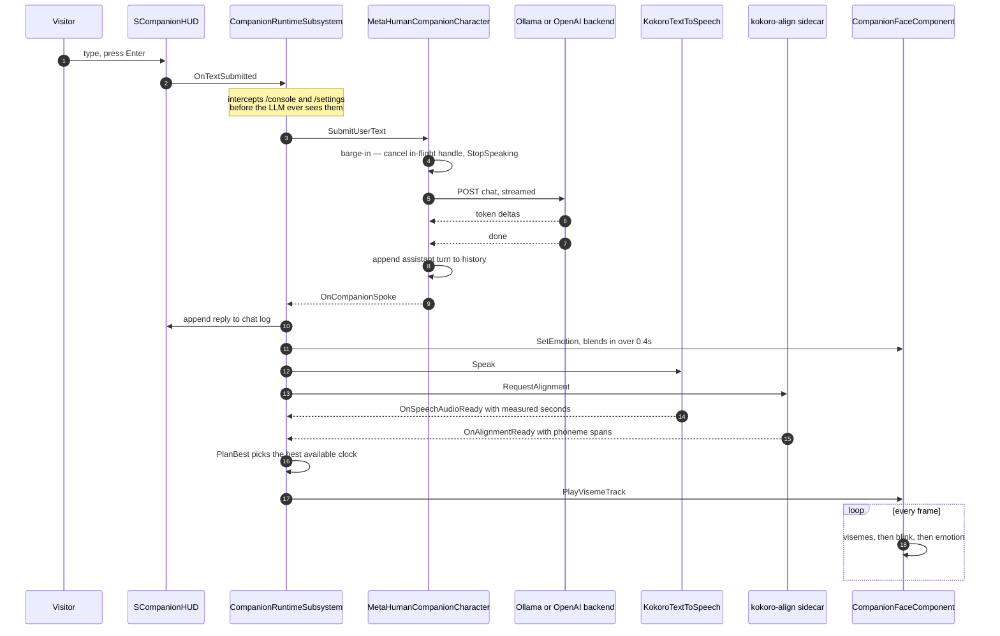

# Architecture — Eliza, a locally-hosted embodied companion

> **Written 2026-07-31, against `main` at commit `dea0437`.** Every structural claim below was
> checked against the source, the deployment files, or the commit history. Where something is
> designed but not wired, or wired but not measured, it says so explicitly.
>
> **Concurrent work notice.** This was written while a feature branch was landing. Facial emotion
> compositing (`FCompanionEmotionState`) went in at `dea0437` and is described as committed. Real
> phoneme alignment (`UKokoroPhonemeAligner`, `FVisemePlanner::PlanBest`) was still uncommitted in
> the working tree and is marked **`IN FLIGHT`** — check `git log` before trusting those sections
> to still be pending.

This is the spine document. It answers *what the system is, what runs where, and how one
conversational turn actually travels*. Deeper topics have their own files — see
[`README.md`](README.md) for the index.

---

## 1. What Eliza is

A photoreal Reallusion Character Creator avatar ("Nia", named Eliza in persona) standing in a
1970s mainframe room, rendered in Unreal Engine, holding a conversation with a visitor. Every
model runs on hardware we own. Nothing leaves the tailnet.

| | |
|---|---|
| **Engine** | UE **5.8** — what the project authors, builds and cooks. The C++ still compiles on 5.5 and is still tested there (§5.4); the **content** is what cannot go back. Every git-tracked package under `Content/` is UE5 package version **1018**, UE 5.5.4 reads at most **1013**, and package serialisation is forward-only, so a 5.5 cook fails at asset *load* — see the header of `Scripts/BuildNative.ps1` and [`COMPAT-AND-ECOSYSTEM-REVIEW.md`](COMPAT-AND-ECOSYSTEM-REVIEW.md) |
| **Avatar** | Reallusion CC "Nia" — **CC-named** morph targets (`V_*`), *not* ARKit. 286 morph targets, all 15 CC visemes present |
| **Cognition** | Ollama `qwen3.8:27b`, thinking disabled — **424–914 ms** warm on beta-1 |
| **Voice out** | Kokoro via AMD Lemonade Server, OpenAI-shaped HTTP — **1166 ms** median |
| **Voice in** | Whisper via the same Lemonade endpoint — **66 ms** median. Service works; **not wired to a UI control** (§6) |
| **Delivery A** | Linux container cook → Pixel Streaming (WebRTC, software VP8) → browser kiosk at `:8090` |
| **Delivery B** | Native Windows executable, same source, same authored set |
| **Behaviour** | C++ `UWorldSubsystem`s. **No Blueprints anywhere** — see §3 |

Latency figures come from `Docs/INFERENCE-STACK.md` and `Scripts/RunConversationE2E.py`; they are
measured, not estimated.

---

## 2. System architecture — what runs where

### 2.1 Topology

The native Windows build is the *same application code*; it draws to a local window instead of a
captured back buffer, and it reaches the same services by whatever route the developer's machine
has (the core-2 tunnels are a core-2 arrangement, not part of the app).

### 2.2 The two hosts

| Host | Hardware | Runs | Why |
|---|---|---|---|
| **core-2** `100.101.156.33` | Ryzen AI Max+ 395 "Strix Halo" iGPU (gfx1151), shared memory | UE app, Pixel Streaming, signalling, TURN | Renders and encodes. **Measured: not a cognition host** — `gemma4:e2b` takes ~12 s a reply here because inference contends with the same silicon that is rendering and VP8-encoding a live stream |
| **beta-1** `100.124.211.75` | 2× discrete Navi 31, 2×25.7 GB VRAM, ROCm 6.4, 64c Threadripper PRO | Ollama, Lemonade (Kokoro + Whisper), kokoro-align | Moving inference here turned a 12 s reply into **814 ms while going from a 2 B model to a 27 B one** — measured at the time on `qwen3.6:27b`, which beta-1 no longer serves; the current model is `qwen3.8:27b`. The accelerator was the bottleneck, never the model size |

### 2.3 The tunnels

Every model port on beta-1 is bound to **beta-1's loopback** — Ollama by a running process that
predates its own `OLLAMA_HOST=0.0.0.0`, Lemonade and the aligner by container port maps published
to `127.0.0.1`. None is reachable across Tailscale as published, so each is forwarded by its own
`--user` systemd unit on core-2.

| Unit (`Deployment/core2/`) | core-2 port | beta-1 service | Consumed by |
|---|---|---|---|
| `ollama-tunnel.service` | `11435` | Ollama `:11434` | `OLLAMA_BASE_URL` |
| `lemonade-tunnel.service` | `13305` | Lemonade `:13305` | `KOKORO_SERVER_URL` **and** `WHISPER_SERVER_URL` |
| `kokoro-align-tunnel.service` | `13400` | kokoro-align `:13400` | `KOKORO_ALIGNER_URL` — **`IN FLIGHT`**; unset at HEAD |

Two rules the history paid for:

- **One port per unit.** They were briefly merged into one `ssh -L … -L …`; under
  `ExitOnForwardFailure=yes` a single port clash then takes down every service at once.
- **A listener is not a tunnel.** A dead forward shows `127.0.0.1:13305 LISTEN` owned by a real
  `ssh` pid and still returns `HTTP 000`. Verify with a status code, never with a socket. And a
  `200` only proves *something answered* — `lemonade-trial` on beta-1 carries `RestartPolicy=no`.

### 2.4 In-process wiring

Note the deliberate split: **the brain is not the body.** The conversational actor is spawned
hidden, 100 m below the floor; the thing the viewer sees is a plain `SkeletalMeshActor` the level
already contains. Keeping them apart is what lets the map stay a purely visual asset.

---

## 3. The constraint everything follows from: no Blueprints

The diorama map is authored **headlessly by Python in a content-only project**
(`Deployment/author_diorama.py`). That project has `Modules: []`. It cannot reference plugin C++
classes and it cannot embed a Blueprint. Therefore:

| Consequence | How it shows up in the code |
|---|---|
| The map cannot place a behaviour actor | Behaviour lives in `UWorldSubsystem`s that attach themselves at `OnWorldBeginPlay` |
| The map cannot name a C++ class | Actors are found by **tag** (`CompanionFace`, `TapeReel`), never by class or label |
| Labels are useless | Actor *labels* are editor-only and do not survive a cook — a label lookup works in the editor and silently finds nothing in the shipped build |
| The HUD cannot be a WidgetBlueprint | `SCompanionHUD` is hand-written Slate added via `AddViewportWidgetContent` |
| `BlueprintImplementableEvent`s are inert | `OnSetVisemeWeights`, `OnSetEmotion`, `OnSpeak`, `OnConversationError` on the character fire into nothing. The subsystem spawns `AMetaHumanCompanionCharacter::StaticClass()` directly (`CompanionRuntimeSubsystem.cpp:55-56`). A `BP_CompanionCharacter` **does** exist and is git-tracked, but `Deployment/create_and_save_bp.py` creates it as a bare subclass and adds no nodes, and the asset carries none of the four event names and no `UbergraphFunction` — so re-pointing the spawn at it would change nothing until someone authors the graph |

That last row is why a whole parallel lip-sync path (`UPiperTextToSpeech` →
`FVisemeKey.JawOpen` → character `Tick` → `OnSetVisemeWeights`) exists in the source and is
unreachable in the shipped game. See [`FACE-PIPELINE.md`](FACE-PIPELINE.md) §6.

The HUD's placement is the same constraint solved the other way round:

> Added as viewport content so it renders into the **same back buffer Pixel Streaming captures**.
> That is what makes one implementation serve both targets: a native window draws it directly, and
> the streamed client sees it because it is part of the frame, with keystrokes travelling back over
> the existing input channel. A browser-only DOM overlay would have worked for the stream and left
> the native build with no way to type at all.
> — `CompanionRuntimeSubsystem.cpp`

---

## 4. One conversational turn

### 4.1 The full sequence

Steps 14–16 are the **`IN FLIGHT`** shape. At `dea0437` there is no aligner: `HandleSpeechAudioReady`
calls `PlanForDuration` directly and the mouth starts the instant the audio duration is known.
Everything else in the diagram, including `SetEmotion`, is committed.

Speech input (`Whisper → SubmitUserText`) is implemented on `UWhisperSpeechToText` and enters at
the same `SubmitUserText` seam — but nothing binds the HUD's mic toggle to it (§6).

### 4.2 Lip-sync timing: the fallback ordering

This is the most important ordering decision in the system, and it is now explicit in code as
`FVisemePlanner::PlanBest` + `EVisemeTimingSource`.

| Rank | Source | Enum | Where it comes from | Accuracy | Wired at HEAD? |
|---|---|---|---|---|---|
| **1** | **Real phoneme alignment** | `Alignment` | `kokoro-align` sidecar returns the per-phoneme durations Kokoro's own duration predictor computed | A **measurement**. Durations summed to 3.05 s against 3.02 s of emitted audio — a 1 % match | **No** — `IN FLIGHT` |
| **2** | **Measured clip duration** | `MeasuredDuration` | `PlanForDuration` — the spelling estimate, uniformly rescaled to the WAV's true length | Total is right; the *distribution* is still a guess. A long word and a short one share time by letter count | **Yes**, whenever `KOKORO_SERVER_URL` is set |
| **3** | **Text estimate** | `TextEstimate` | `PlanFromText` at an assumed 165 wpm | No audio involved at all. Kokoro measured 131–184 wpm, so a long reply visibly drifts | **Yes**, the no-voice fallback |

Why rank 1 exists at all, from `KokoroPhonemeAligner.h`:

> Kokoro is StyleTTS2: a duration predictor decides how many frames each phoneme occupies, and the
> length regulator expands the phoneme encodings by exactly those durations before the vocoder
> runs. The model therefore KNOWS where every phoneme lands in the waveform it just produced.
> OpenAI's `/v1/audio/speech` schema returns audio bytes and nothing else, so serving Kokoro
> through an OpenAI-compatible endpoint discards that tensor at the HTTP boundary. […] Owning the
> TTS means the timing is a MEASUREMENT rather than an inference.

Three properties of the fallback are load-bearing:

- **It falls through, never fails.** An unreachable aligner costs precision and never costs speech.
- **The emptiness check is on the *result*, not the input.** A response can carry spans that are
  all zero-duration; trusting the input count would hand the face an empty track — a shut mouth for
  the whole reply — while reporting the accurate path.
- **The mouth waits, but only briefly.** `AlignmentGraceSeconds = 1.0` bounds how long audio-ready
  will hold out for an alignment that has not arrived. `bMouthDriven` makes the three racing
  callers idempotent, because a second track would restart the mouth mid-sentence.

### 4.3 Why the mouth is deferred when a voice service exists

`HandleCompanionSpoke` deliberately queues **nothing** when TTS is configured:

> planning from text and then re-timing plays the same utterance twice at two different speeds.
> — `CompanionRuntimeSubsystem.cpp`

The same hazard bit once already from the other direction: `Tts` and
`FindComponentByClass<UKokoroTextToSpeech>()` resolved to the *same* component, so
`OnSpeechAudioReady` was bound twice and every clip re-timed the face twice — "two viseme tracks
racing on one mouth."

---

## 5. Subsystem and component reference

### 5.1 World subsystems

All four gate on `World->IsGameWorld()` in `ShouldCreateSubsystem` and attach at
`OnWorldBeginPlay`.

| Class | Owns | Binds to | Configured by |
|---|---|---|---|
| **`UCompanionRuntimeSubsystem`** `Avatar/CompanionRuntimeSubsystem.h` | The spawned `CompanionBrain` actor; the Kokoro TTS component; `SCompanionHUD`; `SCompanionSettingsPanel`; the chat-focus guard timer | `Companion->OnCompanionSpoke`; `Tts->OnSpeechAudioReady`; `Hud->OnTextSubmitted`; `SettingsPanel->OnSettingsChanged`; the `PlayerController` input mode | `MHLLM_COMPANION`, `MHLLM_HUD`, `MHLLM_CONSOLE`, `MHLLM_GREETING`, `MHLLM_FREE_LOOK`, `KOKORO_*`, `OLLAMA_MODEL`, `MHLLM_FACE_PROFILE` |
| **`UCompanionFaceSubsystem`** `Avatar/CompanionFaceSubsystem.h` | The `UCompanionFaceComponent` it creates on the resident | Nothing. Resolves the resident by **actor tag `CompanionFace`**; falls back to the skeletal-mesh actor with the most morph targets | `MHLLM_FACE_PROFILE` (default `CC`), `MHLLM_FACE_SELFTEST` or `-FaceSelfTest` |
| **`UCompanionStageDirector`** `Avatar/CompanionStageDirector.h` *(tickable)* | The spawned `ACameraActor` (FOV 21, aspect unconstrained); the 4-key camera path; the beat state machine | Calls `UCompanionRuntimeSubsystem::SpeakLiteral`; sets `SetViewTarget`, `SetIgnoreLookInput`, `SetIgnoreMoveInput` | `MHLLM_OPENING_SHOT` (opt-in), `MHLLM_OPENING_DELAY`, `MHLLM_FLY_SECONDS`, `MHLLM_OPENING_REPLAY`, `MHLLM_OPENING_LINE`, `MHLLM_FREE_LOOK` |
| **`UTapeReelSpinner`** `Avatar/TapeReelSpinner.h` *(tickable)* | Every actor tagged **`TapeReel`**, each with its own rate | Nothing | — |

`UTapeReelSpinner`'s rates are deliberately non-uniform, seeded from world position:

> A hall of reels turning in lockstep reads as a screensaver; real machines run independent jobs
> […] That variation is the entire difference between "animated" and "alive".

### 5.2 Game-instance subsystems

| Class | Role | Wire format | Notes |
|---|---|---|---|
| `UOllamaClient` | `IChatBackend`, native Ollama | `POST {OllamaBaseUrl}/api/chat`, **NDJSON** stream | Sends `"think": false` unless `MHLLM_THINKING=1` |
| `UOpenAIChatClient` | `IChatBackend`, any OpenAI-compatible server | `POST {OpenAIBaseUrl}/chat/completions`, **SSE** | `Authorization: Bearer` only when a key is set |

Both cancel every in-flight request in `Deinitialize`. Both diff `GetContentAsString()` by TCHAR
length — see [`LEARNINGS.md`](LEARNINGS.md) for the open UTF-8 defect that follows from that.

### 5.3 Actor and components

| Class | Owns | Binds to | Lifecycle |
|---|---|---|---|
| `AMetaHumanCompanionCharacter` | `UOllamaConversation` (turn history), STT component, TTS component, the in-flight request handle | `SpeechToText->OnTranscribed`; `TextToSpeech->OnSpeechFinished`; Piper's `OnVisemeEnvelopeReady` | `BeginPlay` swaps the `Null*` defaults for real backends **only if the matching URL is set**; ticks only while playing a Piper envelope |
| `UCompanionFaceComponent` | `TargetMesh`, `FFaceProfile`, the speech track, the blink clock, the `FCompanionEmotionState` | Nothing — driven by direct calls | Ticks every frame from construction; `BeginPlay` auto-finds the owner's skeletal mesh |
| `UKokoroTextToSpeech` | The active `UAudioComponent` and HTTP request | Publishes `OnSpeechAudioReady(Text, DurationSeconds)` | `Speak()` calls `StopSpeaking()` first — barge-in at the component level |
| `UWhisperSpeechToText` | `UAudioCapture` + a locked float buffer | Publishes `OnTranscribed` | **No UI control binds to it** (§6) |
| `UPiperTextToSpeech` | Same trio, plus a single-channel jaw envelope | Publishes `OnVisemeEnvelopeReady` | Reachable only if `KOKORO_SERVER_URL` is empty and `PIPER_SERVER_URL` is not |
| `UNullTextToSpeech` / `UNullSpeechToText` | — | Null TTS broadcasts `OnSpeechFinished` immediately | The defaults. Their survival is what once shipped a **mute** build |

### 5.4 Settings and compatibility

| Class | Role |
|---|---|
| `UMetaHumanLLMSettings` | `UDeveloperSettings`, `Config=Game`. The single settings object every client reads |
| `FMetaHumanLLMEnvConfig` | Applies process environment onto those settings at `StartupModule`. See [`CONFIGURATION.md`](CONFIGURATION.md) for precedence |
| `CICompanionCompat.h` / `CICompatReport` / `CISkeletalMeshCompat.h` | The UE 5.5 ↔ 5.8 layer, with the compatibility *table* separated from the `#if`s so both branches are testable from one engine. Live and maintained: `Tests/CompatSpec.cpp` asserts `ExpectedFor(5, 5)` and `ExpectedFor(5, 8)` side by side, and `Scripts/RunCompatMatrix.ps1` defaults to `-Engines 5.5, 5.8`. This is the part of 5.5 that still works — the **code**. §1 covers the part that does not: the content |
| `CICompanionEnv.h` / `CICompanionLog.h` | Shared env helpers and log categories, defined **once** — both files exist because unity builds merged their per-file predecessors |

---

## 6. Honest status of each seam

| Seam | State |
|---|---|
| Text in → reply → mouth → audio | **Working, verified in a cooked build** (2026-07-30). Round trip 0.63 s, logged as `backend=ollama model=gemma3:1b`. `CI_HUB_URL` was present and needed no workaround — that run proved **backend precedence**, not that the Hub served the reply: CI-Hub does not proxy inference, see [`COMPAT-AND-ECOSYSTEM-REVIEW.md`](COMPAT-AND-ECOSYSTEM-REVIEW.md) §3 |
| Typing over Pixel Streaming | **Working, measured from a real browser** — auto-focus, click-then-type, Send button, and recovery from a stray click |
| Mic → Whisper → turn | **Not wired.** `SCompanionHUD` exposes `OnMicToggled`; `UCompanionRuntimeSubsystem` never binds it. The STT component and the service both work in isolation |
| Real phoneme alignment | **`IN FLIGHT`.** The sidecar runs and is tunnelled; the client and `PlanBest` exist uncommitted |
| Facial emotion | **Working**, landed in `dea0437`. The reply text drives a sustained brow/cheek/eye bias composited over the visemes, with a 418-case spec behind it |
| Audio reaching the browser | **Working, measured by energy** — 70 s sample, `totalAudioEnergy` 0.0739 against 0.0 for silence |
| Mobile touch | **Unverified.** Exercised only under Chromium mobile emulation. Treat as untested until someone taps Send on real glass |
| Multi-viewer | **Does not exist.** One UE process, one streamer, one conversation |
| Auth | **Broken.** The OIDC gate has never worked; `:8090` is open on the tailnet |

### A likely defect found while writing this

`AMetaHumanCompanionCharacter::BeginPlay` creates a `UKokoroTextToSpeech` named
`RealTextToSpeech`, and `UCompanionRuntimeSubsystem::OnWorldBeginPlay` separately creates another
named `CompanionVoice`. On each reply `HandleComplete` calls the character's `TextToSpeech->Speak`
*and* broadcasts `OnCompanionSpoke`, which reaches the subsystem's `Tts->Speak`. Both hold their
own `UAudioComponent`, so neither stops the other.

Read literally, that is **two synthesis requests and two audio components playing the same clip
per reply.** This is a code-reading conclusion, **not measured** — it is recorded here rather than
asserted as fact, and it is the kind of claim this project's own history says to settle with a
measurement (count the `POST`s, or measure the track energy for doubling) rather than an argument.

---

## 7. Where to go next

| Question | Document |
|---|---|
| How is the face actually driven? | [`FACE-PIPELINE.md`](FACE-PIPELINE.md) |
| What does a visitor experience? | [`USER-FLOWS.md`](USER-FLOWS.md) |
| How do I build and ship it? | [`BUILD-AND-DEPLOY.md`](BUILD-AND-DEPLOY.md) |
| What does every env var do? | [`CONFIGURATION.md`](CONFIGURATION.md) |
| What went wrong, and what did it teach? | [`LEARNINGS.md`](LEARNINGS.md) |
| How do I know it works? | [`TESTING.md`](TESTING.md) |
| What is missing? | [`ROADMAP.md`](ROADMAP.md) |
