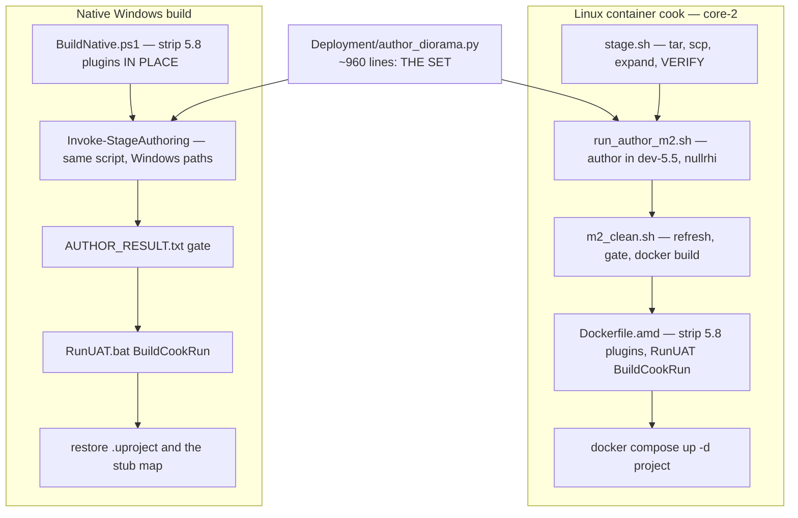

# Build and deploy — two consumers, one definition of the set

> **Written 2026-07-31 against `main` at `dea0437`.** This is the pipeline reference. For *what the
> set contains* — props, lighting, colour, exposure — read
> [`SCENE-AUTHORING.md`](SCENE-AUTHORING.md); this document deliberately does not repeat it.

---

## 1. The shape of the problem

The map is **generated, never committed**. `Content/Maps/CompanionStage.umap` in the repo is a
**23 KB stub** and is restored after every native build.

Two reasons, both stated in `Scripts/BuildNative.ps1`:

> The set is DEFINED by ~960 lines of layout, lighting and material logic. Committing the `.umap`
> would freeze a build artifact as source and guarantee it drifts from the script the moment anyone
> edits the set […] It is also the resident's content behind it (~900 MB when that is Nia), and a `.umap` is
> **ENGINE-VERSION-SPECIFIC**: one authored by 5.8 here cannot be loaded by the 5.5 cook on core-2.
> So the map stays generated, and this function makes the native build generate it the same way the
> container does — **one source of truth, two consumers**.

`Deployment/author_diorama.py` is that source of truth. Both pipelines run **the same script**; the
only thing that differs is where its inputs live, and that is indirected through environment
variables so neither consumer can quietly diverge.



### 1.1 The seam: five environment variables

| Variable | Container default | Windows override |
|---|---|---|
| `MHLLM_GLB_DIR` | `/glb` | `C:\devel\llm-metahuman\scene\glb` (or `-GlbDir`) |
| `MHLLM_MH_DIR` | `/mh` | `Deployment\metahuman` |
| `MHLLM_AUDIO_DIR` | `/audio` | `Deployment\audio` |
| `MHLLM_GEN_DIR` | *`GLB_DIR`* | `Deployment\generated` |
| `MHLLM_AUTHOR_RESULT` | `/out/AUTHOR_RESULT.txt` | `Saved\AUTHOR_RESULT.txt` |

> Any new external input must be read through here, never hard-coded, or the local build silently
> diverges from the cook again.
> — `author_diorama.py`

`MHLLM_GEN_DIR` defaulting to `GLB_DIR` is itself a scar: `T_CRT_Vector.png` and `S_RoomTone.wav`
existed only inside core-2's props mount, both imports are wrapped in `try/except`, so **every
native build shipped with unpowered CRT screens and a silent machine hall** — and the only evidence
was `There was nothing to import` buried in an authoring log.

---

## 2. The Linux container cook

Canonical path is `stage.sh` → `m2_clean.sh`. `m2_full.sh` is the older `cook-m2` variant.

| Step | Script | Cost | What it does |
|---|---|---|---|
| 0 | `core2/stage.sh` | ~30 s | tar the committed source, `scp` to core-2 under **one canonical name**, expand into `/home/ci/cook-clean`, then **verify the expanded tree** (§4) |
| 1 | `core2/run_author_m2.sh` | ~3 min | author the map in `ghcr.io/epicgames/unreal-engine:dev-5.8` (the script's header says why it moved off 5.5) with `-nullrhi`; write `stage-out/Content` (a copy of the result, `Content/AUTHOR_RESULT.txt`, sits beside the map) + `AUTHOR_RESULT.txt` |
| 2 | `core2/m2_clean.sh` | ~20 min | gate on `SUCCESS` and on the requested resident's line, copy content as **root**, fail fast on a missing map, missing resident content (`Content/Seo` with `MHLLM_RESIDENT=metahuman`, `CC_ControlRig_Nia` with `nia`; the default mannequin is engine content) or resident content nobody asked for, `docker build -f Dockerfile.amd --build-arg RESIDENT=<the resident it authored>` (whose own `CHECK_MAP` gate, §2.2, then refuses a stub, or an authored map nothing vouches for), deploy, grep the logs, curl `:8090` |
| — | `core2/gpu_preview.sh` | ~3–5 min | render the **uncooked** authored map on the real GPU. Skips the cook entirely — the fast lighting/material loop |

Notes that are not obvious from the scripts:

- **File operations run as root inside a container.** The UE container writes authored content as
  root, so a host-side `rm -rf`/`cp` as user `ci` half-fails on permissions and leaves a stale tree
  that **silently cooks the wrong content — worse than an outright error.** This trap was paid for
  three times.
- **`Dockerfile.amd` branches on whether a real map was supplied.** `Using the SUPPLIED
  CompanionStage.umap` versus synthesizing a minimal one via `author_companion_stage.py`.
  `m2_clean.sh` asserts the string `SUPPLIED CompanionStage` is present in the Dockerfile before it
  starts, because an older Dockerfile deleted the map unconditionally: `DOCKERFILE_STALE —
  aborting, it would delete the diorama`.
- **The runtime image is `ubuntu:26.04`**, matching the host's Mesa 26.x. Older Mesa gives
  `VK_ERROR_INCOMPATIBLE_DRIVER`. It also bakes a **null ALSA default** into `/etc/asound.conf` —
  without it the audio mixer never leaves "Pre-Initialized", Pixel Streaming has no submix to
  capture, and the negotiated audio track carries digital silence forever.
- **UE refuses to run as root**, and `ubuntu:26.04` already owns uid 1000, so the container user
  `ue4` is uid **1001**.
- **The 5.8-only plugin set is stripped** when the engine minor is < 6, and `GameFeatures` is
  explicitly *added* — see [`LEARNINGS.md`](LEARNINGS.md) L9.
- **Both images are Shipping builds** (`-clientconfig=Shipping` in `Dockerfile` and
  `Dockerfile.amd`): no console, cheat or stat commands for a viewer to reach. Shipping ignores
  `-ExecCmds`, `-ini:` and `-dpcvars`, so the RADV cvars that `docker-compose.amd.yml` used to pass
  on the command line are written into the AMD image's `Config/Linux/LinuxEngine.ini` by
  `Dockerfile.amd`. Shipping also compiles out the engine log, and an installed engine cannot add it
  back (`bUseLoggingInShipping` needs a unique build environment), so `docker logs` shows no
  `Log*` lines and the log greps in `m2_clean.sh` print nothing. Debug from a local Development
  build, never a published one.

### 2.1 Deployment

```
docker compose -f docker-compose.yml \
               -f docker-compose.amd.yml \
               -f docker-compose.ollama.yml \
               -f docker-compose.face.yml up -d project
```

| Service | Image | Ports | Role |
|---|---|---|---|
| `signalling` | `pixel-streaming-signalling-server:5.5` | `8090` player, `8888` streamer | serves `player.html` (ours, mounted over the stock page) |
| `turnserver` | `coturn:4.6.2` | `3478` | ICE relay when a direct path fails |
| `oidc-proxy` | `oauth2-proxy:v7.6.0` | `8095` | the login gate. **Has never worked** |
| `project` | `ci/metahuman-local-llm:5.5-face` | host net | the packaged app |

`docker-compose.face.yml` is an **overlay that contributes only an `environment:` block** — no
ports, no volumes. It is the file that turns a diorama into a companion.

Two switches with reasons:

- **`-ForceRes` is deliberately absent** from the AMD overlay: it pins the backbuffer and silently
  defeats the frontend's `MatchViewportRes`.
- **VP8 software encode.** HW encode is NVENC (NVIDIA) or AMF (AMD); on AMD/RADV/Linux neither
  works. Acceptable at 720p, and a documented trade-off rather than a bug.

⚠️ **`docker compose up -d project` is a no-op when the config hash is unchanged.** It reports
`Running` and restarts nothing. Cycling a container needs an explicit `docker restart`.

### 2.2 Author first: the `CHECK_MAP` gate, and building anywhere but core-2

**Neither Dockerfile authors the set.** Each cooks whatever `Content/` the build context carries,
and the `CompanionStage.umap` committed to git is the 23 KB stub. On core-2 that never showed,
because `m2_clean.sh` copies the authored `stage-out/Content` over the tree before it builds. A
build from a plain checkout -- which is what the NVIDIA path is: `Deployment/Dockerfile`, built by
`docker compose -f docker-compose.yml -f docker-compose.nvidia.yml build project` -- cooked the stub
and streamed an empty stage, and nothing anywhere failed.

So both `Dockerfile` and `Dockerfile.amd` now run the same `CHECK_MAP` step before the cook. It
refuses a `Content/Maps/CompanionStage.umap` that is:

| The map | Build log says | Typical cause |
|---|---|---|
| absent | `is missing` | authored content never copied in |
| a Git LFS pointer | `is a Git LFS pointer` | cloned without `git lfs` |
| byte-identical to the committed stub (its LFS oid) | `is the 23 KB stub committed to git` | a clean checkout: nothing was authored |
| under 200 KB | `is only N bytes` | an editor re-saved the stub, or authoring failed; 200 KB is `BuildNative.ps1`'s floor for an authored map |

Each refusal prints `CHECK_MAP: REFUSING TO COOK` and fails the build before the cook starts,
instead of shipping an empty stage twenty minutes later. A passing build logs
`CHECK_MAP: OK, … N bytes`.

- `--build-arg ALLOW_STUB_MAP=1` cooks the stub anyway, with a warning: for a smoke test of the
  toolchain only. Never ship that image.
- `Dockerfile.amd` with `RELEASE` < 5.6 keeps its old fallback: when the context has **no** map it
  synthesizes a minimal stage with `author_companion_stage.py` (sky, floor, a mannequin), and the
  gate lets that through with a warning.
- The script is byte-for-byte the same in both Dockerfiles; CI fails if they differ, runs it
  against fixtures, and checks its stub hash against the committed stub's LFS oid.

**And it refuses an authored map that nothing vouches for.** The opposite failure is as quiet. A
map authored before the resident switch places Reallusion's Nia, and one authored before the NoAI
prop gate carries the three Sketchfab props `CREDITS.md` says were replaced; both are hundreds of
KB, and both pass every check above. The bytes of a `.umap` cannot say who stands in it. So
`author_diorama.py` writes every line of its result into `Content/AUTHOR_RESULT.txt` as well, beside
the map, ending with `map sha256: <the map it saved>` and `SUCCESS`, and `CHECK_MAP` cooks an
authored map only when that file passes:

| `Content/AUTHOR_RESULT.txt` | Build log says | Typical cause |
|---|---|---|
| absent | `has no Content/AUTHOR_RESULT.txt beside it` | a map authored before this check existed, or a map copied without the rest of `Content/` |
| no `SUCCESS` line | `does not report SUCCESS` | the authoring run failed |
| no `resident: MANNEQUIN placed` line (`ELIZA` with `--build-arg RESIDENT=eliza`, `METAHUMAN` with `RESIDENT=metahuman`, `NIA` with `RESIDENT=nia`) | `has no "resident: … placed" line` | the map holds another resident, such as Nia in a map authored before the switch |
| no `NoAI prop slots:` line | `has no "NoAI prop slots" line` | authored before `author_diorama.py` refused the NoAI-tagged props |
| `map sha256` is not the map's | `belongs to another map` | a result and a map from different runs |

Whatever the map, it also refuses `Content/CC_ControlRig_Nia` unless `--build-arg RESIDENT=nia`,
and `Content/Seo` in a mannequin build: both are Fab content tagged NoAI ([`NOTICE.md`](../NOTICE.md)),
and this is the rule `m2_clean.sh` applies to core-2's cook tree, now applied to every build
context. It refuses `Content/Eliza` unless `--build-arg RESIDENT=eliza` (her content is private,
staged and cooked only when asked for), an `eliza_manifest.json` whose `id` is not `eliza` or whose
variant is not `ELIZA_VARIANT`, and any `Content/EditableCharacters`, where MetaHuman Creator keeps
editable characters, which are never cooked. `RESIDENT` defaults to `mannequin`; `m2_clean.sh` and
`m2_full.sh` pass the resident they authored. `ALLOW_STUB_MAP=1` lifts none of this: it lets an
unauthored map through, never an authored one nothing vouches for.
`Scripts/BuildNative.ps1 -SkipAuthoring` applies the same checks before it cooks a map it did not
author (§3), and its default path refuses a stray `Content/Eliza` or any `Content/EditableCharacters`
before it stages or authors anything.

**The prerequisite, on any build host:**

1. **Author** with the engine the image will cook with (5.8 by default; a `.umap` is
   engine-version-specific, §1). The reference route is `core2/run_author_m2.sh`: it runs
   `author_diorama.py` headlessly in `dev-5.8` with its inputs mounted -- the prop GLBs,
   `Deployment/audio` and `Deployment/generated`, plus the Seo FBX export only with
   `MHLLM_RESIDENT=metahuman` and the Nia character (`nia-content`) only with `nia`; the default
   mannequin is engine content and needs no mount -- and writes `stage-out/Content`, with its
   `AUTHOR_RESULT.txt` beside the map, plus `stage-out/AUTHOR_RESULT.txt`. The GLBs (and the
   opt-in residents' content) are not in this repository, which is why no Dockerfile can author on
   its own. On Windows, `Scripts/BuildNative.ps1 -KeepAuthoredMap` authors in place through the
   same script and leaves the result in `Content/`, `AUTHOR_RESULT.txt` included (do not commit the
   map; the result file is gitignored).
2. **Gate** on `AUTHOR_RESULT.txt` (§4.2), as `m2_clean.sh` and `BuildNative.ps1` do.
3. **Copy** the authored `Content/` into the build context **whole**, `AUTHOR_RESULT.txt` with it,
   as root where the authoring container wrote it as root (`m2_clean.sh` step 3 is the reference;
   §2's first note says why). Remove `Content/CC_ControlRig_Nia` and `Content/Seo` left over from
   an earlier opt-in build.
4. **Build** the image, with `--build-arg RESIDENT=metahuman` or `nia` only for an opt-in resident.
   `.github/workflows/unreal-self-hosted.yml` has a disabled job that does steps 3 and 4 on a
   self-hosted runner from an `authored_content_dir` input.

---

## 3. The native Windows build

`Scripts/BuildNative.ps1 -Platform Win64 -Engine 'C:\Program Files\Epic Games\UE_5.5'`

| Step | Why it exists |
|---|---|
| Platform guard | `Mac` exits 2 — Apple provides no cross-compiler. `Linux` without `C:\UnrealToolchains` exits 2 and points at the container |
| Strip 5.8-only plugins **in place**, restore in `finally` | Cooking a *renamed* copy writes output to `Saved/Cooked/Windows/<name>.build/` while staging still looks under `<name>/` — *"Cook and stage disagreed on the project name and only the second one noticed"* |
| Delete `Intermediate/ShaderAutogen` | Written by whichever **engine** last opened the project. A 5.8-generated `AutogenShaderHeaders.ush` reused by the 5.5 shader compiler fails with errors naming engine internals and nothing about this project |
| Back up the committed stub map | Restored in `finally`; `-KeepAuthoredMap` opts out. *"Do not commit it."* |
| `Invoke-StageAuthoring` | Checks the resident's inputs before launching anything: the engine's `SKM_Manny` for the default `-Resident Mannequin`, the three Seo FBX files for `-Resident MetaHuman`, or — with `-Resident Nia` only — copies Nia's content (**copied, not junctioned** — authoring re-saves what it loads, and a junction would rewrite the source project's own assets). Then purges stale imports (and the last run's `Content/AUTHOR_RESULT.txt`) and runs the same `author_diorama.py` with `MHLLM_RESIDENT` set |
| **The authoring gate** | §4.2 |
| `-SkipAuthoring` instead | Cooks the map already on disk, but an authored one (200 KB or more) only if its `Content/AUTHOR_RESULT.txt` passes §2.2's provenance table for `-Resident`, and never with `Content/CC_ControlRig_Nia` or `Content/Seo` staged unless `-Resident` names her. A smaller map cooks with the old warning: an empty stage |
| `RunUAT.bat BuildCookRun … -ubtargs=-NoHotReloadFromIDE` | Live Coding's mutex is keyed on the **executable**, and every project's editor target is the same `UnrealEditor.exe` — so an editor open on an *unrelated* project blocks packaging this one |
| Check the package's licence files | `MetaHumanLocalLLM.Build.cs` stages `LICENSE`, `NOTICE.md` and `CREDITS.md` as loose files in `<archive>/MetaHumanLocalLLM/`, because the cooked set includes eight CC BY 4.0 models whose attribution must travel with the build. The script fails unless this run's NonUFS manifest lists all three; `Dockerfile` and `Dockerfile.amd` refuse an image without them in the same way |

Every UAT switch is an explicitly-quoted string: a bare `-platform=$Platform` token is **not
interpolated by PowerShell in argument mode** and reaches UAT as the literal `"$Platform"`.

---

## 4. The verification gates

Both pipelines refuse to spend 20+ minutes on a tree they have not checked. This is the single
highest-leverage practice in the repo.

### 4.1 `stage.sh` — the staging gate

> Exists because the same failure has now happened three times: a fix is written, staged to a path
> nothing reads, and a 25-minute cook silently builds the previous revision.

It verifies the **expanded** tree, not the tarball — *"it inspects what the compiler will actually
read"* — and it checks for **named symbols**, because *"a file can be present and still be the OLD
revision, which is the exact failure this script exists to stop"*.

| Kind | Target | Meaning |
|---|---|---|
| file | `Avatar/CompanionStageDirector.cpp` | stage director present |
| file | `Avatar/CompanionRuntimeSubsystem.cpp` | companion runtime present |
| file | `Voice/KokoroTextToSpeech.cpp` | Kokoro TTS present |
| symbol | `SCompanionHUD.cpp` ∋ `RestoreInputFocusIfLost` | the focus guard is *this* revision |
| symbol | `SCompanionHUD.cpp` ∋ `EButtonClickMethod::MouseDown` | Send fires on press |
| symbol | `CompanionRuntimeSubsystem.cpp` ∋ `RearmChatFocus` | the focus timer is present |
| grep | `docker-compose.face.yml` ∋ `MHLLM_OPENING_LINE` | the compose carries the opening line |
| grep | `author_diorama.py` ∋ `CAM_DIST = 106.0` | the solved framing survived staging |

```
[ "$FAIL" -eq 0 ] || { echo "STAGE_FAILED — refusing to cook a stale tree"; exit 1; }
echo "STAGE_OK"
```

### 4.2 `AUTHOR_RESULT.txt` — the authoring gate

The Windows equivalent, and it gates on **content**, not on `$LASTEXITCODE` — the commandlet exits
non-zero on error count alone. Each condition corresponds to something that has actually shipped
empty:

| Assertion | The failure it catches |
|---|---|
| starts with `SUCCESS` | `new_level()` **refuses to overwrite**, returns `False`, the run authors into an untitled transient level, the save fails — and the script printed SUCCESS anyway because that line was unconditional |
| `resident: MANNEQUIN placed` (default), `resident: ELIZA placed` (`-Resident Eliza`, after her staged `eliza_manifest.json` checked out), `resident: METAHUMAN placed` (`-Resident MetaHuman`) or `resident: NIA placed` (`-Resident Nia`) | a cooked build with sky, ground and nobody in it. The MetaHuman line is printed only when all three Seo parts imported, the face is tagged and the body and outfit are attached to it; the mannequin line only by the default path, never by the fall-back after a failed Seo import |
| `CRT vector displays placed: [1-9]` | *"Match the COUNT, not just the words"* — three empty actors and a cheerful success line |
| `room tone placed` | a silent machine hall |
| `exposure PINNED at EV100` | 3.5 stops of overexposure that **failed silently for weeks**, because nothing in any log distinguishes a lit room from a blown one |
| map exists and is **> 200 KB** | *"that is the empty stub, not the set"* |
| `Content/AUTHOR_RESULT.txt` has the resident line, a `NoAI prop slots:` line and this map's `map sha256` | the copy that travels with `Content/` is incomplete or names another map, so a later image build (`CHECK_MAP`) or `-SkipAuthoring` cook from this tree would refuse it; found out now rather than then |

`m2_clean.sh` adds its own fail-fast checks before the cook: `AUTHOR_NOT_STARTED` (an unknown
`MHLLM_RESIDENT`, which would otherwise leave the previous run's result file to be gated on),
`NO_RESIDENT`, `NO_MAP`, and `NO_METAHUMAN_CONTENT` (with `MHLLM_RESIDENT=metahuman`) or
`NO_NIA_CONTENT` (with `nia`). A mannequin or MetaHuman build also refuses a cook tree that still
contains `CC_ControlRig_Nia` (`UNEXPECTED_NIA_CONTENT`), and a mannequin build one that contains
`Content/Seo` (`UNEXPECTED_SEO_CONTENT`). Both Dockerfiles' `CHECK_MAP` and
`BuildNative.ps1 -SkipAuthoring` repeat those two refusals for any tree, and check the
`Content/AUTHOR_RESULT.txt` beside an authored map (§2.2), because neither authors what it cooks.

Not a failure anywhere: a prop slot refused as NoAI (`prop REFUSED …`, summed up as `NoAI prop slots:
N of 3 refused`). `BuildNative.ps1` repeats it after the cook and `m2_clean.sh` prints it, because
the set then has gaps until `Deployment/blender/make_period_props.py` builds the CI-authored
replacements ([`SCENE-AUTHORING.md`](SCENE-AUTHORING.md#the-resident)).

---

## 5. Verification after deploy

**Always verify with pixels, not logs.** `LoadMap complete` and `HTTP 200` prove the stream is up,
not that it shows anything.

| Tool | Measures | Verdict line |
|---|---|---|
| `cap2.mjs` / `cap5.mjs` | decoded WebRTC frame → canvas → `meanLuma`, `maxLuma` | `STATS:` |
| `cap_audio.mjs` | **audio energy** via `AnalyserNode` RMS over 25 s | `AUDIO_RESULT` |
| `cap_audio2.mjs` | patches `RTCPeerConnection` before page scripts; reads receivers and `getStats` `inbound-rtp` — `bytesReceived`, `packetsReceived`, `totalAudioEnergy` | `AUDIO2` |
| `chat_ps.mjs` | five labelled browser input phases (§[`USER-FLOWS.md`](USER-FLOWS.md)) | `SHOT`, then container-log greps |
| `gpu_preview.sh` | uncooked map on the real GPU | `RENDER_OK` / `NO_RENDER` |

Reference values: `meanLuma ~0.03` is black; `~117` is a correctly exposed scene; `~221` was the
overexposed build. `totalAudioEnergy 0.0739` over 70 s is real speech; `0.0` is a live track
carrying silence.

> When checking which way a character faces, look for **eyes** — a yaw error survived weeks of
> "verified" because nobody looked for a face.

Captures use `drawImage(video, …)` onto a canvas, **not** a page screenshot: a page screenshot of a
WebRTC surface can come back blank, and the decoded frame is what the viewer actually sees.

---

## 6. Durability — the part that is not solved

`docker system prune --volumes --all --force` appears repeatedly in core-2's shell history, and the
box reboots. Each occurrence destroys the cooked app, the 24 GB preview image and the 85 GB
`dev-5.5` base. Filesystem content under `/home/ci/` survives; Docker state does not.

| Consequence | Status |
|---|---|
| Restoring the stream costs an 85 GB pull plus a 20-minute cook | **Open.** Pushing the cooked image to a registry, or `docker save` to `/home/ci`, would make it a pull |
| Nothing restarts the stream after a reboot | **Open.** The CI ecosystem containers come back because they carry restart policies; ours do not |
| The build scripts once existed only on the server | **Fixed** — they are committed under `Deployment/core2/`. *"Filesystem content survives those wipes, so nothing has been lost yet. That is luck rather than design."* Copy them to `/home/ci/`; do not edit the server copies in place |
| Shell scripts are pinned to LF via `.gitattributes` | **Fixed.** Checked out with CRLF on Windows and shipped there, bash fails with errors that name the shell rather than the line endings — `set: pipefail: invalid option name` off the very first line |
| `core2/pin-engine-image.sh` protected `dev-5.5` | **Changed.** It now defaults to the digest-pinned `dev-5.8.4` engine the cook builds `FROM` (§7), and replaces an interlock left on an older digest. Pass another reference to protect a second image |

---

## 7. Pinned inputs: what a release build is made of

The same commit used to build on different bytes from one day to the next: the Dockerfiles
started `FROM` floating tags (`dev-${RELEASE}`, `runtime-pixel-streaming`, `ubuntu:26.04`,
`node:lts`, `python:3.12-slim`), and the kokoro-align sidecar ran an unpinned `pip install`. Since
2026-11-12 the inputs in §7.1-7.3 are named exactly, and CI (`.github/workflows/checks.yml`, job
`pins`) fails when they drift apart; §7.4 lists what is still not pinned.

### 7.1 Images, by digest

Each is `tag@digest`: the tag is for the reader, Docker resolves the digest and ignores the tag.
This list is checked against the files: an entry missing here, or left here after the files move
on, fails CI.

```
ghcr.io/epicgames/unreal-engine:dev-5.8.4@sha256:675755b3b06fc3bf450a1eafe52a75f0d043e8b060932a3e1e703f6cf91b7810
ghcr.io/epicgames/unreal-engine:dev-5.5.4@sha256:3f7b292cda7f6066aeaea46fa95a520a0d26811810e0d082cfbf5dc85018bd82
ghcr.io/epicgames/unreal-engine:runtime-pixel-streaming@sha256:dd6927514c845ca6431003dfdee081c1c33e7e3cbfbffaaab79a176fa9934c79
ubuntu:26.04@sha256:065aa8626841f16057b78b027b464cd59c4fac36c204c72dcbf48d66f5fa8a96
node:26.13.1-trixie@sha256:e18c3ccdf7d71619990b0e85639f506e2028a95410999cab24cc373cbd10e0ac
python:3.12.16-slim-trixie@sha256:5e2bdb1b0d542d5039cffb8181c65930093949194a65c365dfb1b0fe13a4fa5b
docker/dockerfile:1.27.1@sha256:4edf897a3ffa55b89f906fc8cc78afdb3f1834cc9c7083565e611a8a7d5fe99e
rhysd/actionlint:1.7.12@sha256:b1934ee5f1c509618f2508e6eb47ee0d3520686341fec936f3b79331f9315667
```

| Image | Pinned in | Note |
|---|---|---|
| `dev-5.8.4` | `Dockerfile`, `Dockerfile.amd` (stage `engine-5.8`); `core2/pin-engine-image.sh` default | was `dev-5.8`; the default `RELEASE` |
| `dev-5.5.4` | `Dockerfile`, `Dockerfile.amd` (stage `engine-5.5`); `Dockerfile.editorpreview` | was `dev-5.5` |
| `runtime-pixel-streaming` | `Dockerfile` runtime stage (NVIDIA) | Epic publishes no versioned tag for it |
| `ubuntu:26.04` | `Dockerfile.amd` runtime, `Dockerfile.editorpreview`, `Dockerfile.mesagit` builder | |
| `node:26.13.1-trixie` | `Dockerfile.signalling` | what `node:lts` resolved to; `setup.sh` needs Node ≥ the pinned ref's `NODE_VERSION` (v22.14.0) |
| `python:3.12.16-slim-trixie` | `kokoro-align/Dockerfile` | what `python:3.12-slim` resolved to; stay on 3.12, misaki requires < 3.13 |
| `docker/dockerfile:1.27.1` | the `# syntax=` line of every Dockerfile | the BuildKit frontend that parses the file; what `docker/dockerfile:1` resolved to |
| `rhysd/actionlint:1.7.12` | `checks.yml` | lints the workflows |

**How the Epic digests were checked.** Epic's images refuse an anonymous registry read (401), and
`gh api` refuses a token without `read:packages` (403; gh's default login scopes lack it), so
neither the CI runner nor a workstation with a default login can see them. On 2026-11-12 all three
were read from Epic's package listing on github.com, signed in with an Epic-linked account. Each
version's page, `https://github.com/orgs/EpicGames/packages/container/unreal-engine/<version>`,
shows the digest pinned above:

| Version | Its tags that day | Digest |
|---|---|---|
| `1416248123` | `dev-5.8.4`, `dev-5.8` | `sha256:675755b3…` |
| `381236776` | `dev-5.5.4`, `dev-5.5` | `sha256:3f7b292c…` |
| `1416168007` | `runtime-pixel-streaming` | `sha256:dd692751…` |

The floating tags the Dockerfiles used before named these same versions, so pinning changed no
bytes against a fresh pull that day. The `pins` job re-checks the three on every run that has the
`EPIC_GHCR_USER` and `EPIC_GHCR_TOKEN` secrets, and warns on every run without them (§7.5). Until
those secrets are added, nothing re-checks them automatically: a digest Epic withdraws would first
show up as a failed `FROM` on core-2 or the NVIDIA host.

`RELEASE` is still a build-arg (compose passes `UE_RELEASE`), but it now selects the
digest-pinned stage `engine-${RELEASE}` rather than the tag `dev-${RELEASE}`. BuildKit only pulls
the stage it uses, and a `RELEASE` with no stage fails to resolve instead of building on whatever
a tag points at that day. It needs BuildKit, as the `CHECK_MAP` heredoc does; that has been
Docker's default builder since 23.0, and `m2_clean.sh` asks for it explicitly.

### 7.2 Python

- **kokoro-align.** `kokoro-align/requirements-direct.txt` names what `app.py` needs and why;
  `kokoro-align/requirements.txt` is the lock compiled from it -- every package, transitive ones
  included, at an exact version with its sha256 -- and the image installs it with
  `pip install --require-hashes`, which refuses anything not in it. spaCy's `en_core_web_sm` is in
  the lock too: misaki used to `pip install` it at runtime on the first `/speak`. To change a
  dependency, edit `requirements-direct.txt` and run the command in the lock's header from
  `Deployment/kokoro-align`; CI installs the new lock and smoke-tests `app.py` against it.
- **CI tools.** `Deployment/requirements-ci.txt` pins ruff and shellcheck the same way.

### 7.3 Source refs

- Epic's `PixelStreamingInfrastructure` is fetched at commit `289b954…`, named in three places
  (`Dockerfile.signalling`'s `ARG`, `docker-compose.yml`'s default, `.env.example`); CI checks they
  agree.
- GitHub Actions are pinned to commit SHAs, with the release tag in a comment.

### 7.4 Still not pinned

| Input | Where | What pinning it would take |
|---|---|---|
| apt packages | every `apt-get install` | archives drop superseded versions, so `pkg=version` pins break builds; a snapshot mirror (`snapshot.ubuntu.com`, `snapshot.debian.org`) is the real fix |
| Mesa and libdrm `main` | `Dockerfile.mesagit` | nothing: it is the newest-driver experiment by design, not a release image |
| `ci/metahuman-local-llm:*` | `Dockerfile.mesagit`, `Dockerfile.vulkan-runtime` | built locally, so there is no registry digest to pin |
| the Kokoro ONNX model and voices | `kokoro-align/app.py` downloads `onnx-community/Kokoro-82M-v1.0-ONNX-timestamped` at runtime | a `revision=` on its `hf_hub_download` calls |
| docopt's build backend | the kokoro-align lock | docopt ships only an sdist, so pip's build isolation fetches setuptools |
| `coturn/coturn:4.6.2`, `oauth2-proxy:v7.6.0` | `docker-compose.yml` | `tag@digest` in the compose file, and the same lines in §7.1 (the `pins` job already reads the compose files) |
| engine and Ubuntu images in the core-2 helpers | `run_author_m2.sh` (`dev-5.8`), `run_tests_linux.sh` (`dev-5.5`), `m2_clean.sh` / `m2_full.sh` (`ubuntu:26.04`) | the same `tag@digest` references as the Dockerfiles |

### 7.5 Moving a pin

1. Look the new digest up. Public images: `docker buildx imagetools inspect <image>:<tag>`.
   Epic's need the Epic-linked account, in one of three ways:
   - `docker login ghcr.io` as that account, then the same command;
   - a token of that account with `read:packages` (`gh auth refresh -h github.com -s read:packages`
     adds the scope to gh's own), then

     ```
     gh api --paginate /orgs/EpicGames/packages/container/unreal-engine/versions \
       --jq '.[] | select(.metadata.container.tags != []) | "\(.name) \(.metadata.container.tags | join(" "))"'
     ```

     which prints each tagged version's digest and tags (`--paginate` matters: one page holds
     only 30 of the package's versions);
   - signed in to github.com as that account, the package's
     [tagged versions](https://github.com/orgs/EpicGames/packages/container/unreal-engine/versions?filters%5Bversion_type%5D=tagged);
     each version's own page shows its full digest.
2. Replace it in **every** file that names the image, and in §7.1; for an Epic image, also the
   version, tags and date under "How the Epic digests were checked". The `pins` job fails on any
   image:tag that carries two digests, on engine stages that differ between `Dockerfile` and
   `Dockerfile.amd`, on a `pin-engine-image.sh` default that is not the cook's `engine-5.8`, and on
   §7.1 disagreeing with the files. It also checks that every digest resolves: the public ones on
   every run, and Epic's on every run that has the `EPIC_GHCR_USER` and `EPIC_GHCR_TOKEN` secrets
   (the Epic-linked account and a classic token of it with `read:packages`, the pair
   `unreal-self-hosted.yml` logs in with). Without them that step warns that Epic's went
   unchecked, and passes: add the secrets, or check by hand as in step 1.
3. Moving an engine digest: run `core2/pin-engine-image.sh` on core-2 afterwards, so the interlock
   protects the image the cook now uses (§6).
