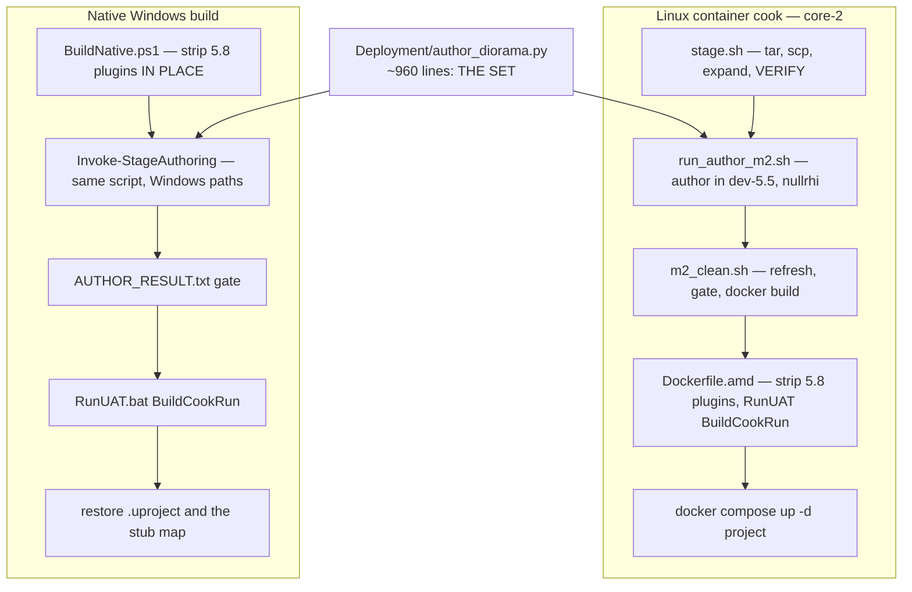

# Build and deploy — two consumers, one definition of the set

> **Written 2026-07-31 against `main` at `dea0437`.** This is the pipeline reference. For *what the
> set contains* — props, lighting, colour, exposure — read
> [`SCENE-AUTHORING.md`](SCENE-AUTHORING.md); this document deliberately does not repeat it.

---

## 1. The shape of the problem

The map is **generated, never committed**. `Content/Maps/CompanionStage.umap` in the repo is a
**23 KB stub** and is restored after every native build.

Two reasons, both stated in `Scripts/BuildNative.ps1`:

> The set is DEFINED by ~960 lines of layout, lighting and material logic. Committing the `.umap`
> would freeze a build artifact as source and guarantee it drifts from the script the moment anyone
> edits the set […] It is also ~900 MB of Nia content behind it, and a `.umap` is
> **ENGINE-VERSION-SPECIFIC**: one authored by 5.8 here cannot be loaded by the 5.5 cook on core-2.
> So the map stays generated, and this function makes the native build generate it the same way the
> container does — **one source of truth, two consumers**.

`Deployment/author_diorama.py` is that source of truth. Both pipelines run **the same script**; the
only thing that differs is where its inputs live, and that is indirected through environment
variables so neither consumer can quietly diverge.



### 1.1 The seam: five environment variables

| Variable | Container default | Windows override |
|---|---|---|
| `MHLLM_GLB_DIR` | `/glb` | `C:\devel\llm-metahuman\scene\glb` (or `-GlbDir`) |
| `MHLLM_MH_DIR` | `/mh` | `Deployment\metahuman` |
| `MHLLM_AUDIO_DIR` | `/audio` | `Deployment\audio` |
| `MHLLM_GEN_DIR` | *`GLB_DIR`* | `Deployment\generated` |
| `MHLLM_AUTHOR_RESULT` | `/out/AUTHOR_RESULT.txt` | `Saved\AUTHOR_RESULT.txt` |

> Any new external input must be read through here, never hard-coded, or the local build silently
> diverges from the cook again.
> — `author_diorama.py`

`MHLLM_GEN_DIR` defaulting to `GLB_DIR` is itself a scar: `T_CRT_Vector.png` and `S_RoomTone.wav`
existed only inside core-2's props mount, both imports are wrapped in `try/except`, so **every
native build shipped with unpowered CRT screens and a silent machine hall** — and the only evidence
was `There was nothing to import` buried in an authoring log.

---

## 2. The Linux container cook

Canonical path is `stage.sh` → `m2_clean.sh`. `m2_full.sh` is the older `cook-m2` variant.

| Step | Script | Cost | What it does |
|---|---|---|---|
| 0 | `core2/stage.sh` | ~30 s | tar the committed source, `scp` to core-2 under **one canonical name**, expand into `/home/ci/cook-clean`, then **verify the expanded tree** (§4) |
| 1 | `core2/run_author_m2.sh` | ~3 min | author the map in `ghcr.io/epicgames/unreal-engine:dev-5.5` with `-nullrhi`; write `stage-out/Content` + `AUTHOR_RESULT.txt` |
| 2 | `core2/m2_clean.sh` | ~20 min | gate on `SUCCESS`, copy content as **root**, fail fast on a missing map or missing Nia content, `docker build -f Dockerfile.amd`, deploy, grep the logs, curl `:8090` |
| — | `core2/gpu_preview.sh` | ~3–5 min | render the **uncooked** authored map on the real GPU. Skips the cook entirely — the fast lighting/material loop |

Notes that are not obvious from the scripts:

- **File operations run as root inside a container.** The UE container writes authored content as
  root, so a host-side `rm -rf`/`cp` as user `ci` half-fails on permissions and leaves a stale tree
  that **silently cooks the wrong content — worse than an outright error.** This trap was paid for
  three times.
- **`Dockerfile.amd` branches on whether a real map was supplied.** `Using the SUPPLIED
  CompanionStage.umap` versus synthesizing a minimal one via `author_companion_stage.py`.
  `m2_clean.sh` asserts the string `SUPPLIED CompanionStage` is present in the Dockerfile before it
  starts, because an older Dockerfile deleted the map unconditionally: `DOCKERFILE_STALE —
  aborting, it would delete the diorama`.
- **The runtime image is `ubuntu:26.04`**, matching the host's Mesa 26.x. Older Mesa gives
  `VK_ERROR_INCOMPATIBLE_DRIVER`. It also bakes a **null ALSA default** into `/etc/asound.conf` —
  without it the audio mixer never leaves "Pre-Initialized", Pixel Streaming has no submix to
  capture, and the negotiated audio track carries digital silence forever.
- **UE refuses to run as root**, and `ubuntu:26.04` already owns uid 1000, so the container user
  `ue4` is uid **1001**.
- **The 5.8-only plugin set is stripped** when the engine minor is < 6, and `GameFeatures` is
  explicitly *added* — see [`LEARNINGS.md`](LEARNINGS.md) L9.

### 2.1 Deployment

```
docker compose -f docker-compose.yml \
               -f docker-compose.amd.yml \
               -f docker-compose.ollama.yml \
               -f docker-compose.face.yml up -d project
```

| Service | Image | Ports | Role |
|---|---|---|---|
| `signalling` | `pixel-streaming-signalling-server:5.5` | `8090` player, `8888` streamer | serves `player.html` (ours, mounted over the stock page) |
| `turnserver` | `coturn:4.6.2` | `3478` | ICE relay when a direct path fails |
| `oidc-proxy` | `oauth2-proxy:v7.6.0` | `8095` | the login gate. **Has never worked** |
| `project` | `ci/metahuman-local-llm:5.5-face` | host net | the packaged app |

`docker-compose.face.yml` is an **overlay that contributes only an `environment:` block** — no
ports, no volumes. It is the file that turns a diorama into a companion.

Two switches with reasons:

- **`-ForceRes` is deliberately absent** from the AMD overlay: it pins the backbuffer and silently
  defeats the frontend's `MatchViewportRes`.
- **VP8 software encode.** HW encode is NVENC (NVIDIA) or AMF (AMD); on AMD/RADV/Linux neither
  works. Acceptable at 720p, and a documented trade-off rather than a bug.

⚠️ **`docker compose up -d project` is a no-op when the config hash is unchanged.** It reports
`Running` and restarts nothing. Cycling a container needs an explicit `docker restart`.

---

## 3. The native Windows build

`Scripts/BuildNative.ps1 -Platform Win64 -Engine 'C:\Program Files\Epic Games\UE_5.5'`

| Step | Why it exists |
|---|---|
| Platform guard | `Mac` exits 2 — Apple provides no cross-compiler. `Linux` without `C:\UnrealToolchains` exits 2 and points at the container |
| Strip 5.8-only plugins **in place**, restore in `finally` | Cooking a *renamed* copy writes output to `Saved/Cooked/Windows/<name>.build/` while staging still looks under `<name>/` — *"Cook and stage disagreed on the project name and only the second one noticed"* |
| Delete `Intermediate/ShaderAutogen` | Written by whichever **engine** last opened the project. A 5.8-generated `AutogenShaderHeaders.ush` reused by the 5.5 shader compiler fails with errors naming engine internals and nothing about this project |
| Back up the committed stub map | Restored in `finally`; `-KeepAuthoredMap` opts out. *"Do not commit it."* |
| `Invoke-StageAuthoring` | Copies Nia's content (**copied, not junctioned** — authoring re-saves what it loads, and a junction would rewrite the source project's own assets), purges stale imports, runs the same `author_diorama.py` |
| **The authoring gate** | §4.2 |
| `RunUAT.bat BuildCookRun … -ubtargs=-NoHotReloadFromIDE` | Live Coding's mutex is keyed on the **executable**, and every project's editor target is the same `UnrealEditor.exe` — so an editor open on an *unrelated* project blocks packaging this one |

Every UAT switch is an explicitly-quoted string: a bare `-platform=$Platform` token is **not
interpolated by PowerShell in argument mode** and reaches UAT as the literal `"$Platform"`.

---

## 4. The verification gates

Both pipelines refuse to spend 20+ minutes on a tree they have not checked. This is the single
highest-leverage practice in the repo.

### 4.1 `stage.sh` — the staging gate

> Exists because the same failure has now happened three times: a fix is written, staged to a path
> nothing reads, and a 25-minute cook silently builds the previous revision.

It verifies the **expanded** tree, not the tarball — *"it inspects what the compiler will actually
read"* — and it checks for **named symbols**, because *"a file can be present and still be the OLD
revision, which is the exact failure this script exists to stop"*.

| Kind | Target | Meaning |
|---|---|---|
| file | `Avatar/CompanionStageDirector.cpp` | stage director present |
| file | `Avatar/CompanionRuntimeSubsystem.cpp` | companion runtime present |
| file | `Voice/KokoroTextToSpeech.cpp` | Kokoro TTS present |
| symbol | `SCompanionHUD.cpp` ∋ `RestoreInputFocusIfLost` | the focus guard is *this* revision |
| symbol | `SCompanionHUD.cpp` ∋ `EButtonClickMethod::MouseDown` | Send fires on press |
| symbol | `CompanionRuntimeSubsystem.cpp` ∋ `RearmChatFocus` | the focus timer is present |
| grep | `docker-compose.face.yml` ∋ `MHLLM_OPENING_LINE` | the compose carries the opening line |
| grep | `author_diorama.py` ∋ `CAM_DIST = 160` | the solved framing survived staging |

```
[ "$FAIL" -eq 0 ] || { echo "STAGE_FAILED — refusing to cook a stale tree"; exit 1; }
echo "STAGE_OK"
```

### 4.2 `AUTHOR_RESULT.txt` — the authoring gate

The Windows equivalent, and it gates on **content**, not on `$LASTEXITCODE` — the commandlet exits
non-zero on error count alone. Each condition corresponds to something that has actually shipped
empty:

| Assertion | The failure it catches |
|---|---|
| starts with `SUCCESS` | `new_level()` **refuses to overwrite**, returns `False`, the run authors into an untitled transient level, the save fails — and the script printed SUCCESS anyway because that line was unconditional |
| `resident: NIA placed` | a cooked build with sky, ground and nobody in it |
| `CRT vector displays placed: [1-9]` | *"Match the COUNT, not just the words"* — three empty actors and a cheerful success line |
| `room tone placed` | a silent machine hall |
| `exposure PINNED at EV100` | 3.5 stops of overexposure that **failed silently for weeks**, because nothing in any log distinguishes a lit room from a blown one |
| map exists and is **> 200 KB** | *"that is the empty stub, not the set"* |

`m2_clean.sh` adds its own fail-fast pair before the cook: `NO_MAP` and `NO_NIA_CONTENT`.

---

## 5. Verification after deploy

**Always verify with pixels, not logs.** `LoadMap complete` and `HTTP 200` prove the stream is up,
not that it shows anything.

| Tool | Measures | Verdict line |
|---|---|---|
| `cap2.mjs` / `cap5.mjs` | decoded WebRTC frame → canvas → `meanLuma`, `maxLuma` | `STATS:` |
| `cap_audio.mjs` | **audio energy** via `AnalyserNode` RMS over 25 s | `AUDIO_RESULT` |
| `cap_audio2.mjs` | patches `RTCPeerConnection` before page scripts; reads receivers and `getStats` `inbound-rtp` — `bytesReceived`, `packetsReceived`, `totalAudioEnergy` | `AUDIO2` |
| `chat_ps.mjs` | five labelled browser input phases (§[`USER-FLOWS.md`](USER-FLOWS.md)) | `SHOT`, then container-log greps |
| `gpu_preview.sh` | uncooked map on the real GPU | `RENDER_OK` / `NO_RENDER` |

Reference values: `meanLuma ~0.03` is black; `~117` is a correctly exposed scene; `~221` was the
overexposed build. `totalAudioEnergy 0.0739` over 70 s is real speech; `0.0` is a live track
carrying silence.

> When checking which way a character faces, look for **eyes** — a yaw error survived weeks of
> "verified" because nobody looked for a face.

Captures use `drawImage(video, …)` onto a canvas, **not** a page screenshot: a page screenshot of a
WebRTC surface can come back blank, and the decoded frame is what the viewer actually sees.

---

## 6. Durability — the part that is not solved

`docker system prune --volumes --all --force` appears repeatedly in core-2's shell history, and the
box reboots. Each occurrence destroys the cooked app, the 24 GB preview image and the 85 GB
`dev-5.5` base. Filesystem content under `/home/ci/` survives; Docker state does not.

| Consequence | Status |
|---|---|
| Restoring the stream costs an 85 GB pull plus a 20-minute cook | **Open.** Pushing the cooked image to a registry, or `docker save` to `/home/ci`, would make it a pull |
| Nothing restarts the stream after a reboot | **Open.** The CI ecosystem containers come back because they carry restart policies; ours do not |
| The build scripts once existed only on the server | **Fixed** — they are committed under `Deployment/core2/`. *"Filesystem content survives those wipes, so nothing has been lost yet. That is luck rather than design."* Copy them to `/home/ci/`; do not edit the server copies in place |
| Shell scripts are pinned to LF via `.gitattributes` | **Fixed.** Checked out with CRLF on Windows and shipped there, bash fails with errors that name the shell rather than the line endings — `set: pipefail: invalid option name` off the very first line |
