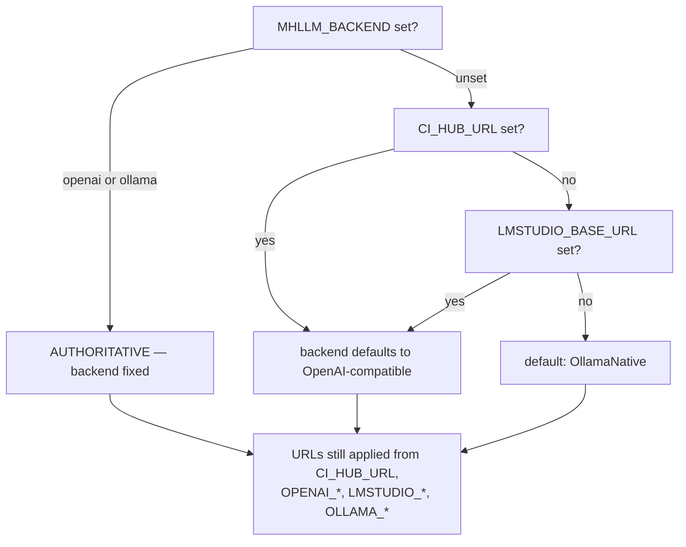

# Configuration reference

> **Written 2026-07-31 against `main` at `dea0437`.** Sources of truth, in this order:
> `Deployment/docker-compose.face.yml` (what a real deployment sets),
> `Private/Settings/MetaHumanLLMEnvConfig.cpp` (what the app reads and in what order), and
> `Public/Settings/MetaHumanLLMSettings.h` (the C++ defaults if nothing is set).
>
> `KOKORO_ALIGNER_URL` is marked **`IN FLIGHT`** — the setting exists but its consumer was still
> uncommitted at the time of writing, and it is not in the compose.

---

## 1. Two reading mechanisms

| Mechanism | Applies | Reads |
|---|---|---|
| `FMetaHumanLLMEnvConfig::Apply` | once, at module `StartupModule` | endpoints, models, persona — everything that lands on `UMetaHumanLLMSettings` |
| `CICompanionEnv::{Get, IsEnabled, IsDisabled}` | at subsystem `OnWorldBeginPlay` | the behavioural switches: HUD, console, camera, self-test |

Conventions that are easy to get wrong:

| Helper | True for | Everything else |
|---|---|---|
| `IsDisabled(Name)` | `0`, `false` | treated as **enabled** |
| `IsEnabled(Name)` | `1`, `true` | treated as **disabled** |
| `StageOptedIn(Name)` | `1`, `true`, `yes`, `on` | treated as **off** |

**Unset always means "default", never "off".** A typo in an opt-in variable therefore silently
gives you the safe behaviour, which is the intended direction of failure.

---

## 2. Backend selection — the precedence that matters

Applied strictly in this order, each overwriting the last when non-empty:

`MHLLM_BACKEND` → `CI_HUB_URL` → `CI_HUB_TOKEN` → `CI_HUB_MODEL` → `OPENAI_BASE_URL` →
`OPENAI_MODEL` → `OPENAI_API_KEY` → `LMSTUDIO_BASE_URL` → `LMSTUDIO_MODEL` → `OLLAMA_BASE_URL` →
`OLLAMA_MODEL` → `MHLLM_THINKING` → `KOKORO_SERVER_URL` → `KOKORO_MODEL` → `KOKORO_VOICE` →
`KOKORO_ALIGNER_URL` → `WHISPER_ENDPOINT_PATH` → `WHISPER_SERVER_URL` → `WHISPER_MODEL` →
`PIPER_SERVER_URL` → `MHLLM_SYSTEM_PROMPT` → `MHLLM_MAX_TURNS` → `MHLLM_MEMORY` →
`MHLLM_MEMORY_PATH` → `MHLLM_CHAT_TIMEOUT`

> An **unrecognised** `MHLLM_BACKEND` is now logged at Warning and ignored, and the value is
> trimmed before matching. Previously `" ollama "` — which is what a compose file produces when it
> interpolates an unset variable — matched neither branch, fell through silently, and handed the
> backend straight back to the incidental `CI_HUB_URL` the paragraph below warns about.

> An explicit `MHLLM_BACKEND` is **AUTHORITATIVE** and outranks the `CI_HUB_URL` inference below.
> It used to be the other way round, and the result was that `MHLLM_BACKEND` did nothing whenever
> `CI_HUB_URL` happened to be set — which the base compose always sets. […] **A specific,
> deliberate signal must beat an incidental one.**
> — `MetaHumanLLMEnvConfig.cpp`

---

## 3. Cognition

| Variable | Compose default | C++ default | What it does |
|---|---|---|---|
| `MHLLM_BACKEND` | `ollama` via `docker-compose.ollama.yml`; `openai` in the base file | `OllamaNative` | `openai` or `ollama`, case-insensitive. Anything else is ignored |
| `OLLAMA_BASE_URL` | `http://127.0.0.1:11435` | `http://127.0.0.1:11434` | `:11435` is the SSH tunnel to beta-1. Client appends `/api/chat` |
| `OLLAMA_MODEL` | `qwen3.6:27b` | `llama3.2` | Measured: `qwen3.6:27b` **814 ms**, `qwen3:8b` **262 ms** (both beta-1, thinking off); `gemma4:e2b` ~12 s on core-2 |
| `MHLLM_THINKING` | `0` | `false` | `1` re-enables chain-of-thought. **~20× latency** (814 ms → 16–21 s) for reasoning nobody reads — Ollama returns it in a separate `thinking` field that never reaches the mouth |
| `CI_HUB_URL` | `http://127.0.0.1:11434/v1` (base compose) | `http://127.0.0.1:11434/v1` | OpenAI-compatible base URL, up to and including `/v1`. Not the Hub's own address: CI-Hub **does not proxy inference**, it distributes the backend's address over `/api/inference/apps/<slug>/credentials` — see [`COMPAT-AND-ECOSYSTEM-REVIEW.md`](COMPAT-AND-ECOSYSTEM-REVIEW.md) §3 |
| `CI_HUB_TOKEN` | `ollama` / historically `change-me-hub-token` and the literal `__NEEDS__` | empty | Bearer token. Ollama's `/v1` validates nothing, so the literal is a placeholder that works |
| `CI_HUB_MODEL` | `llama3.2` | `llama3.2` | Hub model id |
| `OPENAI_BASE_URL` | `http://127.0.0.1:11435/v1` (face) / derived from `CI_HUB_URL` (base) | — | Vendor-neutral alias, applied **after** `CI_HUB_*` so an explicit value wins over an inherited one. The face stack sets it because the base stack selects the `openai` backend, which ignores `OLLAMA_*` |
| `OPENAI_MODEL` | `qwen3.6:27b` (face) / derived from `CI_HUB_MODEL` | `llama3.2` | |
| `OPENAI_API_KEY` | `ollama` (face) / derived from `CI_HUB_TOKEN` | empty | Header sent only when non-empty |
| `LMSTUDIO_BASE_URL` | — | — | Setting it alone selects the OpenAI path and forces the key to `lm-studio` if none is set — LM Studio ignores the key but 401s without a header |
| `LMSTUDIO_MODEL` | — | — | |
| `MHLLM_SYSTEM_PROMPT` | the Eliza persona | a generic companion prompt | **Must agree with `MHLLM_OPENING_LINE`** or her first two sentences introduce two different characters |

---

## 4. Voice

| Variable | Compose default | C++ default | What it does |
|---|---|---|---|
| `KOKORO_SERVER_URL` | `http://127.0.0.1:13305` | **empty** | AMD Lemonade base URL. **Empty ⇒ the character keeps `UNullTextToSpeech` and is mute** while the audio track still negotiates and carries digital silence forever |
| `KOKORO_MODEL` | `kokoro-v1` | `Kokoro-82M-ONNX` | TTS model id |
| `KOKORO_VOICE` | `af_sky` | `af_sky` | Per-request; change freely. `af_sky` measured cleanest of those tried |
| `KOKORO_ALIGNER_URL` **`IN FLIGHT`** | *(not in the compose)* | **empty** | `kokoro-align` sidecar, e.g. `http://127.0.0.1:13400`. Blank means precision loss, never failure — lip-sync falls back to rescaling the estimate |
| `WHISPER_SERVER_URL` | `http://127.0.0.1:13305` | **empty** | Same Lemonade endpoint as TTS. Blank keeps the Null STT stub |
| `WHISPER_ENDPOINT_PATH` | `/api/v1/audio/transcriptions` | `/inference` | whisper.cpp serves `/inference`; **Lemonade serves the OpenAI shape**, hence the explicit override |
| `WHISPER_MODEL` | *(set it to `Whisper-Base`)* | **empty** | Sent as the multipart `model` field, and **omitted entirely when blank**. whisper.cpp hosts one model and ignores it; the OpenAI shape **requires** it and rejects the request without one — so against Lemonade this must be set or every transcription fails with a 4xx that, until now, was logged at `Verbose` and therefore invisible |
| `PIPER_SERVER_URL` | — | empty | Alternative TTS, only selected when Kokoro is unset. Drives the dead Blueprint viseme path |

⚠️ The Kokoro/Whisper API is served under **`/api/v1/...`**, not the `/v1/...` the marketing
implies — verified by probe against a running instance, not assumed.

---

## 5. Behaviour switches

| Variable | Compose default | Effect |
|---|---|---|
| `MHLLM_COMPANION` | *(unset = on)* | `0` disables the whole conversational brain |
| `MHLLM_HUD` | *(unset = on)* | `0` suppresses the chat HUD |
| `MHLLM_CONSOLE` | `0` | `1` opens the operator console at startup. `/console` toggles it live |
| `MHLLM_GREETING` | `none` | An LLM-generated opening turn on a 5 s timer. **Default `none`** because the opening is now scripted, and two greetings collide |
| `MHLLM_FACE_PROFILE` | `CC` (hard-coded) | `CC` = Reallusion Character Creator; `ARKit` = MetaHuman. **The two share no curve names** — anything unrecognised silently becomes `CC` |
| `MHLLM_FACE_SELFTEST` | `0` (hard-coded) | Cycles all 15 visemes. Off deliberately: with it on the mouth moves whether or not the LLM ever replies, masking the exact failure the deployment exists to expose |
| `MHLLM_EMOTION` | `1` | `0` disables facial emotion. Deliberately opt-**out**, unlike `MHLLM_OPENING_SHOT`: *"an expressionless face is the regression"*. Set to `0` to isolate a lip-sync problem from an expression problem in a capture |
| `MHLLM_GAZE` | *(unset = on)* | `0` disables eye aim, saccades and the planning aversion. Opt-**out** for the same reason `MHLLM_EMOTION` is: a dead stare is the regression this fixes. Set to `0` to isolate an eye problem from a lip-sync one |

---

## 5.1 Conversation shape and memory

| Variable | Default | Effect |
|---|---|---|
| `MHLLM_MAX_TURNS` | `24` | Retained user+assistant **pairs**, excluding the system prompt. `0` = unlimited. `/api/chat` has no server-side session, so the entire transcript is re-sent every turn: uncapped, each turn costs more than the last until the request overruns the context window, at which point the server truncates **from the front** and the first thing lost is the persona. She does not error — she stops being Eliza |
| `MHLLM_MEMORY` | `0` | `1` persists the conversation across sessions. **Opt-in, deliberately**: turning it on writes everything anyone says to this companion to disk in plain text, indefinitely. Reasonable for an operator to choose, unreasonable to choose on their behalf — a kiosk must not quietly accumulate transcripts of its visitors |
| `MHLLM_MEMORY_PATH` | *(empty)* | Absolute path for that transcript. Blank uses `Saved/Companion/Conversation.json`, which survives a cook and is never packaged into one |
| `MHLLM_CHAT_TIMEOUT` | `180` | Seconds before a chat request is abandoned. `0` keeps the engine default. Neither client set a timeout at all, so a backend that accepted the connection and then went quiet left the HUD on `thinking...` for the rest of the session, with no error and no way back short of a restart |

The persona is **never** written to the memory file — only the turns. Persisting it would pin
whatever prompt was live when the file was first created, so a later `MHLLM_SYSTEM_PROMPT` change
would be silently ignored on every machine that had already held one conversation.

---

## 6. Staging and camera

| Variable | Compose default | Effect |
|---|---|---|
| `MHLLM_OPENING_SHOT` | `0` | **Opt-in.** `1` plays the flythrough; unset/empty/`0`/typo all mean a static camera on the solved framing |
| `MHLLM_OPENING_LINE` | `Welcome to Companion Intelligence, I'm Eliza. How can I help you?` | Spoken **verbatim**, never generated |
| `MHLLM_OPENING_DELAY` | `3.0` | Held before the move. Pixel Streaming clients take ~10 s to negotiate |
| `MHLLM_FLY_SECONDS` | `11.0` | Flythrough duration |
| `MHLLM_OPENING_REPLAY` | `0` | Attract-loop period in seconds; `0` = once only |
| `MHLLM_FREE_LOOK` | `0` | **Opt-in.** `1` hands input to the `DefaultPawn` — and then any stream viewer can drag the shot off the subject. Note it also has to move the *view target*: un-ignoring input while the view stays welded to a static camera actor is why this switch once read as inert |

---

## 7. Authoring (headless Python)

| Variable | Container default | Windows value |
|---|---|---|
| `MHLLM_GLB_DIR` | `/glb` | `C:\devel\llm-metahuman\scene\glb` or `-GlbDir` |
| `MHLLM_MH_DIR` | `/mh` | `Deployment\metahuman` |
| `MHLLM_AUDIO_DIR` | `/audio` | `Deployment\audio` |
| `MHLLM_GEN_DIR` | `MHLLM_GLB_DIR` | `Deployment\generated` |
| `MHLLM_AUTHOR_RESULT` | `/out/AUTHOR_RESULT.txt` | `Saved\AUTHOR_RESULT.txt` |
| `MHLLM_NIA_CONTENT` | — | `..\CharacterCreatorNia\Content\CC_ControlRig_Nia` or `-NiaContent` |

---

## 8. Infrastructure and container

| Variable | Default | Purpose |
|---|---|---|
| `UE_RELEASE` / `UE_RELEASE_SHORT` | `5.8` | Image tag and `--build-arg RELEASE`. **The shipped cook uses 5.5** |
| `PROJECT_DOCKERFILE` | `Deployment/Dockerfile` | Set to `Deployment/Dockerfile.amd` on core-2 |
| `SIGNALLING_IMAGE` | `…signalling-server:5.5` | Epic publishes only `:5.5` |
| `PUBLIC_IP` | auto-detected by `run.sh` | `--publicIp` and the TURN ICE URL |
| `TURN_USER` / `TURN_PASSWORD` | `ci-agent` / `change-me-turn-password` | coturn credentials |
| `STREAM_RES_X` / `STREAM_RES_Y` | `720` / `1280` | **Portrait** — the product is a video call |
| `RENDER_GID` / `VIDEO_GID` | `992` / `44` | `/dev/dri` access by **numeric GID** — the group *names* do not exist in the container |
| `LIBVA_DRIVER_NAME` | `radeonsi` | VAAPI encoder driver |
| `VK_ICD_FILENAMES` | `/usr/share/vulkan/icd.d/radeon_icd.json` | Note: **not** `…x86_64.json`. Wrong path = zero ICDs = `VK_ERROR_INCOMPATIBLE_DRIVER` |
| `RADV_DEBUG` | empty | Last software lever for the Strix Halo RADV wall |
| `XDG_RUNTIME_DIR` | `/tmp` | Vulkan/offscreen runtime dir |
| `KOKORO_REPO` | `onnx-community/Kokoro-82M-v1.0-ONNX-timestamped` | Aligner sidecar model repo |
| `KOKORO_MODEL_FILE` | `onnx/model.onnx` | **Not** `model_q8f16.onnx` — that one *segfaults* the CPU execution provider on load (exit 139, no traceback) |
| `CI_PORTAL_*`, `OIDC_COOKIE_SECRET` | placeholders | oauth2-proxy. **Never worked** — issuer was wrong and the secret is still a placeholder |

---

## 9. Known configuration hazards

| Hazard | Detail |
|---|---|
| **`.env.example` is stale** | It documents `CI_HUB_*`, `WHISPER_SERVER_URL`, `PIPER_SERVER_URL`, `MHLLM_SYSTEM_PROMPT` — and **none** of `OLLAMA_*`, `KOKORO_*`, `WHISPER_ENDPOINT_PATH`, or the ten `MHLLM_*` staging/face variables. Copying it and running the face stack gives you every face-layer default rather than a documented choice |
| **`kokoro-align-tunnel.service`'s own header contradicts `core2/README.md`** | The unit calls itself *"as load-bearing for lip-sync as :13305 is for audio"*; the README says the aligner *"has no consumer in the shipped build"*. **The README is correct at HEAD**; the unit's comment is aspirational and describes the `IN FLIGHT` state |
| **Duplicate YAML keys win silently** | A duplicated `KOKORO_SERVER_URL` block once sat in the compose. YAML takes the last value with no warning, so the two were not in conflict — but the next person to edit the first pair would have been debugging why it had no effect |
| **The env-config header comment is incomplete** | `MetaHumanLLMEnvConfig.h`'s doc block lists ~8 variables; the `.cpp` reads ~19. The `OPENAI_*`, `LMSTUDIO_*`, `KOKORO_*`, `WHISPER_ENDPOINT_PATH` and `MHLLM_THINKING` entries were added without updating it |
