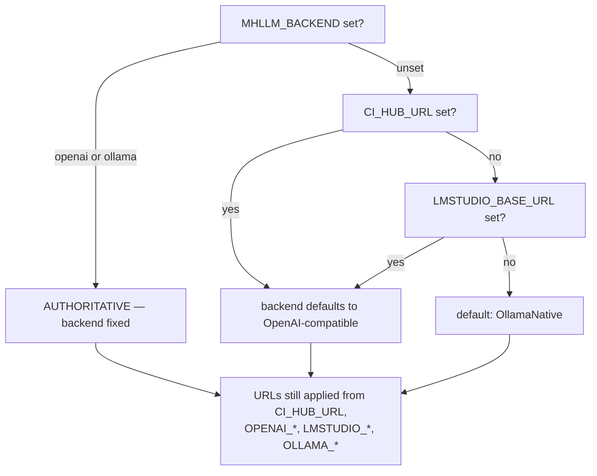

# Configuration reference

> **Written 2026-07-31 against `main` at `dea0437`; every row re-audited against source on branch
> `fix/ci-backends-and-tts`.** Sources of truth, in this order:
> `Deployment/docker-compose.face.yml` (what a real deployment sets),
> `Private/Settings/MetaHumanLLMEnvConfig.cpp` (what the app reads and in what order), and
> `Public/Settings/MetaHumanLLMSettings.h` (the C++ defaults if nothing is set).
>
> **What "compose default" means in these tables.** Each such cell was checked by rendering
> `docker compose config` with **no `.env` present** — once over `docker-compose.yml` alone, and
> once over the `-f yml -f amd -f ollama -f face` merge — so the cells are what the stack actually
> hands the container, not what `.env.example` suggests. Several variables are passed through as a
> bare `${VAR}` with no fallback and therefore render **empty**; where `.env.example` supplies a
> value the compose does not, the row says so. The distinction is load-bearing, because `.env`
> reaches the app through `env_file` and a copied `.env.example` changes these answers.

---

## 1. Two reading mechanisms

| Mechanism | Applies | Reads |
|---|---|---|
| `FMetaHumanLLMEnvConfig::Apply` | once, at module `StartupModule` | endpoints, models, persona — everything that lands on `UMetaHumanLLMSettings` |
| `CICompanionEnv::{Get, IsEnabled, IsDisabled}` | at subsystem `OnWorldBeginPlay` | the behavioural switches: HUD, console, camera, self-test |

Conventions that are easy to get wrong:

| Helper | True for | Everything else |
|---|---|---|
| `IsDisabled(Name)` | `0`, `false` | treated as **enabled** |
| `IsEnabled(Name)` | `1`, `true` | treated as **disabled** |
| `StageOptedIn(Name)` | `1`, `true`, `yes`, `on` | treated as **off** |

**Unset always means "default", never "off".** A typo in an opt-in variable therefore silently
gives you the safe behaviour, which is the intended direction of failure.

---

## 2. Backend selection — the precedence that matters

Applied strictly in this order, each overwriting the last when non-empty:

`MHLLM_BACKEND` → `CI_HUB_URL` → `CI_HUB_TOKEN` → `CI_HUB_MODEL` → `OPENAI_BASE_URL` →
`OPENAI_MODEL` → `OPENAI_API_KEY` → `LMSTUDIO_BASE_URL` → `LMSTUDIO_MODEL` → `OLLAMA_BASE_URL` →
`OLLAMA_MODEL` → `MHLLM_THINKING` → `KOKORO_SERVER_URL` → `KOKORO_MODEL` → `KOKORO_VOICE` →
`KOKORO_ALIGNER_URL` → `WHISPER_ENDPOINT_PATH` → `WHISPER_SERVER_URL` → `WHISPER_MODEL` →
`PIPER_SERVER_URL` → `MHLLM_SYSTEM_PROMPT` → `MHLLM_MAX_TURNS` → `MHLLM_MEMORY` →
`MHLLM_MEMORY_PATH` → `MHLLM_CHAT_TIMEOUT`

> An **unrecognised** `MHLLM_BACKEND` is now logged at Warning and ignored, and the value is
> trimmed before matching. Previously `" ollama "` — which is what a compose file produces when it
> interpolates an unset variable — matched neither branch, fell through silently, and handed the
> backend straight back to the incidental `CI_HUB_URL` the paragraph below warns about.

> An explicit `MHLLM_BACKEND` is **AUTHORITATIVE** and outranks the `CI_HUB_URL` inference below.
> It used to be the other way round, and the result was that `MHLLM_BACKEND` did nothing whenever
> `CI_HUB_URL` happened to be set — which the base compose always sets. […] **A specific,
> deliberate signal must beat an incidental one.**
> — `MetaHumanLLMEnvConfig.cpp`

---

## 3. Cognition

| Variable | Compose default | C++ default | What it does |
|---|---|---|---|
| `MHLLM_BACKEND` | `openai` in the base file; `ollama` pinned by **both** `docker-compose.ollama.yml` and `docker-compose.face.yml`, each as a literal rather than an interpolation, so a later `-f` file's value replaces the base one outright | `OllamaNative` | `openai` or `ollama`, case-insensitive; anything else is logged at Warning and ignored. The face stack pins `ollama` for two measured reasons, both against beta-1 through the same tunnel, same model, same one-line prompt: Ollama's `/v1` shim **ignores** the `chat_template_kwargs` suppression field the OpenAI client now sends (HTTP 200, but a `reasoning` field still comes back), so only `/api/chat` can actually turn reasoning off against *this* server; and the protocol itself costs less — **0.42–0.58 s** over `/api/chat` with thinking off against **1.18–1.23 s** over `/v1` |
| `OLLAMA_BASE_URL` | `http://127.0.0.1:11435` (face) / `http://127.0.0.1:11434` (`docker-compose.ollama.yml`) | `http://127.0.0.1:11434` | `:11435` is the SSH tunnel to beta-1; the direct-Ollama override instead targets the host's own Ollama. Client appends `/api/chat` |
| `OLLAMA_MODEL` | `qwen3.8:27b` (face) / `gemma4:e2b` (`docker-compose.ollama.yml`) | `llama3.2` | Measured warm, thinking off: `qwen3.8:27b` **424–914 ms** on beta-1. Historical, on models beta-1 no longer serves: `qwen3.6:27b` 814 ms, `qwen3:8b` 262 ms; `gemma4:e2b` ~12 s on core-2. **beta-1 serves exactly one model at a time — ask `/api/tags` before pinning a name here, a wrong one 404s silently** |
| `MHLLM_THINKING` | `0` | `false` | `1` re-enables chain-of-thought. Applies to **both** backends: `bEnableThinking` no longer carries an `OllamaNative` `EditCondition`, and `UOpenAIChatClient` threads it into `BuildRequestBody`, which emits a top-level `"chat_template_kwargs": {"enable_thinking": false}` when thinking is off. **What that buys depends on the server.** vLLM honours it — measured against the backend CI-Hub distributes (`cyankiwi/Qwen3.5-35B-A3B-AWQ-4bit` on `:8000`): without the field, `content` comes back **null** with 2118 characters of `reasoning` and `finish_reason: length` after **28.1 s**; with it, `"Hello!"` in **0.335 s**. Ollama's `/v1` ignores it harmlessly (HTTP 200). `api.openai.com` was **not** tested — see `bOpenAISendChatTemplateKwargs` to suppress the field for a gateway that rejects unknown body fields. The Ollama-native `~20×` figure is **historical**, measured on `qwen3.6:27b` (814 ms off vs 16–21 s on) and not re-measured on `qwen3.8:27b` |
| `CI_HUB_URL` | `http://127.0.0.1:11434/v1` (base compose) | `http://127.0.0.1:11434/v1` | OpenAI-compatible base URL, up to and including `/v1`. Not the Hub's own address: CI-Hub **does not proxy inference**, it distributes the backend's address over `/api/inference/apps/<slug>/credentials` — see [`COMPAT-AND-ECOSYSTEM-REVIEW.md`](COMPAT-AND-ECOSYSTEM-REVIEW.md) §3 |
| `CI_HUB_TOKEN` | **none** — the base file passes a bare `${CI_HUB_TOKEN}`, so it renders empty | empty | `.env.example` supplies `ollama`; it supplied `change-me-hub-token` until the commit that repointed the hub URL. Bearer token — Ollama's `/v1` validates nothing, so any non-empty literal works against it |
| `CI_HUB_MODEL` | **none** — bare `${CI_HUB_MODEL}`, renders empty | `llama3.2` | Hub model id. `.env.example` supplies `llama3.2`, which is also the C++ default, so the two agree by coincidence rather than by construction |
| `OPENAI_BASE_URL` | derived from `CI_HUB_URL` in the base file, so it renders `http://127.0.0.1:11434/v1`. **The face stack does not set it** | `http://127.0.0.1:11434/v1` | Vendor-neutral alias, applied **after** `CI_HUB_*` so an explicit value wins over an inherited one. The face stack pins `MHLLM_BACKEND: "ollama"` rather than aliasing the same server under `OPENAI_*`, so it never sets these three at all |
| `OPENAI_MODEL` | derived from `CI_HUB_MODEL`, which has no compose default — so it renders empty. **Not set by the face stack** | `llama3.2` | |
| `OPENAI_API_KEY` | derived from `CI_HUB_TOKEN`, which has no compose default — so it renders empty. **Not set by the face stack** | empty | Header sent only when non-empty |
| `LMSTUDIO_BASE_URL` | — | — | Setting it alone selects the OpenAI path and forces the key to `lm-studio` if none is set — LM Studio ignores the key but 401s without a header |
| `LMSTUDIO_MODEL` | — | — | |
| `MHLLM_SYSTEM_PROMPT` | the Eliza persona | a generic companion prompt | **Must agree with `MHLLM_OPENING_LINE`** or her first two sentences introduce two different characters |

---

## 4. Voice

| Variable | Compose default | C++ default | What it does |
|---|---|---|---|
| `KOKORO_SERVER_URL` | `http://127.0.0.1:13305` | **empty** | AMD Lemonade base URL. **Empty ⇒ the character keeps `UNullTextToSpeech` and is mute** while the audio track still negotiates and carries digital silence forever |
| `KOKORO_MODEL` | `kokoro-v1` | `kokoro-v1` | TTS model id. The C++ default **used to be** `Kokoro-82M-ONNX` — the upstream model's own name, which Lemonade rejects. Only the face compose carried the working override, so every path that skipped that file (a native build, `BuildNative.ps1`, a bare editor run) got a 404 per utterance and a companion that never spoke. The two now agree |
| `KOKORO_VOICE` | `af_sky` | `af_sky` | Per-request; change freely. `af_sky` measured cleanest of those tried. Note the aligner below times against the same voice, so changing it changes both |
| `KOKORO_ALIGNER_URL` | `http://127.0.0.1:13400` (face) | **empty** | `kokoro-align` sidecar. **No longer in flight**: `UKokoroPhonemeAligner` is committed, and `UCompanionRuntimeSubsystem` constructs it whenever this is non-empty, binds its `OnAlignmentReady` delegate and asks it to align each reply. Blank means precision loss, never failure — lip-sync falls back to rescaling the spelling estimate to the clip's measured length, and the log names which of the two it used |
| `WHISPER_SERVER_URL` | `http://127.0.0.1:13305` | **empty** | Same Lemonade endpoint as TTS. Blank keeps the Null STT stub |
| `WHISPER_ENDPOINT_PATH` | `/api/v1/audio/transcriptions` | `/inference` | whisper.cpp serves `/inference`; **Lemonade serves the OpenAI shape**, hence the explicit override |
| `WHISPER_MODEL` | `Whisper-Base` (face) | **empty** | Sent as the multipart `model` field, and **omitted entirely when blank**. whisper.cpp hosts one model and ignores it; the OpenAI shape **requires** it and rejects the request without one — so against Lemonade this must be set or every transcription fails with a 4xx. That 4xx used to be logged at `Verbose`, i.e. invisible in a shipped build; the client now checks the response code and logs it at `Warning` |
| `PIPER_SERVER_URL` | **none** — bare `${PIPER_SERVER_URL}`, renders empty | empty | Alternative TTS. Selection is strictly ordered — Kokoro if its URL is set, else Piper if its URL is set, else the silent `UNullTextToSpeech` — so Piper is only reachable with Kokoro unset. Drives the dead Blueprint viseme path |

⚠️ The Kokoro/Whisper API is served under **`/api/v1/...`**, not the `/v1/...` the marketing
implies — verified by probe against a running instance, not assumed.

---

## 5. Behaviour switches

| Variable | Compose default | Effect |
|---|---|---|
| `MHLLM_COMPANION` | *(unset = on)* | `0` disables the whole conversational brain |
| `MHLLM_HUD` | *(unset = on)* | `0` suppresses the chat HUD |
| `MHLLM_CONSOLE` | `0` | `1` opens the operator console at startup. `/console` toggles it live |
| `MHLLM_GREETING` | `none` | An LLM-generated opening turn on a 5 s timer. **Default `none`** because the opening is now scripted, and two greetings collide |
| `MHLLM_FACE_PROFILE` | `CC` (hard-coded) | `CC` = Reallusion Character Creator; `ARKit` = MetaHuman. **The two share no curve names** — anything unrecognised silently becomes `CC` |
| `MHLLM_FACE_SELFTEST` | `0` (hard-coded) | Cycles all 15 visemes. Off deliberately: with it on the mouth moves whether or not the LLM ever replies, masking the exact failure the deployment exists to expose |
| `MHLLM_EMOTION` | `1` | `0` disables facial emotion. Deliberately opt-**out**, unlike `MHLLM_OPENING_SHOT`: *"an expressionless face is the regression"*. Set to `0` to isolate a lip-sync problem from an expression problem in a capture |
| `MHLLM_GAZE` | *(unset = on)* | `0` disables eye aim, saccades and the planning aversion. Opt-**out** for the same reason `MHLLM_EMOTION` is: a dead stare is the regression this fixes. Set to `0` to isolate an eye problem from a lip-sync one |
| `MHLLM_FACE_GAIN` | *(not in any compose; C++ default `3.0`)* | Gain on the **viseme layer only**. Dials the CC rig's subtle morphs up toward the ceiling `Config/DefaultEngine.ini` already grants the renderer; `1.0` is the historical behaviour. A value `<= 0` is rejected and falls back to `1.0` |
| `MHLLM_FACE_POSE_CAP` | *(not in any compose; C++ default `2.0`)* | Bounds the composed pose so overlapping visemes cannot stack past what the rig was sculpted for. A value `<= 0` is rejected and falls back to `2.0` |

Both face-tuning variables above are read through `CICompanionEnv::Get` at component construction
and appear in no compose file and no `.env.example`, so in practice they are always their defaults.

---

## 5.1 Conversation shape and memory

| Variable | Default | Effect |
|---|---|---|
| `MHLLM_MAX_TURNS` | `24` | Retained user+assistant **pairs**, excluding the system prompt. `0` = unlimited. `/api/chat` has no server-side session, so the entire transcript is re-sent every turn: uncapped, each turn costs more than the last until the request overruns the context window, at which point the server truncates **from the front** and the first thing lost is the persona. She does not error — she stops being Eliza |
| `MHLLM_MEMORY` | `0` | `1` persists the conversation across sessions. **Opt-in, deliberately**: turning it on writes everything anyone says to this companion to disk in plain text, indefinitely. Reasonable for an operator to choose, unreasonable to choose on their behalf — a kiosk must not quietly accumulate transcripts of its visitors |
| `MHLLM_MEMORY_PATH` | *(empty)* | Absolute path for that transcript. Blank uses `Saved/Companion/Conversation.json`, which survives a cook and is never packaged into one |
| `MHLLM_CHAT_TIMEOUT` | `180` | Seconds before a chat request is abandoned. `0` keeps the engine default. Neither client set a timeout at all, so a backend that accepted the connection and then went quiet left the HUD on `thinking...` for the rest of the session, with no error and no way back short of a restart |

The persona is **never** written to the memory file — only the turns. Persisting it would pin
whatever prompt was live when the file was first created, so a later `MHLLM_SYSTEM_PROMPT` change
would be silently ignored on every machine that had already held one conversation.

---

## 6. Staging and camera

| Variable | Compose default | Effect |
|---|---|---|
| `MHLLM_OPENING_SHOT` | `0` | **Opt-in.** `1` plays the flythrough; unset/empty/`0`/typo all mean a static camera on the solved framing |
| `MHLLM_OPENING_LINE` | `Welcome to Companion Intelligence, I'm Eliza. How can I help you?` | Spoken **verbatim**, never generated |
| `MHLLM_OPENING_DELAY` | `3.0` | Held before the move. Pixel Streaming clients take ~10 s to negotiate |
| `MHLLM_FLY_SECONDS` | `11.0` | Flythrough duration |
| `MHLLM_OPENING_REPLAY` | `0` | Attract-loop period in seconds; `0` = once only |
| `MHLLM_FREE_LOOK` | `0` | **Opt-in.** `1` hands input to the `DefaultPawn` — and then any stream viewer can drag the shot off the subject. Note it also has to move the *view target*: un-ignoring input while the view stays welded to a static camera actor is why this switch once read as inert |

---

## 7. Authoring (headless Python)

| Variable | Container default | Windows value |
|---|---|---|
| `MHLLM_GLB_DIR` | `/glb` | `C:\devel\llm-metahuman\scene\glb` or `-GlbDir` |
| `MHLLM_MH_DIR` | `/mh` | `Deployment\metahuman` |
| `MHLLM_AUDIO_DIR` | `/audio` | `Deployment\audio` |
| `MHLLM_GEN_DIR` | `MHLLM_GLB_DIR` | `Deployment\generated` |
| `MHLLM_AUTHOR_RESULT` | `/out/AUTHOR_RESULT.txt` | `Saved\AUTHOR_RESULT.txt` |
| `MHLLM_NIA_CONTENT` | — | `..\CharacterCreatorNia\Content\CC_ControlRig_Nia` or `-NiaContent` |

---

## 8. Infrastructure and container

| Variable | Default | Purpose |
|---|---|---|
| `UE_RELEASE` | `5.8` (from `.env.example`) | The base compose's image tag and its `--build-arg RELEASE`. **It does not reach every stack**: `docker-compose.face.yml` pins `ci/metahuman-local-llm:5.8-face` and `docker-compose.ue55.yml` pins `:5.5`, both literals that override the tag this builds. The face pin now names the same 5.8 this variable carries — deliberately, since `m2_clean.sh` builds `…:5.8-face` and hard-fails with `COMPOSE_IMAGE_MISMATCH` if the two drift — so only the ue55 stack still diverges |
| `UE_RELEASE_SHORT` | `5.8` (from `.env.example`) | **Nothing reads it.** Repo-wide the name occurs only in `.env.example`, in a `docker-compose.yml` comment recording that it is dead, and in this table — no compose file consumes it and no source file reads it. Dead rather than merely undelivered |
| `PROJECT_DOCKERFILE` | `Deployment/Dockerfile` | Set to `Deployment/Dockerfile.amd` on core-2 |
| `SIGNALLING_IMAGE` | `…signalling-server:5.5` | Epic publishes only `:5.5` |
| `PUBLIC_IP` | auto-detected by `run.sh` (via `api.ipify.org`, curl or wget) | `--publicIp` and the TURN ICE URL. `docker-compose.ollama.yml` defaults the signalling service's copy to `127.0.0.1` |
| `TURN_USER` / `TURN_PASSWORD` | `ci-agent` / `change-me-turn-password`, both from `.env.example` — the compose interpolates them with no fallback | coturn credentials |
| `STREAM_RES_X` / `STREAM_RES_Y` | `720` / `1280` (AMD override) | **Portrait** — the product is a video call |
| `RENDER_GID` / `VIDEO_GID` | `992` / `44` (AMD override) | `/dev/dri` access by **numeric GID**, because the group *names* (`render`, `video`) may not exist inside the container. These are core-2's; use `getent group render video` for another host |
| `LIBVA_DRIVER_NAME` | `radeonsi` (AMD override) | VAAPI encoder driver |
| `VK_ICD_FILENAMES` | `/usr/share/vulkan/icd.d/radeon_icd.json` (AMD override) | On the stock Mesa 26 runtime the filename is `radeon_icd.json`, **not** `…x86_64.json`. `docker-compose.mesagit.yml` deliberately uses the `x86_64` spelling because it points into its own `/opt/mesa-git` tree, whose libdir differs — its header says to confirm the path against the actual install. An image with no usable ICD cannot create a Vulkan instance at all: `Dockerfile.editorpreview` records exactly that, every offscreen render aborting at instance creation with `VK_ERROR_INCOMPATIBLE_DRIVER` |
| `RADV_DEBUG` | empty (AMD override) / `llvm,nongg` (mesa-git override) | Last software lever for the Strix Halo RADV wall |
| `XDG_RUNTIME_DIR` | `/tmp` (AMD override) | Vulkan/offscreen runtime dir |
| `KOKORO_REPO` | `onnx-community/Kokoro-82M-v1.0-ONNX-timestamped` | Aligner sidecar model repo |
| `KOKORO_MODEL_FILE` | `onnx/model.onnx` | **Not** `model_q8f16.onnx` — that one *segfaults* the CPU execution provider on load (exit 139, no Python traceback). Full precision runs 6× realtime on this box, so the quantized variants buy nothing |
| `CI_PORTAL_*`, `OIDC_COOKIE_SECRET` | **no longer in `.env.example`** — moved to `.env.edge.example` and renamed to `OAUTH2_PROXY_CLIENT_SECRET` / `OAUTH2_PROXY_COOKIE_SECRET` (still the `change-me-…` placeholders), so the app container stops receiving them | oauth2-proxy, via its own `env_file`. **Never worked**, per `HANDOFF.md` lesson 15: the configured issuer `portal.companionintelligence.com` is NXDOMAIN, and the client id/secret were never registered in CI-Portal. The proxy was not run; only the file contents were checked |

---

## 9. Known configuration hazards

| Hazard | Detail |
|---|---|
| **`.env.example` covers the service config but none of the staging/face switches** | The older complaint that it omits `OLLAMA_*`, `KOKORO_*` and `WHISPER_ENDPOINT_PATH` **no longer holds** — all three are there now, as are `WHISPER_MODEL` and the conversation/memory keys. What it still omits is the behavioural half. Counted by set-differencing the names the plugin reads (`TEXT("MHLLM_…")` across `Plugins/CICompanion/Source`) against the names `.env.example` assigns: **24 read, 8 assigned, 16 unassigned** — `MHLLM_COMPANION`, `MHLLM_HUD`, `MHLLM_CONSOLE`, `MHLLM_GREETING`, `MHLLM_THINKING`, `MHLLM_FACE_PROFILE`, `MHLLM_FACE_SELFTEST`, `MHLLM_FACE_GAIN`, `MHLLM_FACE_POSE_CAP`, `MHLLM_OPENING_SHOT`, `MHLLM_OPENING_LINE`, `MHLLM_OPENING_DELAY`, `MHLLM_OPENING_REPLAY`, `MHLLM_FLY_SECONDS`, `MHLLM_FREE_LOOK` and `MHLLM_OPENAI_CHAT_TEMPLATE_KWARGS`. `MHLLM_OPENING_LINE` is *mentioned* in a comment there but never assigned, so it is still a default rather than a documented choice. Nothing is assigned-but-unread, so there are no dead `MHLLM_*` names. **This count moves whenever a variable is added** — the row was right at 23/15 until `MHLLM_OPENAI_CHAT_TEMPLATE_KWARGS` landed, so re-derive it rather than trusting it. Copying it and running the face stack gives you each of those as a compose or C++ default rather than a documented choice |
| **`kokoro-align-tunnel.service` and `core2/README.md` disagree — and the README is now the stale one** | The unit calls itself *"as load-bearing for lip-sync as :13305 is for audio"*; `core2/README.md` still says the aligner *"has no consumer in the shipped build"* and lists its tunnel as used by "nothing yet". **At HEAD the consumer exists.** `UKokoroPhonemeAligner` is committed; `UCompanionRuntimeSubsystem` constructs it when `KOKORO_ALIGNER_URL` is non-empty, binds `OnAlignmentReady`, calls `RequestAlignment` per reply and feeds the result into the viseme track; and `docker-compose.face.yml` sets the variable. This reverses the verdict this table previously carried |
| **Duplicate YAML keys win silently** | `docker-compose.face.yml` carried two `KOKORO_SERVER_URL` entries at commit `9f16fcc`. Both interpolated the same default, so the two were not in conflict — but YAML takes the last value with no warning, and the next person to edit the first of the pair would have been debugging why it had no effect. No compose file in `Deployment/` has a duplicated environment key today |
| **The env-config header comment is incomplete** | `MetaHumanLLMEnvConfig.h`'s doc block lists **9** variables; `Apply` in the `.cpp` reads **25**. The 16 it does not mention are the `OPENAI_*` and `LMSTUDIO_*` groups, all four `KOKORO_*`, `WHISPER_ENDPOINT_PATH`, `WHISPER_MODEL`, `MHLLM_THINKING`, and the four conversation/timeout keys `MHLLM_MAX_TURNS`, `MHLLM_MEMORY`, `MHLLM_MEMORY_PATH` and `MHLLM_CHAT_TIMEOUT` |
