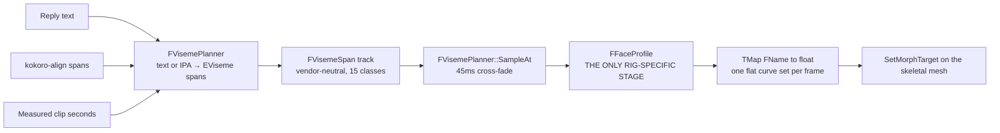
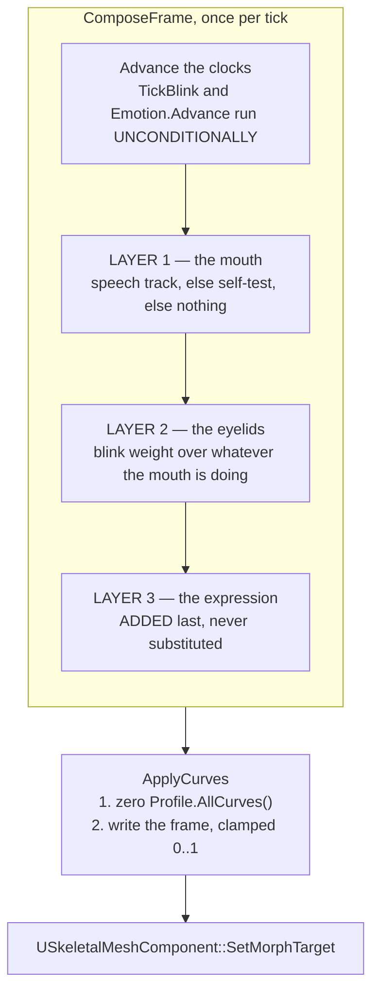

# The face pipeline — how Eliza's face is driven

> **Written 2026-07-31 against `main` at `dea0437`.** Emotion compositing landed in `dea0437`
> while this was being written and is described as committed. Real phoneme alignment
> (`UKokoroPhonemeAligner`, `FVisemePlanner::PlanBest`) was still uncommitted and is marked
> **`IN FLIGHT`** — check `git log` before trusting that to still be pending.
>
> Companion documents: [`ARCHITECTURE.md`](ARCHITECTURE.md) for the turn flow,
> [`ANIMATION-PLAN.md`](ANIMATION-PLAN.md) for the original design rationale (note its ARKit
> tables predate the switch to a Reallusion CC resident — see §3).

---

## 1. The shape of it

There is exactly one rig-specific stage in the whole pipeline, and it is the last one.



> Phoneme → `EViseme` is rig-independent language math; `EViseme` → concrete rig curves is the
> **only** rig-specific stage, and it lives in `FFaceProfile`. Keeping the split here is what lets
> one mapper drive both a Reallusion CC face and a MetaHuman/ARKit face.
> — `FaceProfile.h`

---

## 2. The viseme vocabulary

`EViseme` — 15 classes, the OVR-15 set. **Declaration order is load-bearing**: the interop name
tables and the self-test loop both index by it.

| # | `EViseme` | Phonemes | Articulation |
|---|---|---|---|
| 0 | `Sil` | — | silence / rest |
| 1 | `PP` | p, b, m | bilabial closure |
| 2 | `FF` | f, v | labiodental |
| 3 | `TH` | th | dental, tongue between teeth |
| 4 | `DD` | t, d | alveolar stop |
| 5 | `KK` | k, g | velar |
| 6 | `CH` | ch, j, sh | postalveolar affricate |
| 7 | `SS` | s, z | sibilant, narrow aperture |
| 8 | `NN` | n, l | alveolar nasal / lateral |
| 9 | `RR` | r | retroflex / curled |
| 10 | `AA` | *father* | open |
| 11 | `E` | *bed* | wide, mid |
| 12 | `IH` | *bit* | wide, close |
| 13 | `OH` | *boat* | rounded, mid |
| 14 | `OU` | *boot*, w | rounded, close |

### 2.1 The wire spelling is not the enum spelling

`CIOvr::Names15()` exists so this puppet speaks the same viseme names as the sibling agents
(`CI-Spatial-Companion-WebXR`, `-Unity`, the archived WebSpatial). Mixed case is **not**
cosmetic — it is baked into every Ready Player Me avatar's blendshape list.

| Enum | Wire name | Note |
|---|---|---|
| `Sil` … `RR` | `viseme_sil`, `viseme_PP`, `viseme_FF`, `viseme_TH`, `viseme_DD`, `viseme_kk`, `viseme_CH`, `viseme_SS`, `viseme_nn`, `viseme_RR` | plosives/fricatives uppercase, nasals/velars lowercase — Oculus's own inconsistency, reproduced verbatim |
| `AA`, `E` | `viseme_aa`, `viseme_E` | |
| `IH`, `OH`, `OU` | `viseme_I`, `viseme_O`, `viseme_U` | the only three where UE's spelling diverges |

Two traps pinned by tests rather than by reading:

- **`FName` comparison ignores case in Unreal.** An `FName`-based allow-list cannot verify wire
  spelling at all; the interop layer therefore asserts via `ToString()`.
- **`EARFaceBlendShape` declares 61 enumerators, not 52.** The last nine are `HeadYaw/Pitch/Roll`
  and per-eye `Yaw/Pitch/Roll` — **pose** channels, not blendshapes. Any `i < 52` loop is
  mis-sized. Identical in 5.5.4 and 5.8.1, so this is latent, not a migration issue.

---

## 3. `FFaceProfile` — the CC / ARKit abstraction

A viseme is a **blend**, never a single morph:

> "AA" is an open jaw plus an open mouth shape, and driving only one of them reads as a hinge
> rather than speech.

Each profile carries four *deliberately separate* curve sets:

| Set | Purpose | Why separate |
|---|---|---|
| `Shapes` | viseme → `{curve, scale}` list | the mouth |
| `BlinkCurves` | eyelids | involuntary, own clock |
| `EmotionShapes` | emotion → FACS-ish pose | *"an emotion is a SUSTAINED bias held across a whole utterance, while a viseme is a shape the mouth passes through in ~80 ms. Mixing them into one map would make every reply pick one or the other."* |
| `GazeCurves` | eye look directions | declared; **no driver yet** |

Selection is `FFaceProfile::ByName` — `"ARKit"` case-insensitively, **anything else silently
becomes CC**. Two call sites: `MHLLM_FACE_PROFILE` at `UCompanionFaceSubsystem` startup, and the
operator console's live `ApplySettings`.

### 3.1 The resident is CC-named, not ARKit-named

Probed directly on `SK_Nia` on 2026-07-28:

| Probe | Result |
|---|---|
| ARKit-named morph targets | **0 of 10** sampled present |
| CC viseme morph targets | **15 of 15** present |
| Total morph targets | 286 |

The two vocabularies are **disjoint** — a test asserts it. Setting the wrong profile is not
cosmetic and, worse, is *silent*:

> a rig that has these names in the editor can still ship without them if morph targets are
> stripped at import/cook, and the failure is silent — `SetMorphTarget` on an unknown name is a
> no-op, so the face just never moves.
> — `CompanionFaceComponent.h`

`ResolveCurvesAgainstMesh` exists purely to make that failure loud: it logs
`Face profile 'CC': all N curves resolved on 'SK_Nia'`, or names every missing curve.

### 3.2 CC viseme table (Nia — the shipped profile)

| Viseme | Curves × scale |
|---|---|
| `Sil` | `Mouth_Close` 0.15 |
| `PP` | `V_Explosive` 1.00 |
| `FF` | `V_Dental_Lip` 1.00 |
| `TH` | `V_Tongue_Out` 0.85 + `Jaw_Open` 0.20 |
| `DD` | `V_Tongue_up` 0.90 + `Jaw_Open` 0.15 |
| `KK` | `V_Tongue_Lower` 0.80 + `Jaw_Open` 0.25 |
| `CH` | `V_Affricate` 1.00 |
| `SS` | `V_Tight` 0.90 |
| `NN` | `V_Tongue_Raise` 0.85 |
| `RR` | `V_Tongue_Curl_U` 0.85 + `V_Tight_O` 0.30 |
| `AA` | `V_Open` 1.00 + `Jaw_Open` 0.55 |
| `E` | `V_Wide` 0.80 + `Jaw_Open` 0.30 |
| `IH` | `V_Wide` 0.55 + `Jaw_Open` 0.15 |
| `OH` | `V_Tight_O` 0.80 + `Jaw_Open` 0.35 |
| `OU` | `V_Tight_O` 1.00 + `Jaw_Open` 0.10 |

Blink: `Eye_Blink_L`, `Eye_Blink_R`. Gaze: the eight `Eye_{L,R}_Look_{L,R,Up,Down}` curves.

> The jaw is added separately and **deliberately under-driven**: the `V_*` shapes already imply
> some aperture, and stacking a full `Jaw_Open` on top reads as a puppet hinge.

### 3.3 ARKit profile (MetaHuman — kept for portability)

ARKit has effectively no tongue channels, so `TH`/`DD`/`NN`/`RR` lean on jaw and lip shapes
instead: `AA` is `jawOpen` 0.75 alone, `OU` is `mouthPucker` 0.85 + `jawOpen` 0.12, `PP` is
`mouthPressLeft/Right` 0.70 + `mouthClose` 0.60. Blink is `eyeBlinkLeft/Right`.

`FaceVocabularySpec` validates the whole ARKit profile against the canonical ARKit-52 allow-list —
the `mouthSmileLeft` vs `mouthSmile_L` trap is exactly the kind of typo that reads as a rig bug.

### 3.4 Emotion palettes

Both profiles ship all seven `EEmotionType` poses, all weighted **≤ 0.45** and deliberately
brow/cheek/eye-first rather than mouth-first:

> Deliberately brow/cheek/eye-weighted rather than mouth-weighted, so an expression cannot fight
> the visemes for the same curves and smear the speech.

| Emotion | CC curves |
|---|---|
| `Neutral` | — |
| `Happy` | `Mouth_Smile_L/R` .35, `Cheek_Raise_L/R` .30, `Brow_Raise_Outer_L/R` .15 |
| `Angry` | `Brow_Drop_L/R` .45, `Brow_Compress_L/R` .35, `Eye_Squint_L/R` .20 |
| `Sad` | `Brow_Raise_Inner_L/R` .40, `Mouth_Frown_L/R` .25 |
| `Fear` | `Eye_Wide_L/R` .40, `Brow_Raise_Inner_L/R` .35, `Brow_Raise_Outer_L/R` .25 |
| `Love` | `Mouth_Smile_L/R` .25, `Cheek_Raise_L/R` .20, `Eye_Squint_L/R` .15 |
| `Alert` | `Brow_Raise_Outer_L/R` .35, `Eye_Wide_L/R` .25 |

> A full-strength FACS pose reads as a caricature, and these sit under speech continuously rather
> than flashing, so anything stronger looks unhinged.

---

## 4. Compositing: layers, not competition

The three signals answer different questions and are **summed**, in a fixed order, into one flat
`TMap<FName,float>` per frame.



### 4.1 Why the order is what it is

> Order is load-bearing in both directions. It must come **after** the visemes because
> `FFaceProfile::Accumulate` clamps as it sums, so an emotion accumulated first could be clipped
> away by the speech piled on afterwards. And it must **ADD** rather than replace, because the two
> are answering different questions: the visemes say what shape the mouth is passing through right
> now, the expression says what she means by the sentence. **Choosing between them gives you a face
> that can either talk or feel.**
> — `CompanionFaceComponent.cpp`

Blink composites over speech for the same reason, and its clock runs whether or not she is
talking:

> Blink is involuntary and composites over whatever the mouth is doing, so it is computed every
> frame regardless of speech or self-test state.

`Accumulate` (visemes) sums **and clamps per curve**, so two overlapping visemes sharing
`Jaw_Open` cannot exceed 1. `AccumulateInto` (emotion) sums **without** clamping — the single
clamp happens once, at the point the mesh is written.

### 4.2 The curve-zeroing pass

Every write begins by zeroing the profile's **entire** curve set:

```cpp
// Zero the profile's whole curve set first. Cheaper and far more robust than tracking which
// curves were touched last frame, and it guarantees a shape cannot stick on.
for (const FName& Curve : Profile.AllCurves())
{
    TargetMesh->SetMorphTarget(Curve, 0.0f);
}
for (const TPair<FName, float>& Pair : Curves)
{
    TargetMesh->SetMorphTarget(Pair.Key, FMath::Clamp(Pair.Value, 0.0f, 1.0f));
}
```

`AllCurves()` is the union of Shapes ∪ Blink ∪ Emotion ∪ Gaze **because it is the zeroing set**:

> Blink curves too: `AllCurves` is what the driver zeroes each frame, so omitting them would leave
> a blink latched shut the moment the eyes closed.

The cost is ~20 `SetMorphTarget` calls per frame, so a `bFaceWritten` latch skips the write only
when nothing is shown *and* nothing was shown last frame — preserving the one zeroing pass that
clears the last expression on the way into idle.

### 4.3 Blink timing

| Parameter | Value | Why |
|---|---|---|
| Interval | `FRandRange(2.0, 6.0)` s | *"a fixed interval is immediately legible as a machine"* |
| Duration | 0.12 s | |
| Close | first 40 % of the blink | *"Symmetric linear motion looks mechanical, so the two halves differ"* |
| Open | remaining 60 % | |

> Cheap, and its absence is precisely what makes an otherwise good render read as a mannequin — a
> still face with open eyes looks dead in a way a viewer notices immediately even when they cannot
> say why.

### 4.4 Emotion timing

| Constant | Value | Why |
|---|---|---|
| `DefaultBlendSeconds` | 0.40 s | *"a face that changes in one frame looks like a texture swap, not a reaction"* |
| `DefaultHoldSeconds` | 1.20 s | *"A reaction that vanishes on the last syllable reads as a switch being thrown rather than as a person"* |
| `DefaultSustainSeconds` | 12.0 s | The **backstop**. If the TTS service is down the viseme track never starts and therefore never finishes — *"Without this she would smile for the rest of the session"* |

Re-setting the same emotion retargets intensity; a *different* emotion cross-fades directly rather
than passing through neutral, because happy → neutral → sad takes twice as long and reads as a
double take. `ClearFace()` deliberately **preserves** the expression: clearing means "stop what the
mouth was doing", and wiping the emotional bias would punch a one-frame hole in her face on every
`StopSpeaking()`.

### 4.5 What the layering rewrite fixed

Until `dea0437` the tick was **three separate branches**, each of which had to remember to add
blink for itself. Two of them forgot.

| Branch | Before `dea0437` | After |
|---|---|---|
| Speaking | visemes + blink ✅ | visemes + blink + emotion |
| Idle | blink, but guarded by `if (Blink > 0.0f)` → **the frame that *ends* a blink never wrote 0, latching the eyelids partly closed until the next blink** | one shared `ComposeFrame`, plus the `bFaceWritten` latch so the zeroing pass runs once and clears it |
| Self-test | `ApplyVisemes` only — **blink dropped entirely**, directly contradicting the comment above it | blink survives every branch |

Both defects were identified in
[`COMPAT-AND-ECOSYSTEM-REVIEW.md`](COMPAT-AND-ECOSYSTEM-REVIEW.md) §5 and survived several commits
after that. The real fix was not either guard — it was **collapsing three code paths into one**, so
that there is no longer a branch that can omit a layer.

---

## 5. Sampling and cross-fade

`FVisemePlanner::SampleAt` blends `BlendSeconds = 0.045` (capped at half a span). During a tail the
active viseme fades `1 - α` while the next rises `α`, so **two visemes are simultaneously active**
and their curves sum in `Accumulate`. This is the coarticulation approximation; it is what stops
speech reading as a sequence of discrete poses.

Other planner behaviour worth knowing:

| Behaviour | Detail |
|---|---|
| Rate | `WordsPerMinute = 165`, `LettersPerWord = 4.7` |
| Duration shaping | vowels × 1.45, consonants × 0.8 |
| Punctuation | sentence-end × 6, clause × 3, plain space × 1.2 |
| Digraphs | `th ch sh ph oo ee` collapse by lookahead |
| Repeats | collapse into one longer hold |
| Always | lands on a trailing `Sil` |
| IPA comparison | **case-sensitive, deliberately** — `FString::operator==` is case-insensitive in Unreal, so `S == TEXT("w")` matched misaki's capital `W` (/aʊ/). Caught by a test, not by reading |
| Stress marks | `ˈ ˌ` donate their time forward to the next real shape rather than emitting silence, because stress is voiced as part of the following vowel |

---

## 6. The other lip-sync path, and why it is dead

There are **two** lip-sync systems in this source tree. Only one reaches the shipped avatar.

| | Path A — live | Path B — dead |
|---|---|---|
| Data | `FVisemeSpan` over 15 classes | `FVisemeKey { TimeSeconds, JawOpen }` — one channel |
| Source | Kokoro + planner | `UPiperTextToSpeech::OnVisemeEnvelopeReady` (RMS windows) |
| Consumer | `UCompanionFaceComponent` → `SetMorphTarget` | `AMetaHumanCompanionCharacter::Tick` → `OnSetVisemeWeights` |
| Reachable? | **Yes** | **No** — `OnSetVisemeWeights` is a `BlueprintImplementableEvent` and the subsystem spawns the C++ class directly, so no Blueprint exists to receive it |

Path B is the original "1-DOF jaw flap" that [`ANIMATION-PLAN.md`](ANIMATION-PLAN.md) was written
to replace. It is also, mechanically, why Piper cannot be selected in a working deployment: Piper
is only chosen when `KOKORO_SERVER_URL` is empty, and with Kokoro empty there is no voice at all.

**Also present and not yet reachable:** `FCIWordTimings::ToVisemeTrack()` — the
`{words, wtimes, wdurations}` millisecond envelope the sibling repos pass between TTS and their
viseme generator. Unlike a 165 wpm guess, a track built from measured word windows **cannot drift**
against its audio. It is implemented and unit-tested with no runtime caller.

---

## 7. Self-test

`MHLLM_FACE_SELFTEST=1` (or `-FaceSelfTest`) walks all 15 visemes in enum order, weight
`sin(local × π)` so each eases 0 → 1 → 0 within its slot —

> so a captured frame is unlikely to land on a fully-closed mouth and read as "nothing happened".

It is deliberately **off** in `docker-compose.face.yml`:

> with it on, the mouth moves whether or not the LLM ever replies, so it would mask exactly the
> failure this deployment is meant to expose.

Real speech supersedes it: `PlayVisemeTrack` clears `bSelfTesting`.
