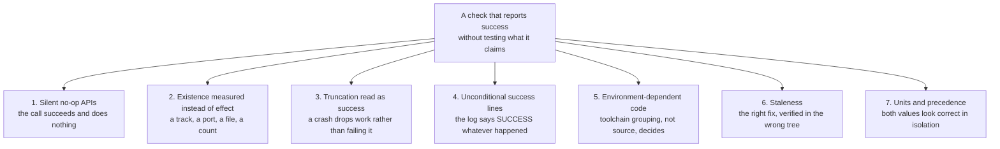

# Learnings — the bugs, their root causes, and what they cost

> **Written 2026-07-31.** Every entry below is traced to a commit on `main` and quotes that
> commit's own post-mortem or the code comment it produced. Nothing here is reconstructed from
> memory; where a claim is a code-reading inference rather than a measurement, it says so.
>
> This supersedes nothing. [`HANDOFF.md`](HANDOFF.md) §1 is still the fifteen-lesson orientation
> read; this file is the evidence behind it and the entries added since.

---

## The thesis

Eighty-six commits over seventeen days produced a lot of distinct bugs with **one recurring
shape**:

> **A check reported success without testing the thing it claimed to test.**

Not a wrong answer — a *confident* answer to a question that was never asked. Five earlier attempts
at the same material bug produced pixel-identical renders because none of them had ever been the
material being drawn. A test suite reported "0 failed" while twenty tests vanished. A tunnel showed
`LISTEN` while nothing was on the far end. An authoring script printed `SUCCESS` on a line that was
unconditional.

The failures cluster:

---

## 1. Silent no-op APIs

The dominant failure mode in this codebase. The call returns, nothing happens, nothing is logged.

### 1.1 A material with no usage flags is replaced by the default gray one

| | |
|---|---|
| **Commit** | `73e1973`, 2026-07-24 |
| **Symptom** | The resident rendered as a flat gray silhouette. **Five** prior fix attempts produced pixel-identical output |
| **Root cause** | Materials built with `MaterialFactoryNew` carry **no usage flags**. Applying such a material to a SkeletalMesh makes UE **silently substitute the DEFAULT material**, logging only `Material with missing usage flag was applied to skeletal mesh` |
| **Why five fixes failed** | *"component `set_material` overrides, in-place mutation of the materials array, fresh `SkeletalMaterial` structs, baked textures, and even a flat constant colour — all produced a pixel-identical gray render: **every one of them used a flag-less material, so none of them was ever the material being drawn.**"* |
| **Fix** | Set `used_with_skeletal_mesh` and `used_with_morph_targets` **before recompile**. Instances inherit from the parent. Warnings went 54 → 0; the face measured `(223,208,184)` |
| **Lesson** | When N fixes produce byte-identical output, stop fixing and ask **whether you are editing the thing being drawn at all**. |

Two follow-ons of the same class: an outfit mesh imported but never spawned (`666781d`) had to be
parented to a flagged material *"so they inherit the skeletal-mesh and morph-target usage flags —
without those it would have rendered default gray for exactly the reason the body just did"*; and
switching to Reallusion CC "Nia" (`8b4dd22`) *"makes the usage-flag bug impossible here: Reallusion
authored these materials for skeletal meshes, so the flags are already set."*

### 1.2 `SetMorphTarget` on a name the mesh lacks

| | |
|---|---|
| **Commit** | `c558ea6`, 2026-07-28 |
| **Root cause** | A silent no-op. The rig can carry these names in the editor and still ship without them if morphs are stripped at import, *"and the only symptom is a face that never moves"* |
| **Fix** | `ResolveCurvesAgainstMesh` counts and **names** every missing curve at startup; `FaceVocabularySpec` guards the spelling in CI |
| **Same commit** | Actor **tag, not label** — *"labels are editor-only and do not survive a cook, so a label lookup would work in the editor and silently find nothing in the shipped build"* |

### 1.3 A closed-vocabulary phonemizer drops words rather than reporting them

| | |
|---|---|
| **Commit** | `4ccaa95`, 2026-07-30 |
| **Symptom** | The brand line was synthesized with **"Eliza" absent, replaced by a bare full stop** |
| **Root cause** | misaki's dictionary is closed-vocabulary and **does not flag a miss**. An out-of-vocabulary word is not reported — it is **dropped** |
| **Fix** | `espeak.EspeakFallback` (clip 4.28 s → 4.75 s), and degrade **loudly** if espeak-ng is missing |
| **Lesson** | *"the character silently failed to say her own name in the brand line, and nothing raised an error."* Any lookup with a closed vocabulary needs an explicit miss path. |

### 1.4 `docker compose up -d` is a no-op on an unchanged config hash

| | |
|---|---|
| **Commit** | `4480553`, 2026-07-30 |
| **Root cause** | *"`docker compose up -d project` was a NO-OP here because the config hash was unchanged, so it reported `Running` and restarted nothing."* |
| **Fix** | Cycling a container needs an explicit `docker restart` |

The same commit's headline bug is the same class: TTS failed with `HTTP 0`, and core-2 showed
`127.0.0.1:13305 LISTEN` owned by a real `ssh` pid — while **nothing** on beta-1 was listening at
all.

> **A half-open forward looks exactly like a working one from the client side**, which is why "the
> port is open" was worthless evidence and only a real `200` settled it.

Compounded by config drift: someone had appended `-L 13305` to the **deployed** `ollama-tunnel.service`
while the repo copy stayed clean — which under `ExitOnForwardFailure=yes` would additionally have
crash-looped Ollama's tunnel. Fixed with two systemd units rather than one, deliberately.

### 1.5 Other silent no-ops, for the pattern file

| API | Silent behaviour | Commit |
|---|---|---|
| `unreal.EditorLevelLibrary.new_level()` | **Refuses to overwrite**, returns `False`, and everything authors into an untitled transient level that cannot be saved | `f517291` |
| `blender transform_apply` on multi-user mesh data | No-op. Shipped a **29-metre "desk terminal"** that enclosed the camera and rendered the whole stream black | `b1180aa` |
| `get_editor_property` returning a struct | Mutating the returned struct **does not persist**. Write back the whole struct | `8b4dd22` |
| `-ForceRes` | Pins the backbuffer and silently defeats the frontend's `MatchViewportRes` | `54b5f95` |
| Interchange glTF material parents | Parent under `/InterchangeAssets/`, i.e. **plugin content the cook does not stage** — so every prop falls back to the engine default in the packaged game and *"looks exactly like textures failed to load"* | `967e302` |

---

## 2. Existence measured instead of effect

### 2.1 A live audio track that nobody could hear

| | |
|---|---|
| **Commits** | `967e302` then `c3c0716`, 2026-07-30 |
| **Symptom** | Audio provably leaves the engine; nothing is audible in the browser |
| **Root cause (engine side)** | `UKokoroTextToSpeech` was *"fully written and unit-tested but never once instantiated"* — the character was **mute by construction**, and the negotiated track carried **peak amplitude 0.0 across 40 seconds** |
| **Root cause (frontend side)** | The video element reported `audioTracks: 0`. The track was on the `RTCPeerConnection` **receivers** all along, never attached to a media element |
| **The trap, twice** | *"the first probe checked only `video.srcObject` and concluded 'no audio track' — wrong, and exactly the trap this class of test exists to avoid."* |
| **Fix** | `cap_audio2.mjs` patches `RTCPeerConnection` before any page script runs and reads receivers plus `getStats()` `inbound-rtp` counters — *"the only view that distinguishes **'not sent', 'sent but silent' and 'sent but not attached'**"* |
| **Proof** | 70 s: `bytesReceived` 303266, `packetsReceived` 3492, `totalAudioEnergy` **0.0739** — against 1773 / 591 / **0.0** for silence |

> **Measuring a track's EXISTENCE and measuring its ENERGY are different tests**, and only the
> second one distinguishes "wired up" from "working".

### 2.2 A container with no audio device

Same family, `967e302`: the container *"has no sound hardware and no ALSA config, so UE's audio
mixer only ever reached 'Pre-Initialized' — **Pixel Streaming had no submix to capture**."* A null
ALSA default is now baked into the image.

### 2.3 A still frame cannot prove liveness

`eb98b3c`: *"every 'is it working?' answer so far has been a single PNG that could equally have been
a frozen render — **which is exactly the mistake that let a back-to-camera pose survive for
weeks.**"* Frames are now assembled into a motion loop, and idle-only motion (17 % frame-to-frame
change from breathing alone) is distinguished from real camera movement.

---

## 3. Truncation read as success

### 3.1 A crashing test run DROPPED tests rather than failing them

| | |
|---|---|
| **Commit** | `4762734`, 2026-07-30 |
| **Symptom** | `132 passed, 0 failed` on a suite that had crashed mid-run |
| **Root cause** | The crash killed the run partway, and because `WavViseme` and `WhisperSpeechToText` **sort last alphabetically, their 20 tests VANISHED rather than failed**. *"'132 passed, 0 failed' looked healthy; it was a truncated run."* |
| **What caught it** | **Only the drop from 149.** Nothing in the output said anything was wrong |
| **Fix** | Every runner now asserts `Started == Completed`, exit code, absence of crash markers, and a non-zero result count |
| **Lesson** | **A pass count alone never establishes a green suite.** State the invariant as an equation, not a number. |

The rule is restated in two later commits — *"209 specs, 209 started and 209 completed, exit code
0, no crash markers — the counts have to match"* — and generalised into
`Scripts/RunTests.Common.ps1` and `core2/run_tests_linux.sh`. See [`TESTING.md`](TESTING.md).

### 3.2 A successful cook that still fails the build

`f1f7c69` / `9f436f1`, 2026-07-31. `LogCook: Display: Done!` appears **first** — every package
cooked — and an `AssetBaseClassLoaded` ensure fires afterwards at engine init. The commandlet exits
1 on the **error count** and UAT reports `Error_UnknownCookFailure(25)`.

> **A successful cook that still fails the build**, which is why searching near the failure for
> "Error:" turns up only callstack frames.

The underlying issue was unwinnable from either side of a `.ini`: keep the asset-manager rule and
`ScanPrimaryAssetTypesFromConfig` cannot load the base class (23 errors); drop it and GameFeatures
complains there is no rule (2 errors). **Neither edit can win** — so the GameFeatures plugin is
enabled project-side instead.

---

## 4. Unconditional success lines

| Commit | The lie | The truth |
|---|---|---|
| `f517291` | `SUCCESS` printed unconditionally after authoring | `new_level()` had returned `False`; sixty actors went into an untitled level and the save failed |
| `f517291` | `if t_body:` guarding a tape-reel spawn | `import_prop()` returns a **tuple**, and `if <tuple>:` is always true. The following call raised a `TypeError` the outer `except` swallowed into a one-line warning — *"That is 'Tape reels spinning: 0', and it was failing on the server too"* |
| `f49dbba` | `CRT vector displays placed` printed unconditionally | A run where `/Engine/BasicShapes/Plane` failed to load spawned three **empty** actors and logged success anyway — *"the same shape of lie as 'Tape reels spinning: 0'"* |

The response was structural rather than per-bug: `BuildNative.ps1` now **fails the build** unless
`AUTHOR_RESULT.txt` reports `SUCCESS`, a placed resident, a **counted** number of CRT screens, room
tone, a pinned exposure, and a map over 200 KB.

> Match the COUNT, not just the words: the authoring line reports "N of 3" precisely so this gate
> can tell "placed three screens" from "placed nothing and said so cheerfully".

---

## 5. Environment-dependent code: the toolchain decides, not the source

### 5.1 Unity builds merge anonymous namespaces

| | |
|---|---|
| **Commits** | `0079f3b`, then `f2b8a8a`, then `3eeed4e` — **three occurrences** |
| **Root cause** | An anonymous namespace guarantees internal linkage **per translation unit** — but Unreal's unity build concatenates several `.cpp` files **into one TU**, at which point those namespaces merge and duplicate definitions collide |
| **First** | `DEFINE_LOG_CATEGORY_STATIC(LogCompanionFace)` in two files → `error C2011: type redefinition` on MSVC, *"which then cascaded into a dozen unrelated-looking C2664/C2027 errors at every use site — none of which pointed at the actual cause"* |
| **Second** | `GetEnv`/`EnvDisabled`/`EnvEnabled` duplicated in three files → `error C2084: function already has a body` |
| **Third (inverse)** | A file used `LogCompanionScene` with no declaration anywhere: **HEAD did not build**, on every engine and platform, because the file was committed after the last packaging run |
| **The lesson** | *"**Whether it breaks is a property of how the toolchain groups files, not of the code**: Linux/clang grouped these apart and compiled clean for weeks while the defect sat there."* Define shared helpers **once** — `CICompanionEnv.h`, `CICompanionLog.h` |

A self-inflicted follow-on worth recording: the regex that stripped those namespace blocks also
removed an unrelated `Ease()` function. It was restored as `StageEase`, uniquely named for exactly
the reason above, and *"caught by building rather than by rereading the diff."*

### 5.2 5.5 is the permissive engine; 5.8 is the strict one

`BuildSettingsVersion.Latest` resolves to **V5 on 5.5.4 and V7 on 5.8.1**. V6 adds
`bStrictInlineConformance` and `UndefinedIdentifierWarningLevel=Error`; V7 adds `ReturnType`,
`Dangling` and `UnreachableCode` as errors.

> Identical source is held to five extra warnings-as-errors on 5.8. **Code that builds clean on 5.5
> can still fail on 5.8 with zero source differences.**

And the compatibility header itself is a hazard: `UE_VERSION_NEWER_THAN_OR_EQUAL` was added in 5.8
and **does not exist in 5.5.4** — using the obvious idiom inside a compatibility header would make
that header fail to compile on the older of the two engines it exists to support.

### 5.3 Testing a compile-time shim by running it is a tautology

> A polyfill's substance is `#if` branches resolved at compile time. A runtime automation spec
> running on 5.8 can never execute the 5.5 branch, so the obvious test ("call the shim, check the
> answer") only ever covers half the code and **silently reports a pass**.
> — `CICompatReport.h`

Resolved by separating the decision from the `#if`: `ExpectedFor(major, minor)` is a **pure
function with no preprocessor**, so the 5.5 answers are asserted even on a machine with only 5.8
installed, and one `Compiled()` check proves the macros resolved to the row the table specifies.

---

## 6. Staleness — the right fix, verified in the wrong tree

### 6.1 A 25-minute cook built the previous revision

| | |
|---|---|
| **Commit** | `97e954d`, 2026-07-30 |
| **Symptom** | A cook completes, deploys, and films 54 frames of the **previous** build |
| **Root cause** | `m2_clean.sh` extracts `/home/ci/proj-src.tgz`; the fix had been uploaded as **`proj-src2.tgz`**, a name only the compile check read |
| **Why it was hard to see** | *"The only symptom was an **absence** — no `LogCompanionStage` lines and an LLM greeting where the scripted line should have been — which is easy to misread as the feature not working rather than as the feature not being present."* |
| **Fix** | One canonical tarball name, then **grep the expanded tree for named symbols** and abort with `STAGE_FAILED`. *"Verifying the EXPANDED tree rather than the tarball is the point: it inspects what the compiler will actually read."* |
| **Note** | Explicitly the **third occurrence**, *"so it gets a fix rather than another retry"* |

### 6.2 The related staleness traps

| Trap | Detail | Commit |
|---|---|---|
| **Root-owned stale content** | A container writes authored content as root; an `rm` as the host user half-fails and leaves a tree that **silently cooks the WRONG content — worse than an outright error** (third occurrence) | `be2ad40` |
| **Server copies that exist nowhere else** | The whole build pipeline ran for weeks as hand-maintained copies in `/home/ci`. *"Three ~20-minute cook failures came from server copies diverging from the repo. […] **Filesystem content survives those wipes, so nothing has been lost yet. That is luck rather than design.**"* | `af42e11` |
| **Cross-engine shader autogen** | `Intermediate/ShaderAutogen` is written by whichever **engine** last opened the project. A 5.8 header reused by the 5.5 compiler fails with errors naming engine internals — *"none of which mention this project or hint at a stale cache"* | `6abb777` |
| **A renamed `.uproject`** | Cook wrote to `…/MetaHumanLocalLLM.build/` while staging looked under `…/MetaHumanLocalLLM/`. *"**The cause was the workaround itself.** […] Cook and stage disagreed on the project name and only the second one noticed"* | `5b951b7` |
| **An orphaned `.uproject` in TEMP** | A `.uproject` locates `Source/`, `Plugins/` and `Content/` **relative to itself**, so the copy was a project with no code — UE synthesised a placeholder `Target.cs` and died on **C# syntax errors in a generated file** naming neither the cause nor the project | `0079f3b` |

---

## 7. Units and precedence — where both values look correct in isolation

### 7.1 The room was never lit wrong; it was GRADED wrong

| | |
|---|---|
| **Commit** | `91291ef`, 2026-07-31 |
| **Symptom** | Every streamed frame 3.5 stops hot. Mean luminance 221.5; 14.7 % of pixels ≥ 240 |
| **Root cause** | `DefaultEngine.ini` sets `r.DefaultFeature.AutoExposure.ExtendDefaultLuminanceRange=True`, which reinterprets a `PostProcessVolume`'s `AutoExposureMin/MaxBrightness` **from average scene luminance to EV100**. The authored values `0.03` and `8.0` are UE4's *luminance-space* defaults — and the comment above them called them "wide bounds". Read as EV100, `8.0` is a hard ceiling of 1.2 × 2⁸ = **307 cd/m²** in a room that meters near EV100 11.5 (~3500 cd/m²) |
| **Result** | Auto exposure asked for 11.5, was clamped to 8.0, and **every frame shipped 11× too bright** |
| **The tell** | *"The **5th percentile** is the tell: the DARKEST five percent of the frame was brighter than middle grey"* |
| **Fix** | Exposure **PINNED** — `min == max == EV100 9.4` — not merely widened. Console vars cannot do it: EV overrides of 11/12/13/14 moved the frame by less than 0.2/255, *"because a volume that overrides exposure wins."* Mean 221.5 → 122.9; ≥240 pixels 14.7 % → **0.00 %** |
| **Gate** | `BuildNative.ps1` now fails the build if authoring did not pin exposure — *"This failed silently for weeks: nothing in any log distinguishes a lit room from a blown one."* |

Two red herrings from the same investigation, both worth keeping:

- **The ceiling never clipped.** *"Every frame reports max luminance 255 only because the chat HUD
  is drawn into the video and its prompt text is pure white — exclude the HUD rows and the
  brightest pixel the renderer produces is 211."* (`f1f7c69`)
- **Halving the emissive made the frame measure *brighter*** — that was the histogram re-metering,
  not the lights.

The structural cause underneath was a no-GI light budget: a ceiling grid hung 60 cm below the slab
lit the ceiling at `I/0.6²` and the floor at `I/4.3²` — **fifty-one times less** — while attenuation
radii of 1500–2600 in a 28 m hall meant *"twenty lights summed into one omnidirectional wash… that
is the no-GI trap."* See [`SCENE-AUTHORING.md`](SCENE-AUTHORING.md) for the full treatment.

### 7.2 `MHLLM_BACKEND` was dead config in every deployment

| | |
|---|---|
| **Commit** | `40a2dfb`, 2026-07-30 |
| **Symptom** | The first real conversational turn fails: `Ollama chat error: OpenAI-compatible server returned HTTP 405` |
| **Root cause** | The deploy set `MHLLM_BACKEND=ollama` and a reachable `OLLAMA_BASE_URL`, and the Ollama client built its URL correctly. **It was never consulted.** Env resolution treated the mere **presence** of `CI_HUB_URL` as proof the OpenAI path was wanted, and applied it *after* the explicit selection |
| **Blast radius** | The base compose **always** sets `CI_HUB_URL`, which made `MHLLM_BACKEND` **dead config in every deployment** — requests went to a hub that does not proxy inference, authenticated with a placeholder token, and got 405 |
| **Fix** | `MHLLM_BACKEND` is authoritative when set; `CI_HUB_URL` still supplies the base URL and still *implies* OpenAI as a **default** |
| **Lesson** | **A deliberate, specific signal must beat an incidental one.** Three dedicated tests, *"because the failure mode is invisible in config review: both variables look correct in isolation and the wrong one quietly wins."* |
| **Proof** | `1ef44e9` re-ran on the live stream with `CI_HUB_URL` present and no workaround. Reply in 0.63 s |

### 7.3 Other unit and API-contract traps

| Trap | Detail | Commit |
|---|---|---|
| `unreal.Rotator` is **(roll, pitch, yaw)** | Not pitch-first like C++ `FRotator`. Every positional rotation set the wrong axis — the machines were **tipped onto their faces**, the horizon was tilted | `9786c19` |
| `field_of_view` is **horizontal** | With the default `MaintainXFOV`, a wider browser window preserves the horizontal angle and **shrinks the vertical one** — cropping her head off | `54b5f95` |
| `FString::operator==` is **case-insensitive** in Unreal | `S == TEXT("w")` matched misaki's capital `W` (/aʊ/) and returned the rounded /w/ shape. *"**Nothing about `S == TEXT(\"w\")` looks wrong.**"* Fixed with `ESearchCase::CaseSensitive` | `c3c0716` |
| `FJsonValue::TryGetString` **succeeds on a number** | `{"words":[5]}` silently yields the word `"5"` — *"a type check is the only way to reject a malformed payload rather than lip-syncing someone's array index"* | review |
| A duplicate YAML key **wins silently** | The two were not in conflict — *"but the next person to change the first pair would have been debugging why it had no effect"* | `d21669f` |
| A bare `-platform=$Platform` | **Not interpolated by PowerShell in argument mode**; reached UAT as the literal string | `87e81e9` |
| Live Coding's mutex is keyed on the **executable** | Every project's editor target is the same `UnrealEditor.exe`, so an editor open on an **unrelated** project blocks packaging this one | `449aa47` |

---

## 8. The WAV parser: one field, three failures

| | |
|---|---|
| **Commit** | `4762734`, 2026-07-30 |
| **Symptom** | An ordinary TTS reply **from our own service** SIGSEGVs the engine |
| **Root cause** | Kokoro returns 24 kHz mono **32-bit float** with a `data` chunk size of **`0xFFFFFFFF`** — the streaming "length unknown" placeholder. `static_cast<int32>(0xFFFFFFFF) == -1`, so the chunk cursor advanced **BACKWARDS** into the middle of the header, where misaligned bytes can spuriously match a `"fmt "`/`"data"` tag and hand the sample loop a bogus offset. That loop indexed with no bounds check |
| **The second bug behind the first** | The data-size clamp ran *after* the int32 cast, which turned the placeholder into `-1` and rejected the clip outright — *"so even without the crash a real Kokoro response decoded to nothing"* |
| **The third** | Float32 was not decoded at all. *"Because `Parse()` failing is indistinguishable from a network error to the caller, the symptom was a companion that simply never spoke, with one warning line to explain it"* |
| **Fix** | All chunk arithmetic in **int64**, clamped **before** any int32 cast; frame count derived from bytes that provably exist; float32, 24-bit and 32-bit PCM decode; `WAVE_FORMAT_EXTENSIBLE` (`0xFFFE`) resolved to its true subformat |
| **How it was found** | `Scripts/RunConversationE2E.py` — the first test that ran the whole loop |

> Every existing test mocks its neighbour, which is why **149 of them were green while the
> integration could not have worked at all**.

The same placeholder fooled the harness too: the duration parser trusted the declared size and
*"reported every clip as 44739 s"*.

---

## 9. Comments and code that assert what is not there

### 9.1 A comment that asserted the property the code was missing

| | |
|---|---|
| **Commit** | `c3759f6`, 2026-07-30 |
| **Symptom** | The scripted opening moved her mouth perfectly and the audio track carried **digital silence, peak amplitude 0.0 across 40 s** |
| **Root cause** | `SpeakLiteral` carried a comment claiming it routed *"through the same handler a generated reply uses"*. That was true of the **FACE** and false of the **VOICE**: it called the face handler and never reached `TextToSpeech->Speak` |
| **Lesson** | *"**The comment is why this survived review, including mine.** It asserted the property the code was missing, and the visible behaviour was exactly what a working path would look like."* |

### 9.2 Implemented, unit-tested, and never constructed

The single most expensive pattern in the project. It happened **three** times in three weeks, to
three different classes.

| What | Consequence | Commit |
|---|---|---|
| `AMetaHumanCompanionCharacter` | *"The cooked build carried the entire conversational stack as unreachable code, so the diorama could only ever be a diorama."* 57 passing tests, all dead in the shipped artifact | `1b119a8` → `2b48ad5` |
| `UKokoroTextToSpeech` | *"The component was written and unit-tested but nothing ever constructed one — the same shape of gap as the companion character itself."* Shipped as **mute by construction**, with a live audio track carrying silence | `02e20ca`, `967e302` |
| `SCompanionHUD` | Text box, chat log, delegate, unit tests — *"constructed **NOWHERE**"* | `87e81e9` |

The pattern is not finished. `FFaceProfile::AccumulateEmotion` sat unreachable for weeks and was
only wired at `dea0437`; `FVisemePlanner::PlanFromAlignment` and `FCIWordTimings::ToVisemeTrack`
are **still** implemented and unit-tested with no runtime caller at the time of writing.

### 9.3 A delegate bound twice through two names for one object

`88a52f7`: `Tts` and `FindComponentByClass<UKokoroTextToSpeech>()` resolved to the **same**
component, so `OnSpeechAudioReady` was bound twice.

> which reads as harmless repetition but is **two viseme tracks racing on one mouth**.

### 9.4 A widget whose *extent* was wrong, not its tree

`41f0ac4`: the settings panel's `SBorder` was the entire `ChildSlot`, so it stretched to fill the
viewport and its 0.86-alpha plate darkened the whole scene.

> visible immediately in the first capture, **and not at all in a unit test, because nothing about
> the widget tree is wrong. Only its extent was.**

---

## 10. Pixel Streaming input: the click that aimed at nothing

| | |
|---|---|
| **Commit** | `6322739`, 2026-07-31 |
| **Symptom** | Typing worked over the stream — *"but the first click killed it"* |
| **Root cause 1** | The stock player page defaults to the **locked-mouse** scheme. It calls `requestPointerLock` on first click, after which the browser reports `clientX`/`clientY` **frozen at the centre of the video** and the frontend sends a virtual cursor accumulated from movement **deltas**. Clicks at `(300,1269)` and `(657,1269)` reached the app as **`(0,640)`** and **`(720,1280)`** |
| **Root cause 2** | A click that misses the HUD lands on the game viewport, which takes keyboard focus and **never gives it back**. *"**ONE stray click made the box untypable for the rest of the session** — and under locked mouse that stray click is the first one."* |
| **Root cause 3** | A streamed tap arrives as `MouseEnter`/`MouseDown`/`MouseUp`/`MouseLeave` **inside a single frame** with no `MouseMove`, and the default `DownAndUp` click method — which needs the button to still hold pointer capture on release — does not fire on it |
| **Fix** | `HoveringMouse=true` forced before `player.js` parses; `RestoreInputFocusIfLost` ticked every 250 ms; Send/Mic on `MouseDown` |
| **Bonus** | The investigation **overturned this project's own earlier explanation.** A comment claiming Pixel Streaming "rides a different user index" *"described a mechanism that does not exist here"* — measured with `-LogCmds="LogPixelStreaming2Input Verbose"`, keys arrived under Slate user 0 the whole time |

---

## 11. Performance findings worth keeping

| Finding | Measurement | Commit |
|---|---|---|
| **The accelerator was the bottleneck, not the model** | Moving inference off the box that is also rendering and VP8-encoding turned a 12 s reply into **814 ms while going from a 2 B model to a 27 B one** | `be2ad40` |
| **Unread reasoning cost 20×** | qwen3.6:27b: 16–21 s with thinking, **814 ms** without. *"Ollama returns that reasoning in a separate `thinking` field which never reaches the mouth"* | `be2ad40` |
| **UE 5.8's Linux-Vulkan path was the blocker, not AMD** | Six commits of bisection: stock Mesa ACO → `SIGABRT @ 0x15a79f`; Mesa main ACO → `SIGSEGV @ 0x781853` — *"two independent, properly-built Mesa versions crash at DIFFERENT offsets"*. Firmware ruled out; reconnect-churn disproved. **UE 5.5 renders fine on the same GPU** | `d78a492` |
| **The wrong premise made a whole document wrong** | *"The old doc pitted AMD against NVIDIA on throughput… **That is the wrong axis: a 20 % throughput difference is invisible next to a component whose kernels only exist for CUDA.**"* | `40bbae6` |

---

## 12. The rules, condensed

These are the ones worth carrying into any similar project.

| # | Rule | Bought with |
|---|---|---|
| 1 | **Verify with pixels, not logs.** `LoadMap complete` and `HTTP 200` prove the stream is up, not that it shows anything | ~5 cook cycles |
| 2 | **Existence ≠ energy.** A present track, open port, or importable asset proves nothing about effect | a mute build shipped and "verified" |
| 3 | **`Started == Completed`.** Never trust "0 failed" | 20 silently dropped tests |
| 4 | **Silent no-ops are the default failure mode.** Assume any API that returns void succeeded at nothing until you have seen its effect | §1, six entries |
| 5 | **A success line must be conditional on the thing it claims** | three unconditional `SUCCESS` prints |
| 6 | **Toolchain grouping is not a property of your code.** Unity builds make per-TU assumptions nondeterministic across platforms | three duplicate-symbol failures |
| 7 | **Deploy from a clean checkout, and verify the expanded tree before spending 25 minutes on it** | three wrong-revision cooks |
| 8 | **An explicit signal must outrank an incidental one** | every conversational turn returning 405 |
| 9 | **A comment asserting a property the code lacks is worse than no comment** | a silent brand-line opening |
| 10 | **When N fixes produce identical output, you are not editing the thing being drawn** | five gray renders |
| 11 | **Mock-per-neighbour test suites can be 100 % green while the integration cannot work at all** | 149 green, integration broken |
| 12 | **Measure in the destination; never trust the source file** | a 29-metre desk |
| 13 | **Look for eyes.** When checking orientation, look for a face, not a forward vector | a back-to-camera pose that survived weeks |
