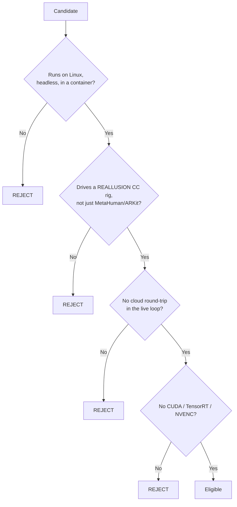

# Known gaps and roadmap

> **Written 2026-07-31 against `main` at `dea0437`.** Every "have" was checked against the source or
> a recorded measurement; every "missing" is stated as a gap, not a plan. This consolidates
> [`GAP-ANALYSIS.md`](GAP-ANALYSIS.md) (engineering-level, 2026-07-28) and
> [`PRODUCT-GAPS.md`](PRODUCT-GAPS.md) (product-level, 2026-07-30) and marks which of their rows
> have since changed.

---

## 1. Where the product is

A visitor at `:8090` sees a photoreal resident in a 1970s machine room who introduces herself,
answers in ~0.8 s on a 27 B model, moves her mouth in time with her own voice, blinks, and can be
**typed to from a browser**. Cognition, speech and hearing all run on hardware we own.

That is a working demo of an embodied companion. It is not yet a product, and the distance is
mostly in §3.

---

## 2. Capability matrix

| Capability | State | Evidence / note |
|---|---|---|
| Body, presence, materials | ✅ | Nia renders with authored PBR slots, correct scale and facing |
| Idle animation | ✅ | `MF_Idle`; verified by diffing two live frames |
| Face rig | ✅ | 286 morph targets, all 15 CC visemes, full FACS expression set |
| Face driver | ✅ | Morph targets **survive the cook** — the real risk. `all N curves resolved on 'SK_Nia'` |
| Viseme mapping | ✅ | CC and ARKit profiles, planner with digraphs, punctuation, cross-fade |
| Lip-sync timing | ⚠️ | Tier 2 of 3 shipped (rescale to measured clip). **Tier 1, real phoneme alignment, is in flight** |
| Blink | ✅ | Randomised 2–6 s, asymmetric close/open, composited over speech. The idle-latch and self-test-drop defects were removed by the `dea0437` layering rewrite |
| Cognition | ✅ | `qwen3.6:27b`, 814 ms warm, thinking off |
| Persona | ✅ | `MHLLM_SYSTEM_PROMPT`, seeded per conversation |
| Short-term memory | ✅ | `UOllamaConversation`, in RAM, one session |
| Speech out | ✅ | Kokoro, 1166 ms median, **audible in the browser — measured by energy** |
| Text input from a browser | ✅ | Measured through five phases including stray-click recovery |
| Emotion → face | ✅ | Landed `dea0437`. Reply text → `UEmotionMapper` → a sustained bias blended over 0.4 s, held 1.2 s past the utterance, with a 12 s backstop |
| **Speech in** | ✅ | **Wired 2026-08-02.** `SCompanionHUD::OnMicToggled` → `UCompanionRuntimeSubsystem::HandleMicToggled` → `AMetaHumanCompanionCharacter::StartListening`. The button rolls back when the backend reports it is not actually listening, and a transcript now enters at `SubmitTranscribedText` so a spoken turn gets the same barge-in, chat echo and opening-skip a typed one does |
| **Long-term memory** | ✅ | **Added 2026-08-02**, opt-in via `MHLLM_MEMORY=1`. `UOllamaConversation::SaveToJson` / `LoadFromJson` under `Saved/Companion/`. The persona is never persisted, so it stays configurable; off by default because it writes visitor transcripts to disk |
| **Gaze / eye contact** | ✅ | **Added 2026-08-02.** `FCompanionGazeState`: ballistic saccades, dyadic contact/speaking/thinking asymmetry, upward planning aversion while the model is answering, and a 30 s backstop so a dead backend cannot leave her staring into the middle distance |
| **Head motion** | ❌ | She does not nod, tilt, or orient toward the speaker. The rig has `Head_Turn_*`, `Head_Tilt_*` and `Neck_*` morphs (`Docs/reference/nia-morph-targets.txt`) that nothing references |
| **Gesture / body language** | ❌ | `EAnimationCategory` is an enum with no animation set behind it |
| **Breathing / micro-motion** | ❌ | `ANIMATION-PLAN` §3, unstarted |
| **World actions** | ❌ | No tool-calling. She cannot look at, walk to, or touch anything. **No sibling agent in the org has this either** — and this puppet is the one with a body to act with |
| **Barge-in (audio)** | ✅ | **Completed 2026-08-02.** The audio half already worked; the FACE half did not — `UCompanionFaceComponent::StopSpeaking` had **zero callers in the repo**, so an interrupted reply kept being silently mouthed to the end of its track. `CancelUtterance()` now stops the mouth, cancels the pending phoneme alignment and clears the grace timer that could otherwise start a fresh silent utterance for the dead turn |
| **Multi-viewer** | ❌ | One UE process, one streamer, one conversation. Not a tuning exercise — a second UE instance per viewer, or a redesign |
| **Auth** | ❌ | The OIDC gate has never worked; `:8090` is open on the tailnet |
| **Observability** | ❌ | Turn latency, failure rate and audio underruns are visible only by reading container logs over SSH |
| **Roll-back** | ❌ | Deploying is a 25-minute cook; reverting is another. There is no "ship the previous build" |
| **Mobile** | ❓ | **Unverified.** Only Chromium mobile emulation, where a tap activated no widget |
| Durability | ⚠️ | `docker system prune --volumes --all --force` has destroyed the stack repeatedly. Nothing restarts it after a reboot |

### 2.1 Rows that changed since the earlier gap docs

| Row | Then | Now |
|---|---|---|
| "The shipped build contains no companion" | The headline gap | **Fixed.** `UCompanionRuntimeSubsystem` spawns and binds it |
| "No input path — nobody can address her" | The #1 product blocker | **Fixed and measured from a real browser** |
| "No voice services deployed" | Piper/Whisper empty | **Superseded.** Kokoro + Whisper via Lemonade on beta-1 |
| "Audio over Pixel Streaming is unverified" | The highest-risk unknown | **Retired.** `totalAudioEnergy 0.0739` over 70 s |
| "`OLLAMA_MODEL` is wrong" | Called a wrong model name | **Half right.** The tag was hub-canonical; the bug was that it was hardcoded and the box was the wrong one |
| "Phoneme→viseme is unwritten" | Unstarted | **Written**; the aligner that feeds its best tier is in flight |
| "Emotion → face: nothing applies it" | Missing in both gap docs | **Fixed** at `dea0437` |
| "Blink is dead in two of three paths" | Open in the compat review | **Fixed** by the same layering rewrite |

---

## 3. Ranked, by product value per unit of effort

> **Items 1–4 of the previous ranking landed on 2026-08-02** (gaze, mic wiring, phoneme alignment,
> long-term memory) along with a set of defects found by auditing the source rather than the docs —
> see §3.1. What follows is what is left.

1. **Observability.** You cannot operate what you cannot see, and today that means SSH and `grep`.
   Now the largest remaining gap: with speech in, memory and gaze all live, there are more ways for
   a turn to fail than there are ways to notice one did.
2. **Head motion and gesture.** Gaze made the eyes alive and left the head frozen, which is a
   sharper contrast than it sounds — the rig carries `Head_Turn_*`, `Head_Tilt_*` and `Neck_*`
   morphs that nothing drives, so this is wiring rather than assets, exactly as gaze was.
3. **Tool calling / world actions.** No sibling agent in the org has it, and this is the one with a
   body to act with. Genuinely large: it needs a `tools` array on the request, `tool_calls` parsing
   in both stream parsers, a `Tool` role, and a dispatch loop.
4. **Prop materials and wardrobe.** The cabinets still import pale against a dark-charcoal
   reference; a white cocktail dress in a machine room undercuts the premise.
5. **Auth and multi-session.** Required before anyone outside the tailnet sees it.

### 3.1 Defects fixed in the same pass

Each was found by reading the source against the docs, and none was visible to the 209-spec suite —
which is the point worth keeping.

| Defect | Why no test saw it |
|---|---|
| **Streaming corrupted every non-ASCII reply.** Both clients diffed `GetContentAsString()` by TCHAR count; a character split across a chunk boundary changed length once completed, so the cursor pointed into a string that had shifted underneath it. Now byte-diffed, holding back partial sequences | Both client specs feed the parser whole, well-formed strings — they exercise the parser and never the cursor in front of it |
| **Conversation history was uncapped.** The whole transcript is re-sent every turn, so context grew until the server truncated from the front and silently discarded the persona | Nothing asserted on history LENGTH over many turns |
| **No HTTP timeout on either chat client.** A backend that accepted the connection and went quiet hung "thinking..." forever | Requires a live, misbehaving server |
| **An LLM error reached nobody.** `OnConversationError` is a `BlueprintImplementableEvent` in a project with no Blueprints | The event fires; nothing asserts anyone hears it |
| **Emotion drained mid-sentence on long replies.** The 12 s sustain is a backstop sized for "nothing reports the end of speech", and was never re-armed against the real utterance length — ~30 words at Kokoro's rate | `CompanionEmotionSpec` tests the policy, which was correct; the caller never told it how long the utterance was |
| **Blink was overwriting, not additive**, and **Fear/Alert held the eyes wide against a blink** with no arbitration, so she appeared to stop blinking during those expressions | Both profiles happen to keep the curves disjoint, so the contract and the behaviour agreed by luck |
| **A cancelled Kokoro request's callback dropped the live request's handle**, leaving the new utterance uncancellable | Needs two overlapping requests |
| **No `Deinitialize`:** a 4 Hz looping timer and two viewport widgets leaked across every world teardown | Nothing tears a world down in a spec |
| **The console's model box never reached the OpenAI backend** — it wrote only `OllamaModel` | The panel spec asserts the model, not which setting it lands in |
| **Whisper omitted the `model` field** the OpenAI shape requires, and logged the resulting 4xx at `Verbose` | The multipart spec pinned the body that existed, not the one Lemonade needs |
| **`RunBackendTests.ps1` never compiled anything** — it tested whatever DLL was last built | This is the one that could hide all of the above |

### What NOT to do next

| | Why |
|---|---|
| Buy NVIDIA for inference | 814 ms on hardware already owned. See [`INFERENCE-STACK.md`](INFERENCE-STACK.md) |
| Migrate chat to Lemonade | Verified, and it would collapse three services into one — but Ollama works. Do it when TTS/STT move, not before |
| Add more isolated component tests | 152 passed while the integration was broken. The E2E harness is the format that finds real defects |

---

## 4. Buy vs. build — the conclusion

**Build.** The entire animation runtime stays in-house, and the two commercial options that came
closest are both rejected.

### 4.1 The hard constraints

Any candidate must satisfy all four simultaneously:

The second box is the one that changed. It did not exist when
[`ANIMATION-PLAN.md`](ANIMATION-PLAN.md) §4 was written on 2026-07-15; the resident became
Reallusion CC "Nia" on 2026-07-24, and the rig was probed on 2026-07-28 as **0 of 10 ARKit names
present, 15 of 15 CC names present**.

### 4.2 Runtime MetaHuman Lip Sync (Georgy Dev, Fab, ~$200) — **REJECTED**

| Reason | Detail |
|---|---|
| **The Reallusion-CC × Linux cell is empty** | Its three models split by platform *and* by rig. The **Realistic** (81 controls) and **Mood-Enabled** models are **MetaHuman-exclusive**; the **Standard** model is the one that covers CC4 — and Standard lists **Windows, Android, Quest**. Our resident is Reallusion CC and our cook is **Linux**. There is no configuration that is both |
| **It would replace a better timing source with a worse one** | It is **audio-driven**: it infers phonemes from a waveform. We own the TTS, so Kokoro's duration predictor already *knows* where every phoneme lands — *"a forced aligner has to re-derive, from a waveform, a fact the synthesizer had in hand and threw away, and it can only ever approximate it."* Adopting it would be paying to downgrade a measurement into an inference |
| **Closed models, unverifiable headlessly** | Already flagged as the risk in the original evaluation: *"verify it runs headless on the AMD/Linux Pixel-Streaming node, since its models are closed"* |

> ⚠️ **This supersedes [`ANIMATION-PLAN.md`](ANIMATION-PLAN.md) §4.1/§4.3/§4.4**, which rate it
> **BUY & BENCHMARK — the one paid tool worth money**. That verdict was written for a MetaHuman
> resident, before the CC switch, and its own platform footnote — *"Realistic/Mood models list all;
> Standard = Win/Android/Quest"* — is what now disqualifies it. The rest of §4 stands.

### 4.3 Convai (NeuroSync) — **REJECTED**

| Reason | Status of the evidence |
|---|---|
| **A per-call cloud round-trip in the live loop** | ✅ Documented in `ANIMATION-PLAN.md` §4.1 and §4.2: cloud by default, on-prem only at Enterprise, per-interaction metering |
| **It duplicates the stack we already run** | ✅ Documented. It bundles STT + LLM + TTS, which we run locally on measured hardware |
| **The interesting part is inseparable** | ✅ Documented. NeuroSync is server-side |
| **No Linux target** | ⚠️ Reported in the current buy-vs-build decision; **not independently verified in this repo** |
| **"Bring your own LLM" means THEIR servers call YOUR endpoint** | ⚠️ Reported; **not independently verified in this repo**. If accurate it is disqualifying on its own — a private-appliance product cannot have a third party dialling into its inference endpoint |

The last two rows are recorded as they were given and flagged, rather than asserted, because this
project's own rule is not to state as fact what has not been checked. They do not change the
outcome: the first three reasons already reject it.

### 4.4 The rest of the landscape, condensed

| Bucket | Verdict | Examples |
|---|---|---|
| **CUDA-locked** | REJECT for the runtime | Audio2Face-3D, ACE, ARDY, gesture-diffusion nets. MIT licensing changed the *cost* story, not the *platform* one |
| **Cloud round-trip** | REJECT for the runtime | Convai, MetaHuman SDK, Speech Graphics Rapport, Inworld service |
| **Needs a live performer** | REJECT — wrong modality | Faceware, Rokoko |
| **Offline / authoring only** | KEEP for pre-baked set-pieces | MetaHuman Animator ADA (**not** CUDA-locked — it runs on NNE/ONNX Runtime), SGX, iClone/AccuLips, JALI |
| **Free escape hatch** | HOLD IN RESERVE | A compact audio→curve ONNX model on `NNERuntimeORT` — the only *free* route to neural lip-sync that honours the no-CUDA rule |
| **Build** | **PRIMARY** | Phoneme timing → viseme → rig-profile curves, procedural eyes/blink/breath, additive body layers |

**Bottom line, unchanged from `ANIMATION-PLAN.md` even though one row flipped:** owning the TTS
means owning frame-accurate phoneme timing, so the best cross-vendor live lip-sync needs no GPU ML
at all. The difference is that the $200 hedge no longer applies to this rig on this platform, so
the correct spend is **zero**.

---

## 5. Structural risks

| Risk | Note |
|---|---|
| **The environment eats itself** | Docker state on core-2 has been destroyed repeatedly. Restoring costs an 85 GB pull plus a 20-minute cook, and nothing restarts the stream after a reboot |
| **One-at-a-time everything** | Every latency figure in this repo is a single user. Concurrency is unmeasured |
| **CI-Hub does not proxy inference** | The `CI_HUB_*` path 404s in every configuration. It survives in the config because it still supplies a base URL, but it is not a working backend |
| **Licensing** | Nia's Character Creator licence states *"Allows usage with AI: No."* The user has stated licensing is handled; it is recorded here because this is a document about an AI-driven character. MetaHuman assets may be rendered and animated but **not** used to train or enhance models |
| **The repo README is stale** | The root `README.md` still describes a UE 5.8 MetaHuman `DefaultCompanion`, a `Source/MetaHumanLocalLLM/` module (the code lives in `Plugins/CICompanion/`), 62 tests, amplitude-driven lip-sync, and an **NVIDIA GPU requirement**. None of that is true of the shipped system |
