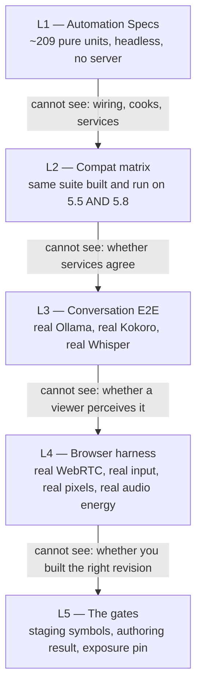
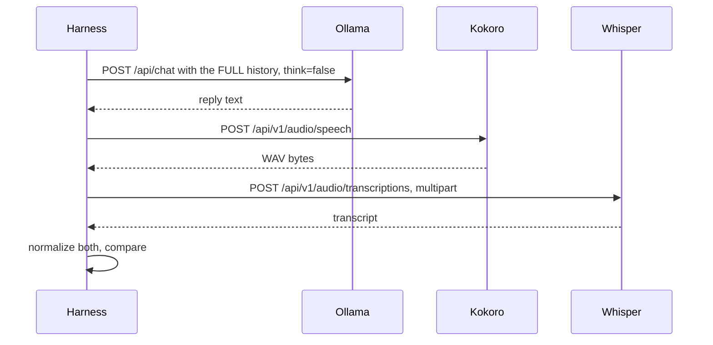

# Testing strategy and verification discipline

> **Written 2026-07-31 against `main` at `dea0437`.** The per-spec detail lives beside the code in
> `Plugins/CICompanion/Source/CICompanion/Private/Tests/README.md`; this document is the strategy,
> the layers above unit test, and the discipline that makes any of it trustworthy.

---

## 1. The claim this project makes about testing

**152 unit tests were green while the integration could not have worked at all.**

That is not a criticism of the units — they caught real defects, including several the author's own
first draft got wrong. It is a statement about what a mock-per-neighbour suite can and cannot
prove. Every layer below exists because the layer above it was insufficient in a way that was
invisible from inside it.



---

## 2. L1 — the unit suite

Unreal Automation Specs (`FAutomationSpecBase`), headless, no live server, no rendering.

| Filter | Runner | Covers |
|---|---|---|
| `MetaHumanLocalLLM.Backend.*` | `Scripts/RunBackendTests.ps1` | request shaping, stream parsing, conversation history, env config precedence, viseme planning, face profiles, curve vocabularies, WAV decode, interop names, compat table |
| `MetaHumanLocalLLM.Frontend.*` | `Scripts/RunFrontendTests.ps1` | `SCompanionHUD` via `Simulate*` hooks — submission, empty-submission rejection, mic toggle, chat log cap |
| `MetaHumanLocalLLM.Backend.Compat` | `Scripts/RunCompatMatrix.ps1` | the same suite, built and run against **both** engines |

17 spec files. The most interesting ones are the ones that guard **silent** failures:

| Spec | The silent failure it makes loud |
|---|---|
| `FaceVocabularySpec` | `SetMorphTarget` on a wrong name does nothing at all, so one typo reads as a rig bug. Validates ARKit against the canonical 52 allow-list, asserts CC and ARKit stay **disjoint**, and pins the 52-vs-61 enumerator distinction |
| `VisemeInteropSpec` | The sibling agents are JavaScript and C#, where `viseme_kk` and `viseme_KK` are different strings and only one exists on a Ready Player Me mesh. Asserts wire spelling via `ToString()`, because `FName` comparison is case-insensitive |
| `CompatSpec` | A polyfill's `#if` branches cannot be executed by a spec on the other engine. The *table* is a pure function so 5.5 answers are asserted from a 5.8-only machine; one `Compiled()` check pins the branch the compiler actually took |
| `EnvConfigSpec` | `MHLLM_BACKEND` losing to an incidental `CI_HUB_URL` is invisible in config review — *"both variables look correct in isolation and the wrong one quietly wins"* |
| `CompanionHUDSpec` | Asserts the **on-screen row count**, not just the tracked array, because fixing the accounting alone would fix none of the symptom |
| `CompanionEmotionSpec` | 418 lines guarding a policy — blend, hold, decay, cross-fade, and the 12 s sustain backstop that stops an expression latching for the session when the TTS service is down and the viseme track never finishes |

### 2.1 What L1 explicitly does not cover

Documented rather than silently dropped: live HTTP wiring (progress diffing, cancellation
mid-flight), anything requiring a rendered frame, and anything requiring two services to agree on a
wire format. The last of those is what L3 exists for.

---

## 3. L3 — the conversation E2E harness

`Scripts/RunConversationE2E.py`. **This is the test that found the segfault.**

One turn exercises the whole loop with no mocks:



Ten turns by default, and **history is carried across them** — so it exercises a real conversation
rather than ten one-shots.

| Assertion | Why it exists |
|---|---|
| `if not reply` | an empty reply is a pass to any component test |
| `"<think>" not in reply` | reasoning leaking into spoken content **would be read aloud verbatim** |
| `audio_s > 0.05` | *"no decodable audio"* — and duration is parsed from the RIFF header **never trusting the declared `data` size**, because Kokoro writes `0xFFFFFFFF` and the first version reported every clip as 44739 s |
| `similarity >= 0.60` | round-trip text fidelity |

`similarity` is order-insensitive word overlap after a `normalize()` that lowercases, strips
non-alphanumerics, **and folds number words to digits** — because Whisper correctly transcribes
spoken "one, two, three" as "1, 2, 3", and the counting prompt scored 0.0 the first time this ran.

Prompts deliberately vary the *shape* of the reply — long, numeric, refusal-ish — to expose viseme
drift, digit mishandling and zero-length clips. Latency medians (`llm_ms`, `tts_ms`, `stt_ms`) and
`wpm` are recorded but not gated; `wpm` is a sanity check against the planner's 165 wpm assumption.

Exit code is `0` only if **every** turn passed.

---

## 4. L4 — the browser harnesses

Four Playwright scripts, each answering a question the others cannot.

| Script | Question | Method | Verdict marker |
|---|---|---|---|
| `cap2.mjs` / `cap5.mjs` | *Is the frame right?* | `drawImage(video)` onto a canvas → `meanLuma`, `maxLuma` | `STATS:` |
| `cap_audio.mjs` | *Does the audio carry energy?* | `MediaStreamSource` → `AnalyserNode`, RMS peak and mean over 25 s | `AUDIO_RESULT` |
| `cap_audio2.mjs` | *Where is the audio?* | Patches `RTCPeerConnection` **before any page script**, enumerates elements, receivers and `getStats` `inbound-rtp` | `AUDIO2` |
| `chat_ps.mjs` | *Can a browser actually drive her?* | Viewport matched to the stream so page pixels are app pixels; five labelled input phases | `SHOT`, then container-log greps |

### 4.1 `chat_ps.mjs` — five phases, five different failure modes

| Phase | What it proves |
|---|---|
| **A** `autofocus-noclick` | Types with **no click at all**, then Enter. Proves a viewer can just start typing |
| **B** `click-then-type` | Clicks the box first. Proves the pointer-lock fix |
| **C** `send-button` | Clicks Send — *"the ONLY route a phone has; it has no Enter key"* |
| **E** `stray-click-then-type` | Deliberately clicks the **4 px border** — the one place that reaches the game viewport — then types. Before the focus guard, everything after this click was silently discarded for the rest of the session |
| **D** `reply-wait` | Six 5-second grabs. *"the full round trip, not just the submit"* |

Two methodological points:

- Capture is `drawImage(video, …)` onto a canvas, **not** a page screenshot — *"a page screenshot of
  a WebRTC surface can come back blank, and the decoded frame is what the viewer actually sees."*
- The script asserts only `!geom.vw` → `FAIL no stream`. **The real proof is a pair of lines in the
  container log**, not the screenshot:

  ```
  docker logs --since <iso8601>Z deployment-project-1 | grep -E 'Chat box submitted|SubmitUserText'
  ```

  With `-LogCmds="LogPixelStreaming2Input Verbose"` added, the log distinguishes **"the app never
  received it"** from **"the app received it and Slate dropped it"** — which is what settled the
  entire chat-box investigation.

---

## 5. The verification discipline

This is the part that generalises. Three rules, each bought with a real failure.

### 5.1 Check the exit code **and** that `Started == Completed`

`core2/run_tests_linux.sh`, in order:

```bash
RUN_EXIT=$?
STARTED=$(grep -c 'Test Started\.' "$LOG")
COMPLETED=$(grep -c 'Test Completed\. Result=' "$LOG")
FAILED=$(grep -c 'Test Completed\. Result={Fail' "$LOG")
CRASH=$(grep -cE 'appError called|LowLevelFatalError|Fatal error:|Assertion failed' "$LOG")

[ "$RUN_EXIT" -eq 0 ]           || exit 1   # nonzero exit
[ "$CRASH" -eq 0 ]              || exit 1   # crash markers present
[ "$COMPLETED" -gt 0 ]          || exit 1   # filter matched nothing, or a boot crash
[ "$STARTED" -eq "$COMPLETED" ] || exit 1   # TRUNCATED
[ "$FAILED" -eq 0 ]             || exit 1
```

> a crash mid-suite **TRUNCATES** the run. Tests that already passed still print Success, the ones
> that never ran print nothing at all, and the log ends looking like a clean pass with a smaller
> number in it.

`Scripts/RunTests.Common.ps1` enforces the same five checks on Windows, and adds two of its own
scars: the whole log is read with `Get-Content -Raw` to avoid *"Select-String file-handle/encoding
races that previously let a `Result={Fail}` slip past and get reported as a pass"*, and it uses
`-abslog` rather than `-log` (which takes a bare filename under `Saved/Logs`, not a full path).

`RunCompatMatrix.ps1` adds two more, because a matrix runner has its own way of lying:

| Guard | Failure it prevents |
|---|---|
| `if ($Passed.Count -eq 0) { … exit 1 }` | An **all-skipped matrix exiting 0** |
| `if ($Passed.Count -lt 2) { WARNING }` | A single-engine pass silently claiming both `#if` branches are covered |

> `Docs/FOLLOW-UP.md` records two separate false-pass bugs of exactly this shape in
> `RunTests.Common.ps1`; this guard is here so the matrix runner does not become the third.

### 5.2 Measure pixels, not logs

`LoadMap complete` and `HTTP 200` prove the stream is up, not that it shows anything.

| Signal | Black | Correct | Overexposed |
|---|---|---|---|
| `meanLuma` | ~0.03 | ~117–123 | 221 |
| `% pixels ≥ 240` | — | 0.00 % | 14.7 % |

Two refinements the history added:

- **Exclude the HUD rows.** Every frame reports `maxLuma 255` only because the chat HUD's prompt
  text is pure white; the brightest pixel the *renderer* produces is 211.
- **A still frame cannot prove liveness.** Assemble frames into a motion loop; distinguish idle
  breathing (~17 % frame-to-frame change) from actual camera movement.
- **Look for eyes.** A back-to-camera pose survived weeks of "verified" because orientation was
  checked by reasoning about a forward vector rather than by looking for a face.

### 5.3 Measure audio energy, not track existence

| Measurement | Answers |
|---|---|
| `video.srcObject` has an audio track | **Nothing.** The frontend may attach inbound audio to a different element — the first probe concluded "no audio track" and was wrong |
| Track exists on `pc.getReceivers()` | It was **sent** |
| `bytesReceived` / `packetsReceived` climbing | It is **arriving** |
| `totalAudioEnergy` > 0 | It **contains sound** |
| The track is attached to a media element | It is **audible** |

Only the full set distinguishes *not sent* from *sent but silent* from *sent but not attached*.

### 5.4 The same discipline applied to services

> **A listener is not a tunnel.** Verify with a status code, never with a socket.

```
curl -s -o /dev/null -w '%{http_code}\n' http://127.0.0.1:13305/api/v1/models   # 200
curl -s -o /dev/null -w '%{http_code}\n' http://127.0.0.1:13400/health          # 200
curl -s -o /dev/null -w '%{http_code}\n' http://127.0.0.1:11435/api/tags        # 200
```

And a `200` only proves *something answered*.

---

## 6. L5 — the gates

Not tests in the usual sense; they are refusals to proceed. See
[`BUILD-AND-DEPLOY.md`](BUILD-AND-DEPLOY.md) §4 for the full lists.

| Gate | Refuses to | Because |
|---|---|---|
| `stage.sh` | cook a stale tree | three cooks built the previous revision |
| `AUTHOR_RESULT.txt` checks | package an empty stage | three unconditional `SUCCESS` prints |
| exposure-pin check | ship a blown frame | *"nothing in any log distinguishes a lit room from a blown one"* |
| `DOCKERFILE_STALE` | run a Dockerfile that deletes the diorama | it used to, unconditionally |
| `NO_MAP` / `NO_NIA_CONTENT` | start a 20-minute cook | fail fast beats failing late |

---

## 7. Current numbers and known gaps

| | |
|---|---|
| **Last recorded full run** | 209 specs — **209 started, 209 completed**, exit 0, no crash markers. (`dea0437` adds `CompanionEmotionSpec`; re-run for a current count) |
| **Compat matrix** | Backend suite builds, links and passes on **both** 5.5.4 and 5.8.1 |
| **E2E** | 10/10 turns; Ollama 1428 ms, Kokoro 1166 ms, Whisper 66 ms medians; TTS→STT similarity **1.000** |

| Gap | Note |
|---|---|
| No CI runner | Every suite is invoked by hand. There is no automated gate on a push |
| No L3-equivalent *visual* spec inside Unreal | Screenshot-based automation against the real skeletal mesh does not exist; the browser harness is the substitute, and it needs a deployed build |
| Specs are not `#if WITH_DEV_AUTOMATION_TESTS`-guarded | Test code compiles into the shipping Runtime module. Matching house style, flagged as a separate decision |
| The compat matrix was measured on **Windows only** | Plugin `PlatformAllowList`s demonstrably differ between versions, and the deployment target is Linux. A Linux pass of the matrix is the obvious next step |
| Mobile | Untested on real hardware |
