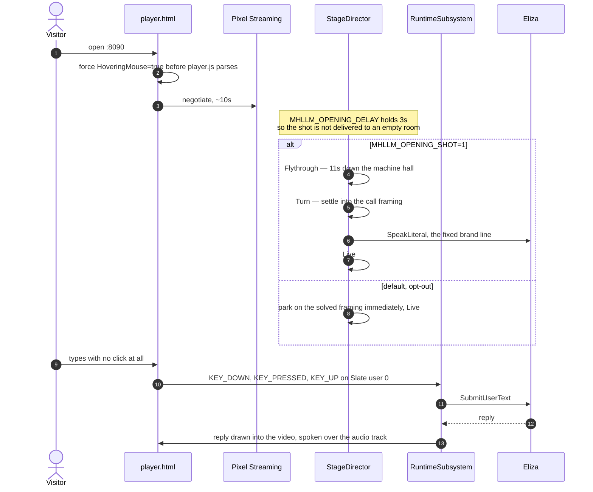
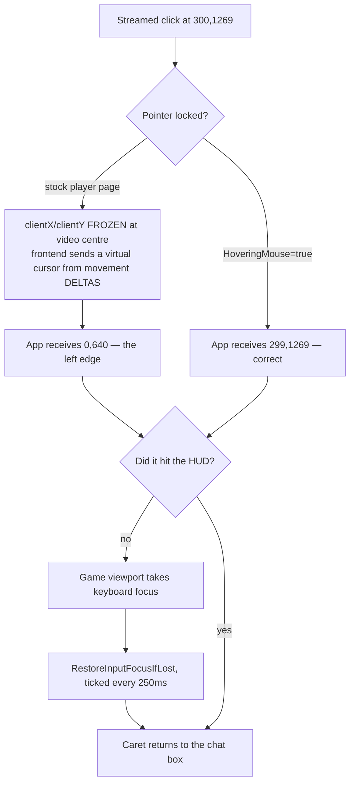
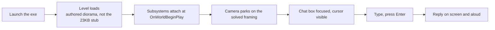

# User flows — kiosk visitor and native desktop

> **Written 2026-07-31 against `main` at `dea0437`.** The Pixel Streaming input findings below were
> *measured* on core-2 with a packaged 5.5 build and a real headless browser, not reasoned about.
> Mobile is explicitly **unverified** — see §5.

---

## 1. The two deliveries

| | **Kiosk visitor** | **Native desktop user** |
|---|---|---|
| Artifact | Linux container cook, streamed | `dist/Win64/MetaHumanLocalLLM.exe` |
| Entry | `http://core-2:8090/` | double-click |
| Frame | 720×1280 **portrait** — the product is a video call | window, same composition |
| Input | keystrokes and clicks over the WebRTC data channel | OS keyboard and mouse |
| HUD | the *same* Slate widget, drawn into the captured back buffer | the same Slate widget, drawn to the window |
| Cursor | virtual, driven by the frontend | real |
| Auth | none — `:8090` is open on the tailnet | n/a |

One HUD implementation serves both because it is viewport content, not DOM. See
[`ARCHITECTURE.md`](ARCHITECTURE.md) §3.

---

## 2. Kiosk visitor

### 2.1 The scripted opening

`UCompanionStageDirector` is a beat machine, not an animation:

| Beat | What happens |
|---|---|
| `Flythrough` | camera runs a 4-key path down the hall, `MHLLM_FLY_SECONDS` (default 11.0) |
| `Turn` | settles into the solved call framing |
| `Speak` | calls `SpeakLiteral(MHLLM_OPENING_LINE)` |
| `Live` | camera parks; ordinary conversation from here |

*(`EStageBeat::Settle` is declared but never assigned — `Flythrough` transitions straight to
`Turn`.)*

Three deliberate choices:

- **The line is spoken verbatim, never generated.** A brand statement has to be identical every run
  and must not wait on a model round trip while the camera is holding on her face. `MHLLM_GREETING`
  therefore defaults to `none`, because two openings would collide — the LLM greeting fires on a
  5 s timer while the camera is still flying.
- **The line is routed through the character, not the face.** An earlier version called the face
  handler directly. That drove the visemes perfectly and skipped `TextToSpeech->Speak` entirely, so
  the opening mouthed the brand line while the audio track carried digital silence.
  *"Same handler" was true of the face and false of the voice.*
- **The camera move is opt-in, not opt-out.**

  > It used to be the other way round […] which meant every plain `run the app` began with an
  > eleven-second camera move nobody asked for, and the only way to get the framing the set was
  > solved for was to know an undocumented env var. **A camera that moves is the special case, so
  > it is the one that has to be requested.**

  Unset, empty, `0` or a typo all mean static. `MHLLM_OPENING_REPLAY=N` turns it into an attract
  loop, which is the only way a live stream can show its opening to someone who connects late.
- Typing a turn calls `Stage->SkipToLive()` — a visitor who starts talking wins over the cinematic.

### 2.2 What a visitor can actually do

| Action | Works? | Notes |
|---|---|---|
| Connect and just **start typing** | ✅ | Auto-focus is real and measured. The click is not a prerequisite |
| Click the box, then type | ✅ | Requires the pointer-lock fix, §3 |
| Press **Send** with the mouse | ✅ | Fires on `MouseDown`, not on a captured press-and-release |
| Click somewhere useless, then type | ✅ | Recovered by the focus guard. Before it, one stray click bricked the session |
| Type `/console` or `/settings` | ✅ | Intercepted **before** the LLM sees it; opens the operator console |
| Speak into a mic | ❌ | `OnMicToggled` is exposed by the HUD and bound by nobody |
| Look around | ❌ by default | `MHLLM_FREE_LOOK=1` hands input to the pawn — and then any viewer can drag the shot off the subject |
| Resize the composition | partial | `?MatchViewportRes=true` makes UE re-render at the browser viewport. **The trade is real**: in a landscape window a composed portrait call becomes a wide shot with a small subject |

---

## 3. The chat box, and why it took three fixes

This is the single most instructive user-facing subsystem in the project. Every failure was
invisible in a unit test, and every one of them was a property of the *environment*, not of the
widget.

### 3.1 The three root causes

| # | Symptom | Root cause | Fix |
|---|---|---|---|
| 1 | Box visible, could never be typed into | A packaged game starts in `FInputModeGameOnly`; the viewport captures input and the pawn eats every key. `SCompanionHUD` did not override `SupportsKeyboardFocus`, **so Slate had nothing to hand the keyboard to even when asked** | `FInputModeUIOnly` + `SupportsKeyboardFocus() => true`. `SetInputMode`'s focus is a *deferred* Slate operation flushed only when input next arrives — hence a re-focus timer as well |
| 2 | Box worked exactly once | `SEditableTextBox` defaults `ClearKeyboardFocusOnCommit` to **true**: the first Enter sends, focus goes nowhere, every subsequent keystroke falls through to the game | `.ClearKeyboardFocusOnCommit(false)` |
| 3 | The overlay ate its own clicks | The HUD fills the entire viewport, so a hit-testable root turns the whole screen into a click sink | Root and layout panels are `SelfHitTestInvisible`; only the input box, scroll box and two buttons are `Visible` |

### 3.2 The Pixel Streaming layer, measured

The keyboard was **never** the problem. With `-LogCmds="LogPixelStreaming2Input Verbose"`,
`KEY_DOWN`/`KEY_PRESSED`/`KEY_UP` all arrived, under **Slate user 0** — the same user a local
keyboard uses.

> MEASURED (core-2, packaged 5.5 + PixelStreaming2, 2026-07-31): a streamed session creates **NO**
> extra Slate user […] The earlier "Pixel Streaming rides a different user index" reasoning was
> never observed and is not what was broken.
> — `SCompanionHUD.h`, correcting a claim this project had itself written a day earlier

What *was* broken:

- **Pointer lock froze the coordinates.** The stock player page defaults to the locked-mouse
  control scheme and calls `requestPointerLock` on first click. Clicks at `(300,1269)` and
  `(657,1269)` reached the app as **`(0,640)`** and **`(720,1280)`** — the left edge and the far
  corner. `Deployment/pixelstreaming/player.html` is Epic's page byte-for-byte plus one inline
  script setting `HoveringMouse=true` before `player.js` parses. The same clicks then arrive at
  `(299,1269)` and `(657,1269)`. Append `?HoveringMouse=false` to get the stock behaviour back.
- **A streamed tap is not a local click.** Epic's fake-touch controller turns one tap into
  `MouseEnter`/`MouseDown`/`MouseUp`/`MouseLeave` with no `MouseMove`, and the input handler drains
  its whole queue inside a single `Tick` — so all four land in **one frame**, and the default
  `DownAndUp` click method (which needs the button to still hold pointer capture on release) never
  fires. Send and Mic therefore use `EButtonClickMethod::MouseDown` / `EButtonTouchMethod::Down`.

### 3.3 The focus guard

`SCompanionHUD::RestoreInputFocusIfLost()`, ticked every **250 ms** by
`UCompanionRuntimeSubsystem::RearmChatFocus`:

- No-op when the HUD is collapsed/hidden, or already focused.
- **Yields** to the operator console — if the focused widget is an `SEditableText` or
  `SMultiLineEditableText`, it backs off rather than stealing the caret out of a settings field.
- Takes focus back from anything else, notably the game viewport.
- Logs recovery **once**, so a multi-hour kiosk log stays readable.

Counter-intuitive detail worth knowing when reading a capture: the HUD's `SScrollBox` fills nearly
the whole screen and swallows clicks **without** taking keyboard focus, so clicking the middle of
the scene is harmless. It is the 4 px border and the corners — exactly where a drifted virtual
cursor lands — that reach the viewport and steal the caret.

### 3.4 The chat log is capped

`MaxRetainedChatEntries = 50`, oldest evicted first from both the tracked array and the
`SScrollBox`.

> The HUD is an overlay drawn on top of the companion, and a streamed kiosk session runs for hours
> without anyone present to clear it — so an uncapped log does not merely grow, it eventually
> covers the character the viewer came to watch. (Observed: ~60 lines filling the frame edge to
> edge.)

`SScrollBox::RemoveSlot` takes a *widget* and offers no index-based removal, so the created row is
retained alongside the text in order to be evictable later — otherwise the tracked array shrinks
while the rows stay on screen, *"which would fix the accounting and none of the symptom"*. The test
asserts the **on-screen row count**, not just the array.

---

## 4. Native desktop user

Identical behaviour, minus the streaming layer — which means **the pointer-lock and fake-touch
classes of bug do not exist here at all**. That is precisely why the chat box shipped broken over
the stream: it had been proven in a native window through four routes and had never once been
driven from a browser. Those are different tests.

Environment variables work the same way; on Windows set them in the shell before launching, or
edit the settings through the operator console at runtime.

---

## 5. The operator console

`/console` or `/settings` in the chat box, or `MHLLM_CONSOLE=1` at startup.

> Everything here is **live**: changing the voice affects the next utterance, muting the music takes
> effect immediately. That is the point — the alternative is a 25-minute cook to hear a different
> voice.

There is deliberately **no key binding** to open it: streamed keystrokes arrive through the focused
text box, so a raw key handler would never see them.

Two design notes worth carrying forward:

- **Values are validated on write, not trusted**, *"because the values arrive from a text box
  travelling over a Pixel Streaming data channel"* — including `NaN` from a malformed float parse.
- **The diff baseline is what listeners were last told**, not the pre-edit model. Clamping `3.0`
  back to `1.0` leaves the model identical to what listeners already have, so a rejected value is
  silently a no-op rather than a spurious re-push.

---

## 6. What is not verified

| Claim | Status |
|---|---|
| Typing, clicking, Send, and stray-click recovery over a real browser | **Measured** on core-2, five labelled phases, `Deployment/core2/chat_ps.mjs` |
| Audio audible in the browser | **Measured by energy**, not by track existence |
| **A real phone** | **UNVERIFIED.** Touch was exercised only under Chromium's mobile emulation, where a tap became the same single-frame fake-mouse burst and activated no widget. Treat mobile as untested until someone taps Send on actual glass |
| Two visitors at once | Not supported. One UE process, one streamer, one conversation — a second visitor shares the same camera and the same dialogue |
| The opening flythrough as seen by a viewer | Historically **never played for one**: the map's auto-activating `StageCamera` outranked the director's, and before that the shot ran at level load, ~7 s before any client could negotiate |
