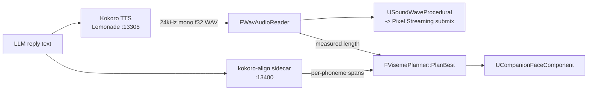

# Voice pipeline — TTS, alignment, and everything learned the hard way

> Companion to [FACE-PIPELINE.md](FACE-PIPELINE.md), which covers what happens to the mouth once
> timing exists. This document covers where the audio and the timing come from.
>
> Every number here was measured on our hardware, not taken from a vendor page. Where something is
> inferred rather than observed, it says so.

## 1. The shape of it

Two services are asked the same question at the same time. Lemonade returns **audio**; the sidecar
returns **when each phoneme was voiced**. They are issued concurrently, not in sequence — sequencing
them adds roughly 0.95 s to time-to-first-audio, which is the latency a listener actually perceives.

## 2. Measured latency

| Stage | Measured | Notes |
|---|---|---|
| LLM (`qwen3.6:27b`, beta-1) | **814 ms** warm | With thinking disabled; 16–21 s with it on |
| LLM (`qwen3:8b`, beta-1) | 262 ms | If latency ever outranks quality |
| LLM (`gemma4:e2b`, core-2 iGPU) | ~12 s warm, 77 s cold | Why cognition moved to beta-1 |
| TTS (Kokoro via Lemonade) | **1166 ms** | Whole-utterance synthesis, not first byte |
| Alignment (sidecar) | ~499 ms for 3.02 s of audio | Runs concurrently, so effectively free |
| STT (Whisper via Lemonade) | **66 ms** | |

**The 1166 ms is almost certainly not model compute.** Kokoro is 82M parameters emitting 24 kHz at
40 frames/sec; the forward pass should be a fraction of that. It is far more likely dominated by
synthesizing the *entire* utterance before returning a single byte, plus HTTP and container
encoding. Streaming with sentence-boundary chunking would cut time-to-first-audio to roughly the
first sentence. **Unverified — this is a hypothesis worth an afternoon, not a finding.**

## 3. Why a sidecar exists at all

Kokoro is StyleTTS2 + ISTFTNet. Its duration predictor produces `pred_dur` — a per-phoneme frame
count that the length regulator *used to build the waveform*. That is ground truth about the audio
that was actually emitted, not a prediction about it.

**The OpenAI `/audio/speech` schema has no field for it.** Serving Kokoro through an
OpenAI-compatible endpoint structurally discards `pred_dur` at the HTTP boundary. That is the entire
reason `Deployment/kokoro-align/` exists: same model, same voice, an endpoint that returns the
tensor instead of throwing it away.

Frame math from Kokoro's own source: multiply `pred_dur` frames by 600 to reach 24 kHz samples, i.e.
40 fps, i.e. **25 ms quantization** — comfortably finer than facial animation needs.

### Sidecar contract

`POST /speak {text, voice, speed}` →

| Field | Meaning |
|---|---|
| `spans[]` | `{symbol, start, duration, frames}` per phoneme |
| `audio_seconds` | Total length |
| `audio_wav_b64` | **The audio itself — currently unused, see §7** |

It returns HTTP **200 with an `{"error": ...}` body** on some failures, so a status-code check reads
as success. `ParseAlignmentResponse` rejects that shape explicitly.

## 4. The timing fallback ladder

`FVisemePlanner::PlanBest` prefers, in order:

| Source | Mechanism | Quality |
|---|---|---|
| `PlanFromAlignment` | Real per-phoneme durations | Ground truth |
| `PlanForDuration` | Spelling estimate, rescaled to measured clip length | Total is right, distribution is not |
| `PlanFromText` | Spelling estimate at an assumed 165 wpm | Drifts on long sentences |

Every reply logs which was used. That log line is not decoration: "is this real alignment or an
estimate?" is a question this project has repeatedly answered wrongly by assumption.

### The 7% discrepancy

The sidecar's ONNX Kokoro and Lemonade's Kokoro do **not** speak at the same rate. Measured on
identical text and voice: aligned 4.65 s against a measured 4.97 s. Waveform inspection showed
leading pad agreeing to 1 ms and trailing silence to 7 ms — so the 275 ms is spread through the
*speech itself*, not the padding.

`PlanBest` therefore combines both signals: **alignment for distribution, measured clip for length.**
End-to-end error drops from 268 ms to ~25 ms. Neither source alone is sufficient.

## 5. Voice selection is load-bearing twice

`KOKORO_VOICE` (`af_sky`) is used by **both** services — Lemonade synthesizes with it, the sidecar
times against it. Kokoro's style vector is per-voice, so **two different voices give different
durations for the same sentence.** An aligner pointed at a different voice returns confidently
precise timing for audio that was never produced. Change one, change both.

## 6. What Kokoro cannot do

No emotion, style, or delivery parameter exists. The only inference-time knobs are **voice** and
**speed**. Its model card states the architecture is "decoder only: no diffusion, no encoder
release" — and no released style encoder means the usual StyleTTS2 trick of extracting a style
vector from reference audio is closed to us.

`speed` is the one genuinely useful lever, and it is safe: it divides into the duration predictor
(`duration / speed`), so changing pace keeps the timestamps correct automatically.

Facial emotion therefore comes from `UEmotionMapper` driving the rig directly, not from the voice.
See [FACE-PIPELINE.md](FACE-PIPELINE.md).

## 7. Known defects and simplifications

| Item | Status |
|---|---|
| **Every reply synthesized twice** | Two `UKokoroTextToSpeech` instances exist — one created by `AMetaHumanCompanionCharacter::BeginPlay`, one by `UCompanionRuntimeSubsystem`. Both fire per reply, each holding its own `UAudioComponent`. **Inferred from code reading; settle it by counting POSTs or checking whether track energy doubles.** |
| **Take audio from the aligner** | The sidecar already returns `audio_wav_b64`. Using it removes the second Kokoro call, the 7% rate mismatch, and the grace window in one change — and probably subsumes the double-synthesis bug. |
| **Streaming synthesis** | Would cut time-to-first-audio dramatically (§2). Untried. |
| **Mic button bound to nobody** | `SCompanionHUD` exposes `OnMicToggled`; nothing subscribes. STT is code-complete and service-verified but **unreachable** — voice input does not exist as a user-facing feature. |

## 8. Traps that cost real time

**A one-frame ordering bug can look like a missing feature.** `AMetaHumanCompanionCharacter` swaps
in the real TTS component during its own `BeginPlay` — one frame *after* `SpawnActor` returns.
Reading `GetTextToSpeech()` on the next line gets the placeholder. The aligner was gated behind that
pointer, so it never constructed and the mouth silently fell all the way to the text estimate. The
log showed the two events 2 ms apart in the wrong order.

**A WAV parser can segfault on its own service's output.** Kokoro writes `data` chunk size
`0xFFFFFFFF` (streaming, length unknown). Cast to `int32` that is **−1**, walking the chunk cursor
*backwards* into the header where misaligned bytes can match a `fmt `/`data` tag and hand the sample
loop a bogus offset. All chunk arithmetic now runs in `int64` with explicit clamping. Kokoro also
emits 32-bit **float** and may use `WAVE_FORMAT_EXTENSIBLE`, neither of which the parser originally
handled.

**A negotiated audio track carries silence just as convincingly as speech.** Two independent faults
produced identical symptoms: no null ALSA device in the container meant UE's audio mixer never left
"Pre-Initialized" so Pixel Streaming had no submix to capture; and separately, the stock player page
built its `MediaStream` from the video track only, so the audio receiver was live and attached to
nothing. **Measure track energy, never track existence.**

**Misaki writes diphthongs as capitals.** `I` = /aɪ/, `W` = /aʊ/, `A` = /eɪ/, `Y` = /ɔɪ/, `O` = /oʊ/.
They look like spelled-out letters and are not — `hˌW` is /haʊ/, "how". Stress marks (`ˈ` `ˌ`) also
carry real frames; emitting them as silence punches a hole in the middle of every stressed syllable.

## 9. Backlog

Ranked by value for effort. None of this is purchasable — see [ROADMAP.md](ROADMAP.md) for why
Convai and the Georgy Dev plugins were evaluated and rejected.

| # | Task | Size | Why |
|---|---|---|---|
| 1 | Bind the mic button to STT | Small | Biggest capability gap; the service already works |
| 2 | Take audio from the aligner response | Small | Removes three problems at once (§7) |
| 3 | Delete the duplicate cook in `m2_clean.sh` | Trivial | Line 41 repeats the whole build to grep two lines; ~55 min instead of ~25 |
| 4 | Move the repo out of OneDrive | Small | A `Content/` tree and `.git` under a sync client is a corruption hazard |
| 5 | Rewrite the root `README.md` | Small | Still advertises UE 5.8, MetaHuman, 62 tests, and an NVIDIA requirement — all false |
| 6 | Gaze / saccades | ~2 days | `FFaceProfile::GazeCurves` is already populated and never written to |
| 7 | Verify mobile touch on real glass | Small | Only ever tested under Chromium emulation |
| 8 | Streaming TTS | Medium | See §2 |
| 9 | Gesture / body language | Large | No animation set wired to `EAnimationCategory` |
| 10 | Long-term memory | Large | `ci-memory` runs on the same host, unused; every session starts blank |
| 11 | World "actions" | Large | Convai's most complete feature; we have nothing |

## 10. Process risks

These have already cost more than any single bug.

**Concurrent sessions share this working tree.** Three ran simultaneously on 2026-07-31. One
committed another's staged work; another re-ran `stage.sh` mid-cook, so a 25-minute cook silently
built a *newer* tree than the one staged — which is how the unbound-voice defect reached a deployed
build. `stage.sh` guards against staleness, not against concurrent mutation. Serialise sessions, or
give each a `git worktree`.

**`docker compose up -d` silently no-ops** when the config hash is unchanged: it prints `Running`
and restarts nothing. Cycling a container needs an explicit `docker restart`.

**Nia's licence states "Allows usage with AI: No".** Recorded as handled, but it outlives every
technical decision in this document and is worth settling in writing.
