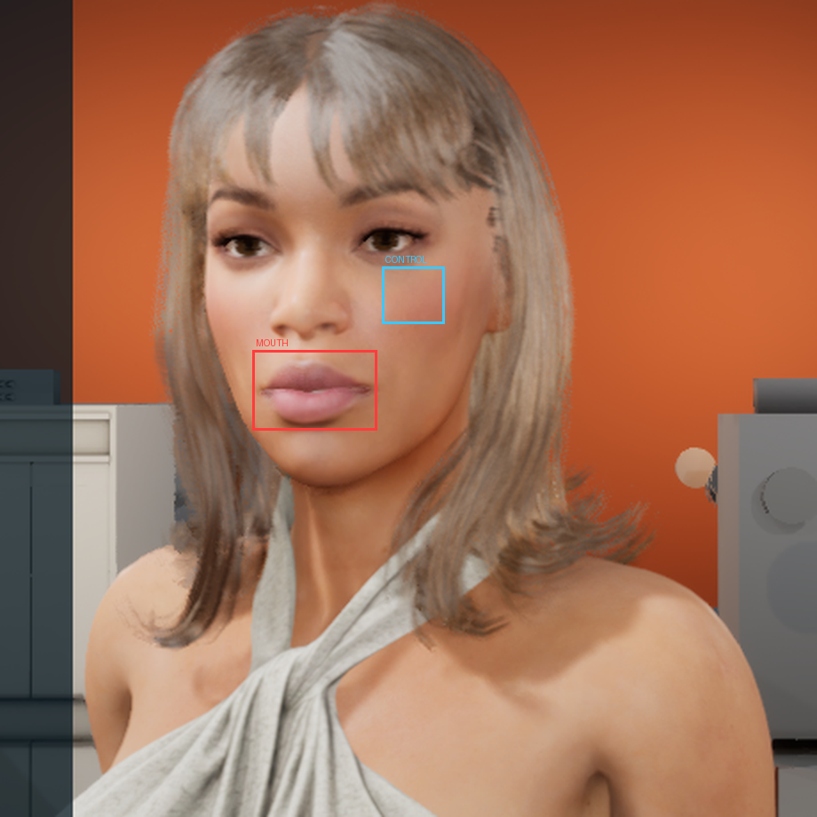
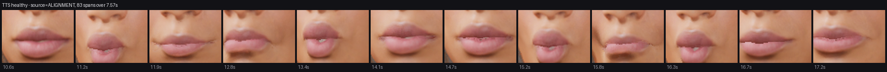
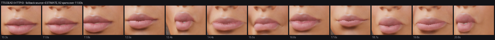

# Live verification — 2026-08-17

Cooked Win64 build (UE 5.8, `dist/Win64`, built from this branch), run against the real services on
beta-1 over the core-2 SSH forwards. Two runs: one with the voice service reachable, one with it
pointed at a closed port.

The point of the second run is that **it is the case the shipped build got wrong**. With a TTS
component attached, `HandleCompanionSpoke` hands the mouth to the audio callback and returns. When
synthesis fails, that callback never comes and — before this branch — the face stayed shut for the
whole reply, with the text on screen and no error anywhere near the face.

> Unlike `Docs/audit-2026-08-16/`, whose ~40 MB of capture media is gitignored, the three images
> here total ~1 MB and are committed: the claims below are unreadable without them.

---

## 1. Result

| | run 1 — voice healthy | run 2 — voice dead |
|---|---|---|
| `KOKORO_SERVER_URL` | `:13305` (Lemonade, `200`) | `:13399` (closed, `000`) |
| TTS outcome | `Kokoro: 7.57s of speech for 111 chars` | `Kokoro: synthesis failed (HTTP 0)` |
| Timing source | `ALIGNMENT`, 118 phonemes → 83 spans | `ESTIMATE from text alone`, 92 spans |
| Mouth, speaking | **3.09 rev/s** | **3.29 rev/s** |
| Mouth, quiet | 1.26 rev/s | 0.80 rev/s |
| **temporal ratio** | **2.44×** | **4.14×** |
| Control (cheek), same window | 0.13 rev/s | **0.00 rev/s** |
| Verdict | mouth articulates | mouth articulates |

Run 2 is the fix working: the voice never produced a sample and the mouth still delivered the line.

---

## 2. Method, and why each part of it is there

Every element below exists because an earlier version of this measurement returned a confident
wrong answer (`Docs/audit-2026-08-16/README.md` §7 lists five of them).

- **Aperture, not frame delta.** A frame-difference over the face counts head motion, and the idle
  animation moves the whole head every frame. Aperture — the fraction of pixels in the lip box
  below a luminance threshold — responds to the mouth changing shape and barely to the head
  translating.
- **Reversals, not variance.** A mouth that opens once and stays open has high variance. Speech is
  an oscillation, so the metric is direction changes per second.
- **A control region that cannot articulate.** The cheek under the eye moves with the head and is
  not driven by visemes. If it moved during the speech window, whatever was measured was the head.
  A previous run reported gaze saccades as articulation for exactly this reason.
- **The speech window is read off the log, not slept for.** An earlier attempt slept a fixed
  interval and began capturing ~10 s *after* the utterance ended, then reported lip-sync working.
  Every frame here carries an elapsed-ms stamp and is selected against the timestamps in `run.log`.
- **Two conditions, both required.** *Temporal*: the mouth moves more while speaking than while
  quiet. *Spatial*: the motion is in the lips, not the face carrying them. Temporal alone is not
  enough — the gaze policy switches to Speaking mode and saccades more, which is head motion.

The spatial test compares **absolute** rates rather than a ratio-of-ratios, because the control's
quiet rate is legitimately `0.00` and dividing by it turns the best possible control into a
division by zero.

### The regions, checked by eye before any number was trusted



Red is the mouth box, cyan the control. This image exists because a previous measurement ran on a
box that was actually chin and background, and reported a dead mouth from it. The first placement
of these two boxes was also wrong — the mouth box included chin, and the control sat on hair, which
moves with the head — and was retargeted before measuring.

---

## 3. Run 1 — voice healthy

```
Face driver bound to 'SkeletalMeshActor_0': 42/42 profile curves resolved.
Settings: avatar=eliza face=CC voice=af_sky(on) llm=qwen3.8:27b think=0 ... selftest=0
Voice enabled (Kokoro, shared with the companion); viseme timing bound to measured audio duration.
Companion replied (111 chars): Boom. Pop. Mama, papa, wow. Open wide, oh oh oh, ...
Kokoro: 7.57s of speech for 111 chars.
Lip-sync source=ALIGNMENT (measured phonemes): 118 phonemes -> 83 spans;
    aligned 7.88s stretched onto measured 7.57s (104%), entered 1ms in.
```

`104%` is the aligner's Kokoro and the voice service's Kokoro disagreeing by 4% on the same text,
rescaled so the mouth ends when the audio does. `entered 1ms in` means alignment arrived before
playback rather than during it.



## 4. Run 2 — voice dead, the case this branch fixes

```
Companion replied (111 chars): Boom. Pop. Mama, papa, wow. Open wide, oh oh oh, ...
Warning: Kokoro: synthesis failed (HTTP 0).
Warning: Speech finished with no audio for this utterance; synthesis failed.
    Driving the mouth from the text estimate so the reply is not delivered by a still face.
Lip-sync source=ESTIMATE from text alone (synthesis produced no audio): 92 spans over 11.93s, unvoiced.
```

`HTTP 0` is the signature failure this deployment produces when a forward or a container behind it
is gone — the same status the one recorded incident logged (`Docs/LEARNINGS.md`, commit `4480553`).
The aligner was disabled for this run as well, so the spelling estimate is carrying the whole
utterance, which is the weakest path available and still legible.



---

## 5. What this does and does not establish

**Established.** The mouth articulates during a reply on a cooked build against real services, and
it still articulates when speech synthesis fails outright. Backing out the one-line release
condition in `DriveMouthFromBestSource` fails 2 of 289 backend specs, so the specs detect the
defect rather than merely accompanying the fix.

**Not established.**

- That the *shapes* are right. This measures that the mouth oscillates at a plausible rate in the
  right place. It does not check that a `PP` closes the lips or that an `OU` rounds them; that
  needs per-viseme frames against a reference, and `Jaw_Open` is still tuned for legibility rather
  than naturalness (`Docs/audit-2026-08-16/README.md` §2).
- Pixel Streaming. Unchanged host limitation — core-2 carries no MetaHuman images and this machine
  cannot cook Linux.
- Anything about the `openai` backend's mouth path. Run 1 and 2 both used the native Ollama
  backend, which is what `docker-compose.face.yml` now pins.

## 6. Reproducing

`lipcheck.py` is committed here. It takes a capture directory containing `frames.csv`
(`frame,elapsed_ms,wallclock`) and the PNGs, plus the speech window read off `run.log`:

```bash
python Docs/verification-2026-08-17/lipcheck.py <shots_dir> --speech <start_ms> <end_ms>
```

The capture side is a screen grab against a windowed `-ResX=1280 -ResY=720` build at screen origin;
the box coordinates in `lipcheck.py` assume that framing and a 460×460 crop at (380, 150).
