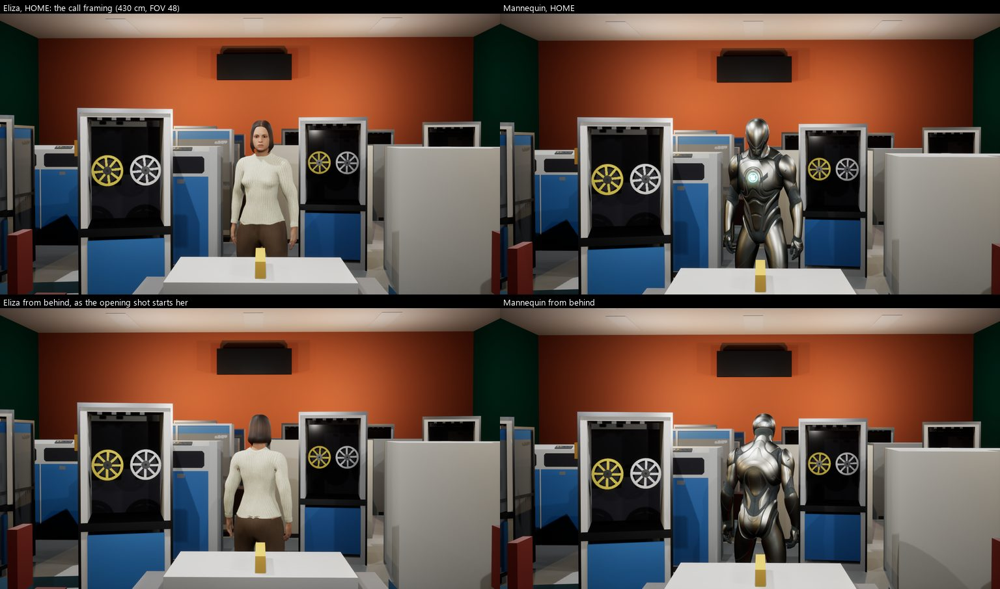
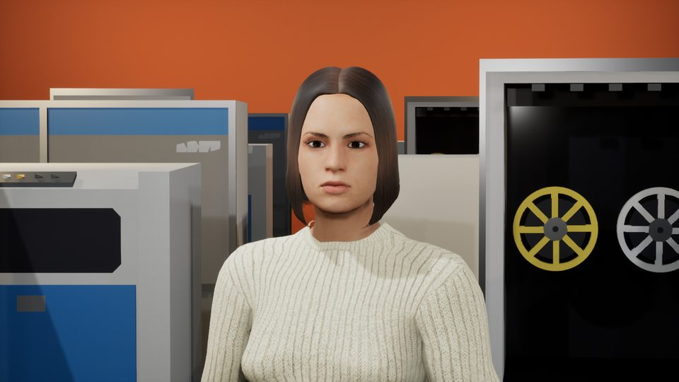
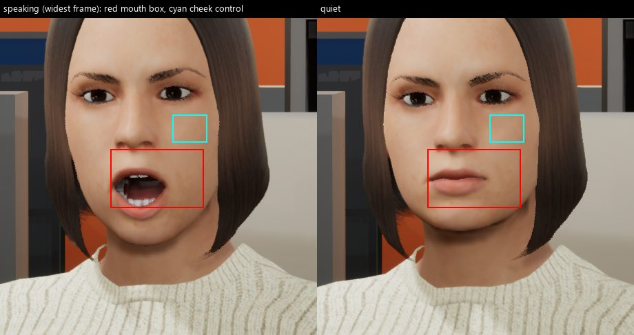
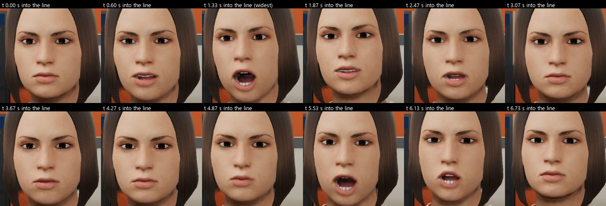
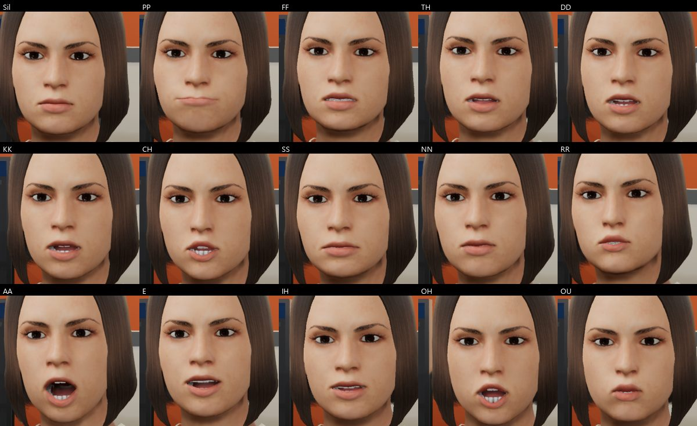
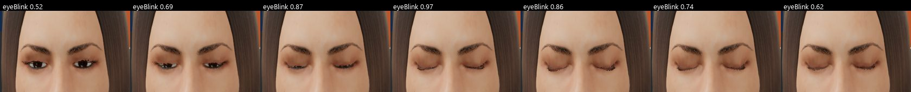

# Eliza in game: verification, 2026-11-13

Eliza's MPFB variant (`eliza_manifest.json` version `1.0.2-mpfb`), staged from private storage into
`Content/Eliza` and authored into the stage with `MHLLM_RESIDENT=eliza`, then played in the game on
Windows (UE 5.8.4, editor binary in `-game` with `-RenderOffScreen`, D3D12 on an RTX 4080 Laptop GPU).
Every image here is a game frame through the player's view, not an editor viewport or a scene capture.

This record was first made with her content 1.0.1. A review of those frames found her open mouth
uncanny (section 2.3), so the mouth was rebuilt as 1.0.2 and every check and image below was made again
on 1.0.2.

> The six images total about 0.5 MB and are committed, like those in `Docs/verification-2026-08-17/`.
> They are renders of Eliza: the rule in NOTICE.md applies to them too (never use them to build
> datasets or to train or test AI).

---

## 1. Result

| Check | Result |
|---|---|
| Editor target (`MetaHumanLocalLLMEditor Win64 Development`) | builds; the only compiler output is three C4996 deprecation warnings inside engine headers (`Character.h`, `FontFace.h`, `SoundWaveProcedural.h`), none in project code |
| Authoring, with `Scripts/BuildNative.ps1`'s own staging and gates (`Invoke-StageAuthoring`, `Assert-NoStrayEliza`, `Assert-StageProvenance`) | `SUCCESS`; `resident: ELIZA placed (variant=mpfb, SKM_Eliza, tagged CompanionFace + FaceProfile=ARKit, idle=A_Eliza_Idle) at (330, 20, 0) yaw 90`; `Content/AUTHOR_RESULT.txt` vouches for the map |
| The set's counts, against a mannequin run of the same tree | identical apart from the resident lines and the map's size: 11/11 props imported and placed, NoAI slots 0 of 3 refused, 18 troffers, 6 display panels, 28 hall cabinets, 8 tape units with 16 reels, 3 of 3 CRT displays, 93 prop materials re-homed |
| Face binding (game log) | `Face profile 'ARKit': all 37 curves resolved on 'SKM_Eliza'`, `Face tuning for 'Eliza': gain 1.00 (tag FaceGain=1), pose cap 1.00 (tag FacePoseCap=1)`, `Face driver bound to 'Eliza': 37/37 profile curves resolved.` |
| Facing | yaw 90 faces the call camera with her eyes visible (HOME below) |
| Idle (`A_Eliza_Idle`, Epic's `MM_Idle` retargeted) | moves like `MM_Idle`: over the 7.57 s loop the head travels 0.73 cm, the pelvis 0.35 cm and each foot 0.14 cm in Z (limit 2 cm); the last frame matches the first to 0.03 cm |
| Visemes (face self-test, one frame at each peak) | all 15 distinct. With the jaw open (AA, E, OH, and the widest frame of the line) the upper incisors show under the upper lip, the mouth behind them is dark, and the tongue lies low behind the lower teeth; PP closes the lips, OU rounds them, TH puts the tongue between the teeth. Measured on the frames with the review's own boxes, 1.0.1 to 1.0.2: AA's opening box (x 915-965, y 528-552) has median luminance 136 to **33**, against 131 to 132 on her chin; the widest speaking frame, 114 to **32**; pixels darker than 60 in the mouth box (x 895-1025, y 512-585) rise from 2.5% to **19.7%** at AA, 2.9% to 8.8% at E, 2.6% to 9.0% at OH and 2.4% to 20.5% at the widest frame; the corner that read as a grey wedge at AA, (906, 540), goes from (118, 112, 108) to (54, 48, 46) |
| Lip-sync, `Docs/verification-2026-08-17/lipcheck.py` with the boxes re-measured for her | mouth **5.20** reversals/s speaking against **0.47** quiet (**11.09x**), cheek control **0.15** rev/s: `VERDICT: mouth articulates` (targets: 2.5 rev/s, 2.0x, control 0.3 or less). 1.0.1 measured 4.60 against 0.47: the darker mouth makes the opening easier to see |
| Blink | both lids close (eyeBlink 0.97 in two frames of the 120 fps pass) |
| Gaze, 750 idle frames | both eyes "In" at once: 0.000; both "Out" at once: 0.000; the eyes move together (largest conjugate deflection 0.094) |
| Materials | no missing-usage-flag or default-material warning in the game log (uncooked) |
| Plugin specs, `MetaHumanLocalLLM.*` through `Scripts/RunTests.Common.ps1` | **339 of 339** pass, including `LiveLinkFaceSource`, `FaceProfile` (ARKitMH) and the tuning-tag specs |

## 2. Three content defects this found, fixed in her private content

### 2.1 and 2.2: her skeleton and her idle (1.0.0 to 1.0.1)

Her 1.0.0 content authored and bound 37/37, and the first game frame showed **no resident at all**.

- **Every bone collapsed into her pelvis.** `SK_Eliza.fbx` declares metres, and the FBX importer put the
  unit conversion on the `Root` bone as a 100x scale, leaving every child translation in metres (the
  same with *Convert Scene Unit* on: measured). The bind pose renders correctly, so every editor capture
  looked right. The retargeted idle keys `Root` at scale 1, so in game the head sat at z 90.9 cm and the
  feet at z 89.4 cm: the whole mesh shrank to a point behind the operator console. Fixed with
  `SkeletonModifier`: each bone keeps its global position and orientation and loses the scale, so the
  bind pose and all 66 morph targets are unchanged (measured drift 0.000 cm, bounds unchanged).
- **The idle was one static pose.** `IKRetargeterController.set_ik_rig` does not give the target rig to
  the retarget op stack, so the batch retarget wrote the target's retarget pose on all 227 frames. A
  check that her feet moved 0.0 cm read that as planted feet. Fixed by assigning both rigs to every op.

1.0.1 made both fixes by hand on the imported asset. The tool that builds her in Unreal now makes them
itself, so the 1.0.2 rebuild came out with a unit-scale `Root` and an idle that moves exactly as 1.0.1's did.

### 2.3: her open mouth (1.0.1 to 1.0.2)

1.0.1 passed the self-test above as "AA opens with the teeth showing". A review of its frames found the
opposite of a mouth: whenever her jaw opened (AA, E, OH, and the widest frames of the line), a flat,
evenly lit, tongue-pink surface filled the opening from the upper lip down to one row of teeth on the
lower lip, with no upper teeth, no dark cavity, and grey wedges at the corners. Measured on her export,
three things made it:

- **The upper teeth sat behind the upper lip.** They stay put under `jawOpen`, as they should, but
  MakeHuman places their edges at the lips' meeting line, so the upper lip hid them in every open shape.
- **The tongue dropped less than the jaw.** MPFB moves the tongue proxy by a weighted average of the base
  mesh's deltas, not by the jaw's rotation, so its tip and front filled the opening.
- **Nothing in the mouth was darker than the face.** The cavity is body skin mapped to a mid-red and lit
  like her cheek, and the tongue's CC0 texture is lighter than her skin.

Fixed in her export and her materials: every tooth and the tongue sit 3 mm lower in every shape key (a
translation, so every delta is kept; a few millimetres of upper incisor showing below a relaxed upper
lip is usual in adults); the tongue's `jawOpen` key is rebuilt as the jaw's own rotation (20.9 degrees, fitted to the
lower teeth's key) after flattening the tongue toward its floor; ambient occlusion is baked by ray
casting into a vertex colour on the teeth, the tongue and the body's mouth cavity, keeping each vertex's
most open view over AA, E, OH and TH, and the skin and mouth materials multiply base colour and specular
by it; and the tongue's material darkens and reddens its texture. 1.0.1 is kept beside 1.0.2 in private
storage, her provenance record carries the change, and `Docs/LEARNINGS.md` section 1.5 has the lesson.

## 3. Method

- **Authoring.** `Invoke-StageAuthoring` and the helpers it calls were taken from
  `Scripts/BuildNative.ps1`'s syntax tree and called unchanged, with `-Resident Eliza -ElizaVariant mpfb`
  and the licensed GLB set; only the `BuildCookRun` package step that follows them was left out. The same
  run with `-Resident Mannequin` gave the comparison counts above. The committed stub map was restored
  afterwards (`git checkout`), and `git status` is clean.
- **Frames.** [`capture_resident.ps1`](capture_resident.ps1) plays the authored map in the game at a
  fixed 30 fps (120 fps for the blink pass), with synchronous shader compilation and no texture
  streaming, and [`capture_resident.py`](capture_resident.py) takes the frames from inside it. HOME is
  the stage director's own call framing (`MHLLM_OPENING_SHOT=0`: 430 cm, horizontal FOV 48). This
  branch has no CLOSE shot of its own, so CLOSE is the stage design's punch-in geometry: 231 cm in front
  of her eyes, 80 mm (horizontal FOV 25.4), at eye height and aimed 10 cm below her eyes.
- **Lip-sync.** The line is spoken by `UCompanionRuntimeSubsystem::SpeakLiteral`, exactly what the
  opening line calls, with no voice service configured: `Lip-sync source=ESTIMATE from text alone (no
  voice service): 61 spans over 6.75s.` So the mouth is timed by the spelling estimate, not by Kokoro
  audio and phoneme alignment. The strip is every other frame from the start of the line to 2 s after
  it, plus a quiet pass; each frame's morph weights are in the capture manifest. The speaking sheet below
  always includes the widest frame of the line (`jawOpen` 0.75).
- **lipcheck.py** ran on 460x460 greyscale crops at (730, 300) of the CLOSE frames, with
  `MOUTH = (160, 190, 295, 275)` and `CONTROL = (250, 140, 300, 180)` (a cheek patch under her left eye),
  checked by eye first:

## 4. What this does not establish

- **A packaged build.** No `BuildNative.ps1 -Resident Eliza` package and no Docker build with
  `RESIDENT=eliza` (their gates pass in the `checks.yml` fixtures only). So no cooked-log check for
  material fallbacks, and no Linux cook.
- **Budgets.** No GPU timing (`stat gpu` with and without skeletal meshes), no 60 s p95 frame time
  with a viewer, no 30-minute memory run. The manifest's `gpu_ms` stays null.
- **Lip-sync against real audio.** Kokoro and the aligner were not reachable from the capture machine.
- **Her MetaHuman variant**, which does not exist yet (NOTICE.md, "Still open" item 1).
- **Look, judged by eye:** she reads as a credible late-1970s lab professional from the call camera
  and from behind. Four notes for the owner: her resting brows sit low, so her neutral face reads a
  little stern rather than approachable; there is a small dark notch in the back hem of the sweater;
  a light hair-card tip shows by her left jaw at CLOSE; and with the jaw wide open, a premolar at her
  left mouth corner still catches some light.
