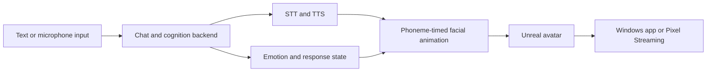

<h1 align="center">CI Metahuman — a locally-hosted embodied companion</h1>

<p align="center"><strong>A locally hosted embodied companion built with Unreal Engine.</strong></p>

[](https://github.com/companionintelligence/CI-MetaHuman/releases)
[](https://github.com/companionintelligence/CI-MetaHuman)
[](LICENSE)
[](https://discord.com/invite/yQp9hwpzAa)

<p align="center"><a href="docs/README.md">Documentation</a> · <a href="https://docs.ci.computer/docs/reference/open-source-systems">Systems map</a></p>

<p align="center">
  <a href="#build-and-test-windows"></a>
</p>


## How it fits together

Unreal C++ subsystems connect the chat backend to cognition, speech, emotion and face animation; the same authored project can run natively or stream from a Linux host.




## Features

| Feature | What it provides |
|---|---|
| **Conversation** | Use an interchangeable chat backend for local or OpenAI-compatible inference. |
| **Voice** | Connect speech recognition and synthesis to phoneme-timed lip-sync. |
| **Embodied behavior** | Coordinate cognition, emotion and facial animation in Unreal C++ subsystems. |
| **Delivery** | Run natively on Windows or stream a Linux container with Pixel Streaming. |

> [`Docs/README.md`](Docs/README.md). This file is the orientation; that one is the spine.
>
> Rewritten 2026-08-02. The previous version described an earlier design (UE 5.8, a MetaHuman
> `DefaultCompanion`, `Source/MetaHumanLocalLLM/`, amplitude lip-sync, an NVIDIA requirement) and
> had carried a "this is out of date" banner for some time. Everything below was checked against
> the source or a recorded measurement.

A photoreal avatar standing in a 1970s mainframe room, holding a conversation with a visitor.
**Every model runs on hardware we own; nothing leaves the tailnet.**

| | |
|---|---|
| **Engine** | UE **5.5** for the shipped cook. 5.8 is used for authoring and MCP work only |
| **Avatar** | Reallusion Character Creator "Nia" (persona: Eliza) — **CC-named** morph targets (`V_*`), *not* ARKit. 286 morphs, all 15 CC visemes |
| **Cognition** | Ollama, thinking disabled — **424–914 ms** warm for `qwen3.8:27b` on the reference host |
| **Voice out** | Kokoro via AMD Lemonade, OpenAI-shaped HTTP — 1166 ms median, **audible in the browser, measured by energy** |
| **Voice in** | Whisper via the same endpoint — 66 ms median |
| **Lip-sync** | Phoneme-timed from Kokoro's own duration predictor, with two documented fallbacks |
| **Delivery** | Linux container → Pixel Streaming (WebRTC, software VP8) at `:8090`, **or** a native Windows executable from the same source |
| **Behaviour** | C++ `UWorldSubsystem`s. **No Blueprints anywhere** — and that constraint explains most of the architecture |

The deployment target is an **AMD/ROCm** host. It does **not** require an NVIDIA GPU.

## What she does

- **Talks and listens.** Type in the browser or click the mic; replies are spoken aloud with the
  mouth timed from the synthesizer's own phoneme durations rather than guessed from spelling.
- **Looks at you.** Ballistic saccades, ~70% eye contact while listening and ~40% while speaking,
  and an upward planning aversion while the model is thinking — so latency reads as thought.
- **Has a face.** Reply text drives a sustained brow/cheek/eye expression composited over the
  visemes, plus involuntary blinking.
- **Can remember you**, opt-in via `MHLLM_MEMORY=1`.
- **Runs against anything.** `IChatBackend` covers native Ollama `/api/chat` and any
  OpenAI-compatible `/v1/chat/completions` (LM Studio, Lemonade, vLLM, a gateway) by config alone.

## Layout

| Path | What |
|---|---|
| `Plugins/CICompanion/` | **All the companion code.** A reusable plugin — drop it into another UE project |
| `Plugins/CICompanion/Source/CICompanion/Private/Tests/` | The Automation Spec suite |
| `Source/MetaHumanLocalLLM/` | A near-empty host module. The code is *not* here |
| `Content/` | The diorama and the resident. Most of it is authored at build time by `Deployment/author_diorama.py` |
| `Deployment/` | Dockerfiles, compose files, the `kokoro-align` sidecar, browser harnesses, core-2 tunnel units |
| `Docs/` | See [`Docs/README.md`](Docs/README.md) for the index |
| `Scripts/` | Build, test and E2E runners |

## Build and test (Windows)

The Unreal **Editor must be closed** — Live Coding holds a global lock and the build fails with
`Unable to build while Live Coding is active`.

```bash
pwsh Scripts/RunBackendTests.ps1
```

`RunTests.Common.ps1` now **compiles before it tests**. It previously ran the editor directly, which
loads whatever DLL was built last — so the suite could report a full green pass for source that was
never compiled.

To build without testing:

```bash
"C:\Program Files\Epic Games\UE_5.8\Engine\Build\BatchFiles\Build.bat" MetaHumanLocalLLMEditor Win64 Development -project="C:\Users\hegem\OneDrive\Documents\Unreal Projects\MetaHumanLocalLLM\MetaHumanLocalLLM.uproject" -waitmutex
```

The end-to-end conversation harness runs against a local Ollama with no other services:

```bash
python Scripts/RunConversationE2E.py --llm-only --model llama3.2 --turns 10
```

Drop `--llm-only` to exercise TTS and STT as well; that needs Lemonade reachable at `:13305`.

## Configure

Every endpoint and credential comes from the environment, applied at module startup — one image,
every environment. See [`Docs/CONFIGURATION.md`](Docs/CONFIGURATION.md) for the full table and the
precedence rules, which have bitten before.

```sh
OLLAMA_BASE_URL=http://127.0.0.1:11434   OLLAMA_MODEL=llama3.2
KOKORO_SERVER_URL=http://127.0.0.1:13305 WHISPER_SERVER_URL=http://127.0.0.1:13305
WHISPER_MODEL=Whisper-Base               # REQUIRED by the OpenAI shape; blank omits the field
MHLLM_MEMORY=1                           # opt-in: persists transcripts to disk
```

## Deploy

See [`Deployment/README.md`](Deployment/README.md) and
[`Docs/BUILD-AND-DEPLOY.md`](Docs/BUILD-AND-DEPLOY.md).

## Known gaps

[`Docs/ROADMAP.md`](Docs/ROADMAP.md) is the authority. The largest remaining items are
**observability** (turn latency and failure rate are visible only by reading container logs over
SSH), **head motion and gesture**, **tool calling**, and **auth** — the OIDC gate has never worked
and `:8090` is open on the tailnet.

## Licensing

CI-MetaHuman's first-party code is free for noncommercial use under the [PolyForm Noncommercial License 1.0.0](LICENSE). See the [License FAQ](Docs/License-FAQ.md). Epic Games Unreal Engine and MetaHuman assets are **not** covered by this license; they remain under Epic's EULA terms (see [NOTICE.md](NOTICE.md)).

Nia's Character Creator licence states *"Allows usage with AI: No."* The user has stated licensing
is handled; it is recorded here because this is a document about an AI-driven character. MetaHuman
assets may be rendered and animated but **not** used to train or enhance models. Flag to counsel
before any commercial ship.

<!-- companion-hub-readme-deep-review -->

## Build and runtime reference

| Stage | Platform | Entry point |
|---|---|---|
| Build and test | Windows | Follow the project build/test commands below |
| Configure | Local environment | Use the checked-in configuration template and provide local credentials separately |
| Deploy | Target runtime described in this repository | Review the known-gaps section before relying on unfinished behavior |

This project distinguishes the character's intended role from the parts that are currently implemented. Treat the [Known gaps](#known-gaps) section as the source of truth for incomplete integrations, and do not commit secrets or private voice/persona data in configuration files.

