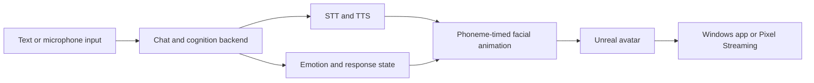

<h1 align="center">CI Metahuman — a locally-hosted embodied companion</h1>

<p align="center"><strong>A locally hosted embodied companion built with Unreal Engine.</strong></p>

[](https://github.com/companionintelligence/CI-MetaHuman/releases)
[](https://github.com/companionintelligence/CI-MetaHuman)
[](LICENSE)
[](https://discord.com/invite/yQp9hwpzAa)

<p align="center"><a href="docs/README.md">Documentation</a> · <a href="https://docs.ci.computer/docs/reference/open-source-systems">Systems map</a></p>

<p align="center">
  <a href="#build-and-test-windows"></a>
</p>


## How it fits together

Unreal C++ subsystems connect the chat backend to cognition, speech, emotion and face animation; the same authored project can run natively or stream from a Linux host.




## Features

| Feature | What it provides |
|---|---|
| **Conversation** | Use an interchangeable chat backend for local or OpenAI-compatible inference. |
| **Voice** | Connect speech recognition and synthesis to phoneme-timed lip-sync. |
| **Embodied behavior** | Coordinate cognition, emotion and facial animation in Unreal C++ subsystems. |
| **Delivery** | Run natively on Windows or stream a Linux container with Pixel Streaming. |

> [`Docs/README.md`](Docs/README.md). This file is the orientation; that one is the spine.
>
> Rewritten 2026-08-02. The previous version described an earlier design (UE 5.8, a MetaHuman
> `DefaultCompanion`, `Source/MetaHumanLocalLLM/`, amplitude lip-sync, an NVIDIA requirement) and
> had carried a "this is out of date" banner for some time. Everything below was checked against
> the source or a recorded measurement.

A photoreal avatar standing in a 1970s mainframe room, holding a conversation with a visitor.
**Every model runs on hardware we own; nothing leaves the tailnet.**

| | |
|---|---|
| **Engine** | UE **5.8** for editor authoring, MCP work and the current Pixel Streaming cook |
| **Avatar** | **A placeholder by default**: Epic's UE mannequin, which has no facial rig. **Eliza** (`-Resident Eliza`) is the resident made in-house for this product and licensed for it: her MPFB variant (CC0 assets, 52 ARKit + 14 viseme morph targets, `ARKit` profile, 37/37 curves) authors and runs today, checked in game in [`Docs/verification-2026-11-13-eliza`](Docs/verification-2026-11-13-eliza/README.md) (a packaged Eliza build has not been made yet), and a MetaHuman variant (`ARKitMH` profile over Live Link) follows the owner's two steps in [NOTICE.md](NOTICE.md); making her the default is a separate decision. Two older residents are **opt-in only**, both Fab content tagged *"Allows usage with AI: No"* (see [Licensing](#licensing)): the MetaHuman "Seo" (`-Resident MetaHuman`, `ARKit` profile, unverified) and the Reallusion Character Creator "Nia" (`-Resident Nia`; **CC-named** `V_*` morphs, 286 morphs, all 15 CC visemes). Persona: Eliza |
| **Cognition** | Ollama, thinking disabled — **424–914 ms** warm for `qwen3.8:27b` on the reference host |
| **Voice out** | Kokoro via AMD Lemonade, OpenAI-shaped HTTP — 1166 ms median, **audible in the browser, measured by energy** |
| **Voice in** | Whisper via the same endpoint — 66 ms median |
| **Lip-sync** | Phoneme-timed from Kokoro's own duration predictor, with two documented fallbacks |
| **Delivery** | Linux container → Pixel Streaming (WebRTC, software VP8) at `:8090`, **or** a native Windows executable from the same source |
| **Behaviour** | C++ `UWorldSubsystem`s. **No Blueprints anywhere** — and that constraint explains most of the architecture |

The deployment target is an **AMD/ROCm** host. It does **not** require an NVIDIA GPU.

## What she does

- **Talks and listens.** Type in the browser or click the mic; replies are spoken aloud with the
  mouth timed from the synthesizer's own phoneme durations rather than guessed from spelling.
- **Looks at you.** Ballistic saccades, ~70% eye contact while listening and ~40% while speaking,
  and an upward planning aversion while the model is thinking — so latency reads as thought.
- **Has a face.** Reply text drives a sustained brow/cheek/eye expression composited over the
  visemes, plus involuntary blinking.
- **Says she is an AI**, in a line that stays in the frame and on the player page for as long as
  the stream runs, and in the face stack's opening line.
- **Runs against anything.** `IChatBackend` covers native Ollama `/api/chat` and any
  OpenAI-compatible `/v1/chat/completions` (LM Studio, Lemonade, vLLM, a gateway) by config alone.

## Layout

| Path | What |
|---|---|
| `Plugins/CICompanion/` | **All the companion code.** A reusable plugin — drop it into another UE project |
| `Plugins/CICompanion/Source/CICompanion/Private/Tests/` | The Automation Spec suite |
| `Source/MetaHumanLocalLLM/` | A near-empty host module. The code is *not* here |
| `Content/` | The diorama and the resident. Most of it is authored at build time by `Deployment/author_diorama.py`; the resident is chosen there (see [`Docs/SCENE-AUTHORING.md`](Docs/SCENE-AUTHORING.md#the-resident)) |
| `Deployment/` | Dockerfiles, compose files, the `kokoro-align` sidecar, browser harnesses, core-2 tunnel units |
| `Docs/` | See [`Docs/README.md`](Docs/README.md) for the index |
| `Website/` | Static explainer for [`metahuman.ci.computer`](https://metahuman.ci.computer/) |
| `Scripts/` | Build, test and E2E runners |

## Build and test (Windows)

The Vibe editor integrations and native Unreal MCP setup are documented in
[`Docs/EDITOR-AI-TOOLS.md`](Docs/EDITOR-AI-TOOLS.md).

The Unreal **Editor must be closed** — Live Coding holds a global lock and the build fails with
`Unable to build while Live Coding is active`.

```bash
pwsh Scripts/RunBackendTests.ps1
```

`RunTests.Common.ps1` now **compiles before it tests**. It previously ran the editor directly, which
loads whatever DLL was built last — so the suite could report a full green pass for source that was
never compiled.

To build without testing:

```bash
"C:\Program Files\Epic Games\UE_5.8\Engine\Build\BatchFiles\Build.bat" MetaHumanLocalLLMEditor Win64 Development -project="C:\Users\hegem\OneDrive\Documents\Unreal Projects\MetaHumanLocalLLM\MetaHumanLocalLLM.uproject" -waitmutex
```

To package the game (authors the diorama first, then cooks):

```powershell
pwsh Scripts/BuildNative.ps1                       # default: Epic's UE mannequin, no input beyond the engine
pwsh Scripts/BuildNative.ps1 -Resident Eliza -ElizaContent <staged Eliza folder>   # Eliza: needs her staged content
pwsh Scripts/BuildNative.ps1 -Resident Eliza -ElizaContent <staged Eliza folder> -ElizaVariant mpfb
pwsh Scripts/BuildNative.ps1 -Resident MetaHuman   # opt-in MetaHuman "Seo": needs the Seo FBX export
pwsh Scripts/BuildNative.ps1 -Resident Nia         # opt-in Reallusion "Nia": needs her CC_ControlRig_Nia content
```

The default needs nothing outside the engine and the prop GLBs: the mannequin (`SKM_Manny` and its
idle) ships in the engine's MoverTests plugin. Seo and Nia are **opt-in for licence reasons** (see
[Licensing](#licensing)); do not distribute a build made with either. `-Resident MetaHuman` needs the
Seo FBX export (`fbx\SKM_MHC_Seo_BodyMesh.fbx`, `fbx\SKM_MHC_Seo_FaceMesh.fbx`,
`fbx\MHC_Seo_Outfits.fbx`) in `-MetaHumanDir`, `MHLLM_MH_DIR`, or `C:\devel\_mh-convert\out\seo`, and
the script checks for all three before launching the editor
([`Docs/SCENE-AUTHORING.md`](Docs/SCENE-AUTHORING.md#the-resident) has the steps). On core-2 the same
choice is `MHLLM_RESIDENT=mannequin|eliza|metahuman|nia` for `Deployment/core2/m2_clean.sh`. Eliza's
content is private: `-ElizaContent` (or `MHLLM_ELIZA_CONTENT`) names the staged `Eliza` folder holding
`eliza_manifest.json`, which `BuildNative.ps1` mirrors into `Content\Eliza`; core-2 mounts
`/home/ci/eliza-content`.

Three prop slots (`ibm-1401-cpu.glb`, `ibm-3178-terminal.glb`, `ibm-3350-disk.glb`) only accept
CI-authored GLBs. The Sketchfab models that used to fill them are tagged NoAI, so authoring leaves a
slot empty (`prop REFUSED …` in the result) until its replacement is built with
`blender --background --python Deployment/blender/make_period_props.py -- --out <glb dir>`.

The end-to-end conversation harness runs against a local Ollama with no other services:

```bash
python Scripts/RunConversationE2E.py --llm-only --model llama3.2 --turns 10
```

Drop `--llm-only` to exercise TTS and STT as well; that needs Lemonade reachable at `:13305`.

## Configure

Every endpoint and credential comes from the environment, applied at module startup — one image,
every environment. See [`Docs/CONFIGURATION.md`](Docs/CONFIGURATION.md) for the full table and the
precedence rules, which have bitten before.

```sh
OLLAMA_BASE_URL=http://127.0.0.1:11434   OLLAMA_MODEL=llama3.2
KOKORO_SERVER_URL=http://127.0.0.1:13305 WHISPER_SERVER_URL=http://127.0.0.1:13305
WHISPER_MODEL=Whisper-Base               # REQUIRED by the OpenAI shape; blank omits the field
```

## Deploy

See [`Deployment/README.md`](Deployment/README.md) and
[`Docs/BUILD-AND-DEPLOY.md`](Docs/BUILD-AND-DEPLOY.md).

## Known gaps

[`Docs/ROADMAP.md`](Docs/ROADMAP.md) is the authority. The largest remaining items are
**observability** (turn latency and failure rate are visible only by reading container logs over
SSH), **head motion and gesture**, **tool calling**, and **auth** — the OIDC gate now denies by
default and `:8090`, `:8888`, `:8889` and `:8095` listen on loopback only, but nobody has signed in
through the gate yet, so nothing may rely on it until a live sign-in has been tested.

**The default resident has no face.** Epic's mannequin is a licence-clean placeholder with no facial
rig, so a default build has no lip-sync, expression or gaze; the face driver binds and logs 0 resolved
curves. The measurements in the table above (lip-sync, gaze) were taken on Nia. Getting a face back
without a licence problem needs a character the project has the right to use with AI, for example a
MetaHuman created in-house with MetaHuman Creator rather than bought on Fab
([`Docs/SCENE-AUTHORING.md`](Docs/SCENE-AUTHORING.md#the-resident) lists what that takes). The opt-in
Seo is also unfinished: no idle, flat skin, and an `ARKit` mapping never checked against her face.

## Licensing

CI-MetaHuman's first-party code is free for noncommercial use under the [PolyForm Noncommercial License 1.0.0](LICENSE). See the [License FAQ](Docs/License-FAQ.md). The exception is the five Blender scripts that import Blender's Python API (`Deployment/blender/make_period_props.py`, `Deployment/blender/make_ibm729.py`, `Deployment/blender/previz_diorama.py`, `Deployment/blend_fix_mats.py` and `Deployment/ue_prop_fbx.py`): they are GPL-3.0-or-later, as their headers state. Epic Games Unreal Engine and MetaHuman assets are **not** covered by this license; they remain under Epic's EULA terms (see [NOTICE.md](NOTICE.md)).

This section is the engineering record of what was checked and why the build behaves as it does.
The licensing record itself is three files, kept in step with each other and with this section:
[NOTICE.md](NOTICE.md) (the notices licences require, and the status of each resident),
[CREDITS.md](CREDITS.md) (attributions) and [THIRD_PARTY.md](THIRD_PARTY.md) (every third-party
component and where it enters a build). None of it is legal advice; have counsel confirm it before
any release.

### The resident avatar

Builds place **Epic's UE mannequin** by default. The two characters this project has used are
opt-in only, because this product is an AI companion and **both are Fab content tagged NoAI**. All
sources were checked on 2026-11-12.

- **Mannequin (default)** — `SKM_Manny` and `MM_Idle` from the engine's MoverTests plugin. The
  [Unreal Engine EULA](https://www.unrealengine.com/eula/unreal) §1: the Licensed Technology "includes
  all Unreal Engine code and related Epic-provided content that you access when you download, use, or
  install Unreal Engine". §4: a distributed Product must incorporate Licensed Technology "only in object
  code and only as an inseparable part of the Product", which the cooked build and container image do;
  "Distribute" includes making a Product's functionality "available on a network", so the Pixel
  Streaming service is Distribution too. The current EULA has no AI clause: the
  [change log](https://www.unrealengine.com/eula-change-log/unreal) records *"EULA update 22 (October
  30, 2026): Removes the restrictions in Section 6(e) on using the Licensed Technology as training or
  prompt input for generative AI, and on using MetaHuman digital characters and animation curves to
  build databases or to train or test AI and machine learning technologies."* Rendering the mannequin
  is neither training nor prompt input, so the earlier terms permit this use too.
- **Eliza** (`-Resident Eliza`) — the resident Companion Intelligence made for this product, named
  after the opening line. Her content is private and staged, never committed (`Content/Eliza/` is in
  `.gitignore`), and it comes in two variants under one id; the staged `eliza_manifest.json` says which.
  Sources were read on 2026-11-13.
  - *MPFB variant (`mpfb`, buildable today).* Built with [MPFB 2](https://extensions.blender.org/add-ons/mpfb/)
    2.0.18 from CC0 assets only (the MakeHuman system assets, Faceunits 01, Visemes 02, and Margaret
    Toigo's sweater, wool slacks, flats and curled-under bob). MPFB's code is GPL-3.0-or-later and is an
    authoring tool only; it is not in the repository, the build or the image. Its
    [LICENSE.md](https://github.com/makehumancommunity/mpfb2/blob/master/LICENSE.md) §C says the data
    contributing to its output "have been released under CC0 1.0 Universal", and §D that "the MakeHuman
    team makes no claim whatsoever over output" such as exports and renderings. CC0 1.0 §2 waives all
    rights "for any purpose whatsoever, including without limitation commercial, advertising or
    promotional purposes", which covers a generative-AI product, the packaged binary and a public image.
  - *MetaHuman variant (`metahuman`, not built yet: it follows the owner's two steps in
    [NOTICE.md](NOTICE.md)).* To be made in-house in MetaHuman Creator in Unreal Engine 5.8 from its
    presets and grooms, which ship with the
    engine: Licensed Technology under the EULA §1 quoted above, carried in object code as §4 requires,
    with no AI clause since update 22. The [MetaHuman licence FAQ](https://www.metahuman.com/license)
    allows MetaHumans "in workflows that incorporate artificial intelligence technology". Free below
    US$1M; above that Unreal's standard terms apply.
  - One rule comes with both: **never use Eliza's mesh, rig, curves or renders to build datasets or to
    train or test AI.**
- **MetaHuman "Seo"** (`-Resident MetaHuman`) — `mhc_seo.mhpkg` is the Fab listing
  [*Seo - Editable MetaHuman Character*](https://www.fab.com/listings/3693be83-9054-4fd3-9b2e-0b6d5b45fe22)
  by Groomchenko: Standard License (Personal free, Professional $4.99) and **"Allows usage with AI:
  No"** (`isAiForbidden: true` in Fab's listing API). The local package matches it: its manifest names
  `MHC_Seo`, an editable MetaHuman Character for engine 5.6, and its embedded thumbnail shows the face
  in the listing's gallery. [`Docs/GDD.md`](Docs/GDD.md) lists it among the "premium character source
  files". Epic's MetaHuman terms do not override the seller's: the UE EULA §1 says *"assets you may
  download from an Epic-operated online marketplace (including, but not limited to, Fab) are not
  Licensed Technology and are not licensed to you under the terms of this Agreement."* The
  [MetaHuman licence FAQ](https://www.metahuman.com/license), which allows MetaHumans "in workflows that
  incorporate artificial intelligence technology", describes Epic's terms and does not lift a Fab
  seller's NoAI tag. Seo therefore stands exactly where Nia does.
- **Nia** (`-Resident Nia`) — Fab listing [*Character Creator: Nia*](https://www.fab.com/listings/366cfc84-6d6a-44ff-89ad-4bffb7347c15)
  (Reallusion Inc; checked 2026-11-12): *License terms: Standard License*, **"Allows usage with AI:
  No"** — the `NoAI` tag — and a description that marks her *"Non-Commercial Use"*. The
  [Fab EULA](https://www.fab.com/eula) (last updated October 1, 2024), §6(b)(vii) and §16(l)(i): under
  a Standard License you may not use NoAI Content "(a) in datasets utilized by Generative AI Programs,
  (b) in the development of Generative AI Programs, or (c) as training inputs to Generative AI
  Programs", where Generative AI Programs are technologies "designed to automate the generation of or
  aid in the creation of new content". An LLM-driven character that speaks generated text is at best
  unclear against (b), and an unclear licence is treated as a licence issue. The same clause governs
  Seo. Neither one's content is staged, mounted or loaded unless asked for by name, and building
  with either is a decision for counsel, not for the build script.

Nothing else on hand is a clean substitute. The other local packages, `mhc_crowd80.mhpkg` and
`mhc_crowd84.mhpkg`, have no recorded origin, and their likely source, Epic's own Fab listing
[*MetaHuman Crowd Sample*](https://www.fab.com/listings/5f481d73-afb1-4d94-ba6e-7cabf5d296fa), is
itself tagged NoAI. A resident with a face and a clean licence takes one of two things: a MetaHuman
created in-house with MetaHuman Creator (Licensed Technology, so the EULA and FAQ above govern it),
or written permission for AI use from Groomchenko or Reallusion.

### The machine-room props

Eight hero props, and the hall rows built from them, are Sketchfab models under
[CC BY 4.0](https://creativecommons.org/licenses/by/4.0/). Licence and author come from the public
Sketchfab API (`https://api.sketchfab.com/v3/models/<uid>`: *"CC Attribution: Author must be
credited. Commercial use is allowed."*). Every build cooks them and every stream shows them, so this
attribution has to travel with every build. None of the eight carries a NoAI tag. Each is by
[museudocomputador](https://sketchfab.com/museudocomputador) (Museu do Computador; the mainframe's
page credits the model to Breno Valli for that collection), is licensed CC BY 4.0, and is
**modified**: re-exported to GLB in Blender, then rescaled and re-materialed by
`Deployment/author_diorama.py`.

[CREDITS.md](CREDITS.md#sketchfab-models-used-under-cc-by-40) is the attribution record for all
eight: set file, title, author, source link, licence and the modifications made. NOTICE.md repeats
the list with the licence's required notice.

**Three slots no longer take Sketchfab models.** `ibm-1401-cpu.glb`, `ibm-3178-terminal.glb` and
`ibm-3350-disk.glb` held maxdragon's CC BY models
[IBM 1401 Central Processing Unit](https://sketchfab.com/3d-models/ibm-1401-central-processing-unit-62a34be60e0548bf938b52989f86136d),
[IBM 3178](https://sketchfab.com/3d-models/ibm-3178-891ae8149d8547a5971381237d13e2e6) and
[IBM 3350 "Madrid"](https://sketchfab.com/3d-models/ibm-3350-madrid-6d1b6c37642a44388c06992e0923f990),
and all three carry Sketchfab's `noai` tag (as does maxdragon's IBM 2401, which the set no longer
loads).
Sketchfab's [Help Center](https://help.sketchfab.com/en/articles/16152133) says its Terms of Use
prohibit *"use of content tagged with NoAI in datasets for, in the development of, or as inputs to
generative AI programs."* `author_diorama.py` therefore imports those slots only when the GLB's
`asset.copyright` names Companion Intelligence, which is what
`Deployment/blender/make_period_props.py` writes into its CI-authored replacements. Otherwise it
logs `prop REFUSED` and leaves the slot empty, so a stale prop folder cannot ship them. The 729 tape
units are CI-authored as well (`Deployment/blender/make_ibm729.py`).

The credits travel with the build: every package, native or container, carries `CREDITS.md`,
`NOTICE.md` and `LICENSE` in `MetaHumanLocalLLM/` beside its paks, staged by
`Source/MetaHumanLocalLLM/MetaHumanLocalLLM.Build.cs`, and the build scripts refuse a package
without them. The stream page has a "Credits" link to `credits.html`, a page the signalling image
serves with the eight attributions (`Deployment/pixelstreaming/credits.html`). CI fails if that page,
CREDITS.md and NOTICE.md stop naming the same models. Because the product has credits, the
[Unreal Engine EULA](https://www.unrealengine.com/eula/unreal) §7(a) requires two Epic notices in
them ("[Product name] uses Unreal® Engine. ..." and "Unreal® Engine, Copyright 1998 – xxxx, Epic
Games, Inc. All rights reserved.", with the current year). That page and `CREDITS.md` carry both,
word for word, and CI fails if either loses them.


<!-- companion-hub-readme-deep-review -->

## Build and runtime reference

| Stage | Platform | Entry point |
|---|---|---|
| Build and test | Windows | Follow the project build/test commands below |
| Configure | Local environment | Use the checked-in configuration template and provide local credentials separately |
| Deploy | Target runtime described in this repository | Review the known-gaps section before relying on unfinished behavior |

This project distinguishes the character's intended role from the parts that are currently implemented. Treat the [Known gaps](#known-gaps) section as the source of truth for incomplete integrations, and do not commit secrets or private voice/persona data in configuration files.

